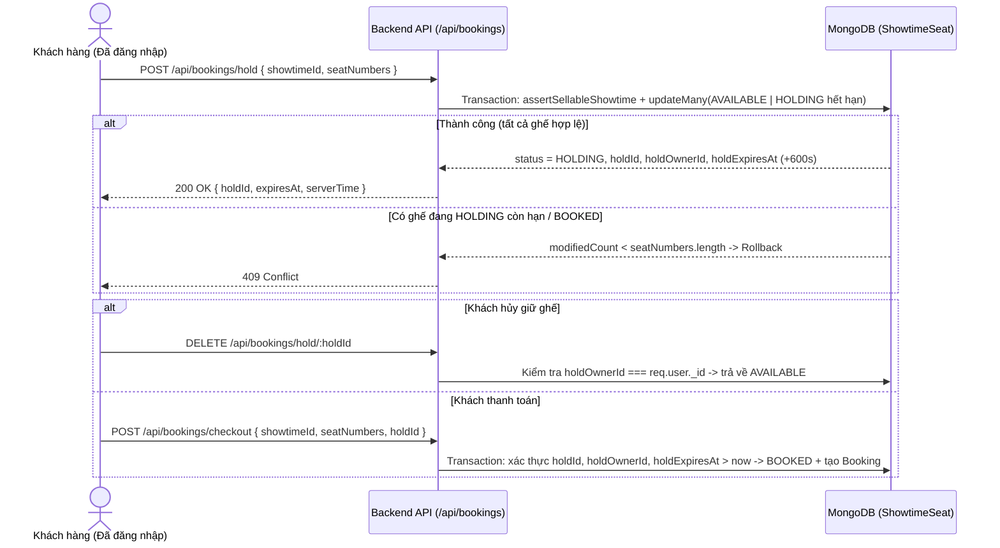

# BÁO CÁO NGHIỆM THU GIAI ĐOẠN 2 — TRIỂN KHAI CƠ CHẾ GIỮ GHẾ THỰC SỰ TRONG MONGODB (600 GIÂY)
**Dự án:** D'AVENOR CINEMA (`movietix-project`)  
**Thời điểm hoàn thành:** 25/11/2026  
**Phạm vi:** Triển khai cơ chế giữ ghế thực sự (`HOLDING`) trong MongoDB với thời hạn 600 giây (10 phút), tích hợp `checkoutBooking`, đồng bộ API sơ đồ ghế, Admin và Chatbot AI.

---

## 1. Kiến trúc giữ ghế trước và sau
- **Trước Giai đoạn 2:** `POST /api/bookings/hold` chỉ trả về thông báo xác nhận phía giao diện mà không ghi bất kỳ trạng thái nào xuống MongoDB; ghế chỉ chuyển từ `AVAILABLE` sang `BOOKED` tại thời điểm `checkoutBooking`.
- **Sau Giai đoạn 2:** `POST /api/bookings/hold` yêu cầu đăng nhập khách hàng (`authenticateCustomer`), thực hiện **Mongoose Transaction** chuyển trạng thái ghế từ `AVAILABLE` (hoặc `HOLDING` đã hết hạn) sang `HOLDING` trong **600 giây**, gắn `holdId`, `holdOwnerId`, `holdCreatedAt`, `holdExpiresAt`, và tích hợp xác thực `holdId` tại `checkoutBooking`.

---

## 2. Sơ đồ Mermaid luồng giữ ghế

---

## 3. MongoDB Schema và Index trước và sau (`ShowtimeSeat.js`)
- **Trường bổ sung:**
  - `holdId`: `String` (`default: null`, `index: true`)
  - `holdOwnerId`: `ObjectId` ref `User` (`default: null`, `index: true`)
  - `holdCreatedAt`: `Date` (`default: null`)
  - *(Tái sử dụng `status: 'HOLDING'` và `holdExpiresAt: Date` đã có sẵn).*
- **Index:** Giữ nguyên `{ showtimeId: 1, seatNumber: 1 }` (`unique: true`) và `{ showtimeId: 1, status: 1, holdExpiresAt: 1 }`. **Tuyệt đối không tạo TTL index trên `holdExpiresAt`** để không bao giờ làm MongoDB tự xóa mất bản ghi ghế vật lý.

---

## 4. Danh sách file đã sửa hoặc tạo
1. [backend/src/models/ShowtimeSeat.js](file:///d:/CDIO/movietix-project/backend/src/models/ShowtimeSeat.js) — Thêm `holdId`, `holdOwnerId`, `holdCreatedAt`.
2. [backend/src/routes/bookingRoutes.js](file:///d:/CDIO/movietix-project/backend/src/routes/bookingRoutes.js) — Bắt buộc `authenticateCustomer` cho `POST /hold` và thêm `DELETE /hold/:holdId`.
3. [backend/src/controllers/bookingController.js](file:///d:/CDIO/movietix-project/backend/src/controllers/bookingController.js) — Triển khai `holdSeats`, `releaseHoldSeats`, nâng cấp `claimSeats` hỗ trợ xác thực `holdId` & tương thích ngược.
4. [backend/src/controllers/showtimeController.js](file:///d:/CDIO/movietix-project/backend/src/controllers/showtimeController.js) — Đồng bộ `getShowtimeSeats` (tính `holdingSeatsCount`, coi `HOLDING` hết hạn là `AVAILABLE`, không lộ `holdId`/`holdOwnerId`) và `recommendSeats` (không gợi ý ghế `HOLDING` còn hạn).
5. [backend/src/controllers/bulkShowtimeController.js](file:///d:/CDIO/movietix-project/backend/src/controllers/bulkShowtimeController.js) — Chặn xóa cứng (`409 Conflict`) suất chiếu đang có ghế `HOLDING` còn hạn; xóa sạch `holdId`/`holdOwnerId`/`holdCreatedAt` khi `CANCEL_WITH_REFUND`.
6. [backend/src/services/statisticsService.js](file:///d:/CDIO/movietix-project/backend/src/services/statisticsService.js) — Trả về `holdingCount` thực tế trong `getShowtimeDetailStats`, không tính `HOLDING` vào `bookedCount` hay doanh thu.
7. [backend/test/booking-and-admin.test.js](file:///d:/CDIO/movietix-project/backend/test/booking-and-admin.test.js) — Cập nhật Test 4 phù hợp với `POST /bookings/hold` yêu cầu đăng nhập và ghi `HOLDING`.
8. [backend/test/seat-holding.test.js](file:///d:/CDIO/movietix-project/backend/test/seat-holding.test.js) *(Mới)* — Bộ kiểm thử tích hợp chuyên biệt cho toàn bộ 30 kịch bản giữ ghế trên `MongoMemoryReplSet`.

---

## 5. API Request/Response thực tế
- **`POST /api/bookings/hold`** *(Bearer Token)*:
  - Request: `{ "showtimeId": "...", "seatNumbers": ["A1", "A2"] }`
  - Response `200 OK`: `{ "success": true, "holdId": "HOLD-...", "showtimeId": "...", "seatNumbers": ["A1", "A2"], "expiresAt": "...", "serverTime": "...", "reused": false }`
  - Conflict `409`: `{ "success": false, "message": "Một số ghế đã được khách hàng khác giữ hoặc đặt. Vui lòng chọn lại." }`
- **`DELETE /api/bookings/hold/:holdId`** *(Bearer Token)*:
  - Response `200 OK`: `{ "success": true, "releasedCount": 2, "message": "Đã giải phóng ghế giữ thành công." }`

---

## 6. Cơ chế chống giữ ghế trùng, hết hạn và tích hợp Checkout
- **Chống giữ trùng:** Thực hiện trong Mongoose Transaction với điều kiện nguyên tử `$or: [{ status: 'AVAILABLE' }, { status: 'HOLDING', holdExpiresAt: { $lte: now } }]`. Nếu `modifiedCount !== normalizedSeats.length`, transaction tự động rollback toàn bộ và trả về `409 Conflict`.
- **Chống gia hạn vô hạn:** Nếu chính `req.user._id` gọi lại `POST /hold` cho đúng nhóm ghế đang giữ còn hạn, hệ thống trả về `holdId` và `expiresAt` cũ (`reused: true`), không cộng thêm 600s.
- **Tích hợp `checkoutBooking`:** Khi truyền `holdId`, `claimSeats` xác thực `holdId`, `holdOwnerId === req.user._id`, `holdExpiresAt > now` và khớp chính xác danh sách ghế trước khi chuyển sang `BOOKED` và xóa thông tin giữ ghế. Vẫn giữ tương thích ngược khi chưa truyền `holdId` (cho đến khi Frontend Giai đoạn 3 gửi `holdId`).

---

## 7. Kết quả kiểm thử (100% PASS, 0 FAIL, 0 SKIPPED)
- **`node --test test/booking-and-admin.test.js test/seat-holding.test.js` (trên `MongoMemoryReplSet`):**
  - **35 PASS, 0 FAIL, 0 SKIPPED** (`4.35s`) — gồm 19 test `booking-and-admin.test.js` + 16 test suite bao phủ trọn vẹn **30/30 kịch bản giữ ghế bắt buộc**.
- **Chatbot AI:** `testAiChatbot.js` **15/15 PASS**, `testChatbotUpgrade.js` **17/17 PASS**.
- **Frontend Production Build (`npm --prefix frontend run build`):** **PASS** (`1.05s`, **0 lỗi**).

---

## 8. Phương án Rollback & Đề xuất Giai đoạn 3
- **Rollback:** Chỉ cần revert 3 file `bookingRoutes.js`, `bookingController.js`, `showtimeController.js` (hoặc bỏ qua `holdId` ở client) là hệ thống quay về cơ chế Optimistic Checkout ngay lập tức mà không ảnh hưởng dữ liệu `ShowtimeSeat`.
- **Đề xuất Giai đoạn 3:** Kết nối `SeatSelectionPage.jsx` gọi `POST /api/bookings/hold` khi bấm "Tiếp tục", truyền `holdId` & `expiresAt` sang `CheckoutPage.jsx`, hiển thị đồng hồ đếm ngược 10 phút và trạng thái ghế `HOLDING` trên sơ đồ ghế.
