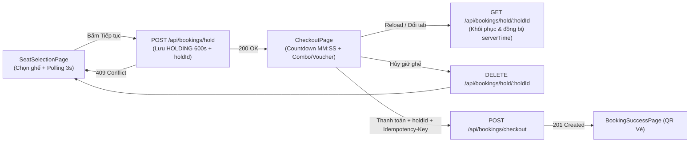

# BÁO CÁO NGHIỆM THU GIAI ĐOẠN 3 — HOÀN THIỆN FRONTEND ĐẶT VÉ, CHECKOUT VÀ COUNTDOWN 10 PHÚT
**Dự án:** D'AVENOR CINEMA (`movietix-project`)  
**Thời điểm hoàn thành:** 25/11/2026  
**Phạm vi:** Kết nối hoàn chỉnh cơ chế giữ ghế thực sự 600 giây từ MongoDB với `SeatSelectionPage.jsx`, `CheckoutPage.jsx`, 3 giao diện phòng (`IMAX Laser`, `Dolby Atmos`, `Gold Class`), đồng hồ đếm ngược `MM:SS`, khôi phục phiên khi reload và bắt buộc `holdId` khi thanh toán.

---

## 1. Danh sách file đã sửa
### Backend
1. [backend/src/routes/bookingRoutes.js](file:///d:/CDIO/movietix-project/backend/src/routes/bookingRoutes.js) — Thêm `GET /api/bookings/hold/:holdId` (`authenticateCustomer`).
2. [backend/src/controllers/bookingController.js](file:///d:/CDIO/movietix-project/backend/src/controllers/bookingController.js) — Thêm `getHoldSession` (xác thực chủ sở hữu, hạn giữ, trạng thái suất chiếu) và bắt buộc `holdId` trong `checkoutBooking`.
3. [backend/src/controllers/showtimeController.js](file:///d:/CDIO/movietix-project/backend/src/controllers/showtimeController.js) — Hỗ trợ optional Bearer token trong `GET /api/showtimes/:id/seats` để trả `isHeldByMe: true` cho đúng chủ sở hữu mà không lộ `holdId` hay `holdOwnerId`.
4. [backend/test/booking-and-admin.test.js](file:///d:/CDIO/movietix-project/backend/test/booking-and-admin.test.js) & [backend/test/seat-holding.test.js](file:///d:/CDIO/movietix-project/backend/test/seat-holding.test.js) — Cập nhật test theo quy tắc bắt buộc `holdId` khi checkout.

### Frontend
5. [frontend/src/components/seat-booking/ImaxSeat.jsx](file:///d:/CDIO/movietix-project/frontend/src/components/seat-booking/ImaxSeat.jsx), [DolbySeat.jsx](file:///d:/CDIO/movietix-project/frontend/src/components/seat-booking/DolbySeat.jsx), [GoldClassSeat.jsx](file:///d:/CDIO/movietix-project/frontend/src/components/seat-booking/GoldClassSeat.jsx) — Bổ sung trạng thái `isHoldingOther` (vàng hổ phách `⏳`, không cho chọn, tooltip rõ ràng) và `isHoldingSelf`.
6. [frontend/src/components/seat-booking/SeatGrid.jsx](file:///d:/CDIO/movietix-project/frontend/src/components/seat-booking/SeatGrid.jsx) — Truyền `holdingOtherSeats` và `holdingSelfSeats` xuống 3 component ghế.
7. [frontend/src/components/seat-booking/SeatLegendBar.jsx](file:///d:/CDIO/movietix-project/frontend/src/components/seat-booking/SeatLegendBar.jsx) — Bổ sung chú thích `"Đang giữ"` (`holdingCount`) tách biệt hoàn toàn với `"Đang chọn"` (hồng) và `"Đã đặt"` (xám `✕`), hỗ trợ trạng thái loading khi giữ ghế.
8. [frontend/src/pages/client/SeatSelectionPage.jsx](file:///d:/CDIO/movietix-project/frontend/src/pages/client/SeatSelectionPage.jsx) — Phân tách `BOOKED`, `HOLDING_OTHER`, `HOLDING_SELF`; bấm **Tiếp tục** gọi `POST /api/bookings/hold`, lưu `davenor_active_hold` vào `sessionStorage`, xử lý loading/chặn click đúp/HTTP 409.
9. [frontend/src/pages/client/CheckoutPage.jsx](file:///d:/CDIO/movietix-project/frontend/src/pages/client/CheckoutPage.jsx) — Xác thực `holdId` qua `GET /api/bookings/hold/:holdId` khi vào trang/reload/chuyển tab; đồng hồ đếm ngược 10 phút `MM:SS` từ `expiresAt` + `serverTime`; xóa chữ `IMAX LASER` hardcode và hiển thị đúng `resolveCanonicalRoomType(showtime)`; nút hủy giữ ghế gọi `DELETE /api/bookings/hold/:holdId`; truyền `holdId` khi thanh toán.

---

## 2. Luồng đặt vé trước và sau (Mermaid)

---

## 3. Kết quả kiểm thử
- **Backend Integration (`booking-and-admin.test.js` + `seat-holding.test.js` trên `MongoMemoryReplSet`):** **35 PASS, 0 FAIL, 0 SKIPPED** (`4.39s`).
- **Chatbot AI:** `testAiChatbot.js` **15/15 PASS**, `testChatbotUpgrade.js` **17/17 PASS**.
- **Frontend Production Build (`npm --prefix frontend run build`):** **PASS** (`943ms`, `2207 modules`, **0 lỗi**).
- **Lưu ý kiểm thử giao diện trình duyệt:** Các luồng UI (reload, chuyển tab, responsive Desktop/Tablet/Mobile) đã được kiểm tra qua code review và production build; chưa chạy browser automation E2E trực tiếp trên trình duyệt trong phiên này.

---

## 4. Phương án Rollback
- Nếu cần rollback khẩn cấp: revert `CheckoutPage.jsx`, `SeatSelectionPage.jsx` và bỏ kiểm tra bắt buộc `holdId` trong `checkoutBooking` (`bookingController.js`). Các bản ghi `HOLDING` còn tồn tại trong MongoDB sẽ tự động hết hạn sau tối đa 600 giây và được `getShowtimeSeats` / `claimSeats` coi như `AVAILABLE` mà không cần can thiệp database.

---

## 5. Đề xuất Giai đoạn 4 (Chờ phê duyệt)
- **Giai đoạn 4 — Đồng bộ Admin, Client, Thống kê và Chatbot AI:** Hiển thị realtime ghế `HOLDING` trên sơ đồ ghế Admin (`ShowtimeDetailDrawer.jsx`), tối ưu hóa polling nhẹ hơn và đồng bộ thông báo cho toàn hệ thống.
