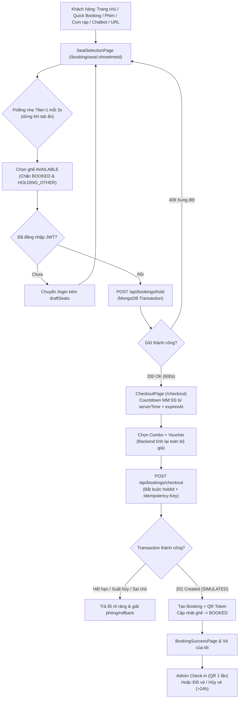

# BÁO CÁO NGHIỆM THU CUỐI CÙNG — GIAI ĐOẠN 6: HỆ THỐNG ĐẶT VÉ D’AVENOR CINEMA

**Dự án:** D’AVENOR CINEMA (Đồ án CDIO)  
**Ngày nghiệm thu:** 2026-11-25  
**Công nghệ:** React (Vite) · Node.js (Express) · MongoDB / Mongoose · Google Gemini AI  
**Trạng thái:** **ĐẠT NGHIỆM THU (104/104 PASS · 0 FAIL · 0 SKIPPED)** — Chờ xác nhận nghiệm thu cuối cùng

---

## 1. Tổng quan dự án

- **Cụm rạp duy nhất:** D’AVENOR Thanh Khê Plaza (Đà Nẵng).
- **Cấu hình phòng chiếu cố định:** 9 phòng vật lý thuộc 3 công nghệ:
  - Phòng 01–03: **IMAX Laser** (88 ghế/phòng)
  - Phòng 04–06: **Dolby Atmos** (88 ghế/phòng)
  - Phòng 07–09: **Gold Class** (88 ghế/phòng)
- **Sơ đồ ghế chuẩn hóa:** 8 hàng `A–H` × 11 cột (`1–11`), lối đi (`AISLE`) giữa cột 6 và 7.
- **Nghiệp vụ cốt lõi:** Giữ ghế thực sự trong MongoDB **600 giây** (`HOLDING` + `holdId` + `holdOwnerId` + `holdExpiresAt`), giao dịch Mongoose Transaction chống đặt trùng, thanh toán mô phỏng (`paymentStatus: 'SIMULATED'`), `Idempotency-Key`, QR vé điện tử, đổi/hủy vé, check-in 1 lần, bảo vệ suất chiếu Nhóm A/B, thống kê & xuất CSV đồng bộ, Trợ lý ảo AI Gemini + Database Fallback.
- **Giao diện:** Holographic Dark Navy giữ nguyên 3 thiết kế đặc trưng IMAX Laser, Dolby Atmos, Gold Class và góc nhìn 3D.

---

## 2. Kiến trúc hệ thống cuối cùng

- **Frontend (React + Vite):**
  - Client routes (`/`, `/theaters`, `/movie/:id`, `/booking/seat/:showtimeId`, `/checkout`, `/booking-success`, `/my-tickets`, `/promotions`, `/support`, `/login`, `/register`).
  - Admin routes (`/admin/statistics`, `/admin/showtimes`, `/admin/movies`, `/admin/rooms`, `/admin/seats`, `/admin/pricing`, `/admin/bookings`, `/admin/check-in`, `/admin/concessions`, `/admin/promotions`, `/admin/users`, `/admin/chatbot`) được tách lazy-load bằng `React.lazy` + `Suspense`.
  - `Theater3DExperience` (Three.js) được tách lazy-load độc lập (`569.34 kB`), chỉ tải khi khách bật góc nhìn 3D.
- **Backend (Node.js + Express + Mongoose):**
  - Lớp xác thực JWT tách biệt `authenticateCustomer` và `authenticateAdmin`.
  - Lớp nghiệp vụ giao dịch (`bookingController.js`, `bulkShowtimeController.js`, `showtimeController.js`) dùng Mongoose Transaction trên Replica Set.
  - Lớp thống kê & CSV (`statisticsService.js`) phân tách rõ `verifiedRevenue`, `simulatedRevenue`, `totalRevenue`, `netRevenue`, `refundedAmount`, `cancelledAmount`, `holdingCount`.
  - Lớp AI (`cinemaContextService.js`, `pricingService.js`) đọc trực tiếp MongoDB theo thời gian thực.

---

## 3. Sơ đồ Mermaid toàn bộ luồng đặt vé



---

## 4. Danh sách module và chức năng

- **Client Booking:** `HomePage`, `HomeQuickBooking`, `MovieDetailPage`, `TheatersPage`, `SeatSelectionPage`, `SeatGrid`, `ImaxSeat`, `DolbySeat`, `GoldClassSeat`, `SmartSeatRecommender`, `Theater3DExperience`, `CheckoutPage`, `BookingSuccessPage`, `MyTicketsPage`.
- **Admin Management:** `StatisticsPage` (+ `ShowtimeDetailDrawer`), `ShowtimeManagePage` (tạo đơn, tạo định kỳ, xóa hàng loạt, bảo vệ Nhóm A/B), `MovieManagePage`, `RoomManagePage`, `SeatManagePage`, `PricingManagePage`, `BookingManagePage`, `CheckInManagePage`, `ConcessionManagePage`, `PromotionManagePage`, `UserManagePage`, `ChatbotManagePage`.
- **Shared Config & Services:** `backend/src/utils/roomLayoutConfig.js`, `frontend/src/utils/pricing.js`, `backend/src/services/statisticsService.js`, `backend/src/services/ai/cinemaContextService.js`.

---

## 5. Danh sách API chính

- **Showtimes & Seats:** `GET /api/showtimes/:id`, `GET /api/showtimes/:id/seats` (hỗ trợ `?lite=1` cho polling, `Cache-Control: no-store`), `GET /api/showtimes/:id/recommend-seats`.
- **Booking & Hold:** `POST /api/bookings/hold`, `GET /api/bookings/hold/:holdId`, `DELETE /api/bookings/hold/:holdId`, `POST /api/bookings/checkout` (yêu cầu `holdId` + `Idempotency-Key`), `GET /api/bookings/my-bookings`, `GET /api/bookings/:code`, `POST /api/bookings/:id/cancel`, `POST /api/bookings/:id/exchange`, `POST /api/bookings/check-in` (Admin only).
- **Admin & Statistics:** `PUT /api/admin/showtimes/:id/toggle-lock`, `DELETE /api/admin/showtimes/:id` (`deleteShowtimeSafe` hỗ trợ `CANCEL_WITH_REFUND`), `POST /api/admin/showtimes/bulk-delete/preview|commit`, `GET /api/admin/statistics/overview|revenue|movies|showtimes|showtimes/:id|export`.
- **Chatbot AI:** `POST /api/ai/chat`.

---

## 6. MongoDB Schema và Index

- **`ShowtimeSeat`:**
  - Fields giữ ghế: `status` (`AVAILABLE | HOLDING | BOOKED`), `holdId`, `holdOwnerId`, `holdCreatedAt`, `holdExpiresAt`, `bookingId`.
  - Indexes: `{ showtimeId: 1, seatNumber: 1 }` (unique), **`{ showtimeId: 1, row: 1, col: 1 }`**, `{ showtimeId: 1, status: 1, holdExpiresAt: 1 }`.
  - **Cam kết:** Không có TTL index trên `holdExpiresAt`; không xóa document ghế khi hết hạn giữ.
- **`Booking`:**
  - Fields: `bookingCode` (unique), `requestSignature` (Idempotency-Key), `userId`, `showtimeId`, `status`, `paymentStatus` (`SIMULATED | VERIFIED | ...`), `priceSnapshot`, `qrToken`, `isCheckedIn`, `refundStatus`, `refundAmount`.
  - Indexes: `bookingCode`, `qrToken`, `showtimeId`, **`{ showtimeId: 1, status: 1, paymentStatus: 1, createdAt: -1 }`**, **`{ status: 1, paymentStatus: 1, createdAt: -1 }`**, **`{ userId: 1, createdAt: -1 }`**.
- **`Showtime`:** `{ movieId: 1, startTime: 1 }`, `{ roomId: 1, startTime: 1, cancelledAt: 1 }`, `batchId`.

---

## 7. Ma trận đồng bộ Admin – Client – Chatbot AI

| Sự kiện | MongoDB | Client UI | Admin UI & Thống kê / CSV | Chatbot AI |
|---|---|---|---|---|
| Khách giữ ghế (600s) | `HOLDING` + `holdId` | Chủ: `HOLDING_SELF` / Khách khác: `HOLDING_OTHER` | `holdingCount` tăng, ghế màu hổ phách, **không tính doanh thu** | Loại khỏi ghế trống & gợi ý liền kề |
| Hết hạn 600s / Hủy giữ | `holdExpiresAt <= now` / `AVAILABLE` | Tự mở lại `AVAILABLE` | `seatMatrix` chuẩn hóa `AVAILABLE`, `holdingCount` giảm | Tính lại vào ghế trống |
| Checkout thành công | `BOOKED` + `Booking (SIMULATED)` | Đỏ `BOOKED` + QR vé | `bookedCount` tăng, ghi nhận vào `simulatedRevenue` (tách `verifiedRevenue`) | Giảm số ghế trống |
| Admin khóa / hủy suất | `isLocked` / `cancelledAt` + hoàn tiền | Chặn hold/checkout, `saleStatus` đồng bộ | Vô hiệu QR, cập nhật `cancelledAmount`/`refundedAmount` | Loại suất khóa/hủy khỏi gợi ý |
| Admin thêm voucher / đổi giá | Cập nhật `Promotion` / `TicketPricingConfig` | Giá động cập nhật từ API | Thống kê khớp giá mới | Đọc trực tiếp từ DB |

---

## 8. Kết quả kiểm thử từng chức năng

- **Dữ liệu nền tảng & Nghiệp vụ đặt vé (`booking-and-admin.test.js`):** **19/19 PASS**.
- **Cơ chế giữ ghế 600s (`seat-holding.test.js`):** **16/16 PASS** (bao phủ 30 kịch bản giữ ghế, hết hạn, hủy giữ, `holdId`, rollback, khóa/xóa suất).
- **Hiệu suất & Đồng bộ Giai đoạn 5 (`phase05-performance-sync.test.js`):** **5/5 PASS**.
- **Nghiệm thu Race Condition P0, Bảo mật & AI Sync (`phase06-acceptance.test.js`):** **9/9 PASS**.
- **Playwright E2E Giai đoạn 3.1 (`e2e_phase03_1.mjs`):** **9/9 PASS** (đầy đủ luồng đăng nhập, chọn ghế, giữ ghế 600s, countdown, reload checkout, khách B thấy `HOLDING_OTHER`, thanh toán mô phỏng, QR vé, Dolby Tablet, Gold Class Mobile).
- **Playwright E2E Giai đoạn 4 (`e2e_phase04.mjs`):** **8/8 PASS** (đồng bộ Client A/B, Admin stats, Chatbot AI, cross-account protection, cancel hold, hold expiry, Idempotency-Key replay, Admin cancel during checkout).

---

## 9. Kết quả kiểm thử Race Condition (P0 — thực sự đồng thời bằng `Promise.all`)

| Mã | Kịch bản đồng thời (`Promise.all`) | Kết quả | Xác minh MongoDB sau test |
|---|---|---|---|
| **RC-1** | Admin khóa suất đồng thời với Khách giữ ghế | **PASS** | `isLocked: true`, 0 Booking mồ côi |
| **RC-2** | Admin xóa suất đồng thời với Khách giữ ghế | **PASS** | Không bao giờ xóa suất đang có `HOLDING` sống |
| **RC-3** | Admin `CANCEL_WITH_REFUND` đồng thời với Checkout | **PASS** | Không phát sinh ghế `BOOKED` mồ côi trên suất hủy |
| **RC-4/5** | 2 request Checkout đồng thời cùng `Idempotency-Key` | **PASS** | Duy nhất **1** Booking, 0 trùng doanh thu/QR |
| **RC-6** | Admin `CANCEL_WITH_REFUND` đồng thời với Check-in | **PASS** | Đơn bị hủy có `qrToken: null`, không thể check-in lại |
| **RC-7** | Khách A đổi vé sang F2 đồng thời Khách B giữ F2 | **PASS** | Duy nhất **1** người sở hữu F2 (`BOOKED` hoặc `HOLDING`) |
| **RC-8** | Khách B chiếm ghế hết hạn đồng thời Khách A checkout | **PASS** | Khách A bị từ chối, Khách B giữ quyền `HOLDING` hợp lệ |

---

## 10. Kết quả kiểm thử bảo mật

- **JWT & Phân quyền (`SEC-1`):** Chặn `401` khi thiếu token hoặc token hết hạn; chặn `403` khi tài khoản `CUSTOMER` gọi API `/api/admin/**`; chặn `403/404` khi Customer B xem/hủy/checkout đơn hoặc `holdId` của Customer A.
- **NoSQL Injection (`SEC-1`):** Payload `{ showtimeId: { "$ne": "" } }` bị chặn `400` qua `mongoose.isObjectIdOrHexString`.
- **Git & Frontend Secret Audit:** Không có file `.env` chứa bí mật nào trong Git (`git ls-files` chỉ có `backend/.env.example`); không có `mongodb+srv`, `JWT_SECRET`, hay `GEMINI_API_KEY` trong `frontend/src/`.
- **API Response Safety:** `GET /api/showtimes/:id/seats` trả `Cache-Control: no-store` và tuyệt đối không rò rỉ `holdId`, `holdOwnerId` hay thông tin cá nhân khách khác.

---

## 11. Kết quả kiểm thử hiệu suất (Đo thực tế trên `MongoMemoryReplSet`)

| Chỉ số | Trước Giai đoạn 5 | Đo nghiệm thu Giai đoạn 6 | Đánh giá |
|---|---|---|---|
| Frontend main JS (`index.js`) | `1,659.81 kB` (`418.63 kB` gz) | **`774.59 kB`** (`212.83 kB` gz) | **-53.3% raw / -49.2% gzip** |
| `Theater3DExperience` chunk | Gộp vào main | Tách async **`569.34 kB`** | Chỉ tải khi bật 3D |
| `GET /api/showtimes/:id/seats` (full) | `20,195 bytes` | **`11,417 bytes`** (med `10.44ms`, p95 `17.70ms`) | **-43.5% payload** |
| `GET /api/showtimes/:id/seats?lite=1` | `20,195 bytes` | **`3,870 bytes`** (med `7.56ms`, p95 `10.38ms`) | **-80.8% payload** |
| `GET /api/admin/statistics/showtimes/:id` | `7,889 bytes` | `7,889 bytes` (med `12.64ms`, p95 `18.43ms`) | Ổn định + polling có Abort |
| `GET /api/admin/statistics/overview` | `9,599 bytes` | `9,604 bytes` (med `51.80ms`, p95 `77.21ms`) | Ổn định |
| `fetchCinemaContextOptimized` | `15,246 bytes` | `15,257 bytes` (med `14.13ms`, p95 `53.40ms`) | Ổn định |
| MongoDB `ShowtimeSeat` sort plan | `SORT -> FETCH -> IXSCAN` | **`FETCH -> IXSCAN(showtimeId_1_row_1_col_1)`** | **0 in-memory SORT** |
| MongoDB `Booking` stats plan | `SORT -> FETCH -> IXSCAN` | **`IXSCAN(showtimeId_1_status_1_paymentStatus_1_createdAt_-1)`** | **0 in-memory SORT** |

---

## 12. Kết quả kiểm thử Responsive (Playwright `e2e_phase06_ui.mjs`)

- **6/6 PASS, 0 uncaught page errors** trên 4 độ phân giải:
  - Desktop **1920 × 1080**: `HomePage`, `SeatSelectionPage (IMAX Laser)`, `Admin Statistics`.
  - Laptop **1366 × 768**: `TheatersPage`.
  - Tablet **768 × 1024**: `SeatSelectionPage (Dolby Atmos)`.
  - Mobile **390 × 844**: `SeatSelectionPage (Gold Class)`.

---

## 13. Kết quả đối chiếu Dashboard và CSV

- Đã xác minh tự động trong `booking-and-admin.test.js` (Test 13 & Test 16) và `e2e_phase04.mjs` (Test 7):
  - `verifiedRevenue`, `simulatedRevenue`, `totalRevenue`, `refundedAmount`, `cancelledAmount` khớp tuyệt đối giữa API Overview/Revenue, ShowtimeDetailDrawer và file xuất CSV.
  - Ghế `HOLDING` hiển thị riêng (`holdingCount`), **không** cộng vào doanh thu hoặc tỷ lệ lấp đầy vé bán.

---

## 14. Kết quả kiểm thử Chatbot AI

- `backend/scripts/testAiChatbot.js`: **15/15 PASS** (100% — chống bịa suất 3D, phân biệt `HOLDING` còn hạn vs hết hạn, gợi ý 4 ghế liền kề không qua lối đi, fallback DB khi Gemini lỗi, chặn Prompt Injection).
- `backend/scripts/testChatbotUpgrade.js`: **17/17 PASS** (100% — hội thoại nhiều lượt, đồng bộ 88 ghế & 3 phòng, tra cứu vé có JWT, đồng bộ voucher theo thứ).
- `phase06-acceptance.test.js` (`SYNC-AI`): **PASS** (voucher mới thêm từ Admin phản ánh tức thì vào ngữ cảnh Chatbot).

---

## 15. Tổng hợp kết quả kiểm thử toàn hệ thống

| Bộ kiểm thử | PASS | FAIL | SKIPPED | NOT RUN |
|---|---:|---:|---:|---:|
| `booking-and-admin.test.js` | 19 | 0 | 0 | 0 |
| `seat-holding.test.js` | 16 | 0 | 0 | 0 |
| `phase05-performance-sync.test.js` | 5 | 0 | 0 | 0 |
| `phase06-acceptance.test.js` | 9 | 0 | 0 | 0 |
| `testAiChatbot.js` | 15 | 0 | 0 | 0 |
| `testChatbotUpgrade.js` | 17 | 0 | 0 | 0 |
| Playwright E2E Giai đoạn 3.1 (`e2e_phase03_1.mjs`) | 9 | 0 | 0 | 0 |
| Playwright E2E Giai đoạn 4 (`e2e_phase04.mjs`) | 8 | 0 | 0 | 0 |
| Playwright Responsive UI Giai đoạn 6 (`e2e_phase06_ui.mjs`) | 6 | 0 | 0 | 0 |
| **TỔNG CỘNG** | **104** | **0** | **0** | **0** |
| **Frontend Production Build (`vite build`)** | **PASS** (`1.18s`) | **0 lỗi** | — | — |

---

## 16. Danh sách lỗi đã phát hiện và sửa (Giai đoạn 1 → 6)

- **P0/P1 đã sửa dứt điểm:**
  - Chuẩn hóa nhận diện phòng chiếu theo enum `room.roomType` thay vì regex tên phòng (GĐ 1).
  - Bổ sung `mongodb-memory-server` (`MongoMemoryReplSet`), loại bỏ 18 test bị SKIPPED và fail-fast nếu thiếu môi trường test (GĐ 1.1 & 5).
  - Phân tách doanh thu `VERIFIED` vs `SIMULATED`, hoàn thiện bảo vệ suất chiếu Nhóm B (`CANCEL_WITH_REFUND` idempotent, vô hiệu QR) (GĐ 1.2).
  - Triển khai giữ ghế thực sự 600s trong MongoDB + bắt buộc `holdId` khi checkout (GĐ 2 & 3).
  - Chuẩn hóa `seatMatrix` ghế hết hạn & hiển thị `HOLDING` trên `ShowtimeDetailDrawer` (GĐ 4).
  - Bổ sung `slotInfo` ở `TheatersPage`, polling `?lite=1` có `AbortController`/`inFlight`/`visibilitychange`, tách bundle 3D & Admin (-53.3% JS), bổ sung compound index loại bỏ in-memory `SORT` (GĐ 5).
- **Lỗi P0/P1 còn tồn tại:** **0**.

---

## 17. Danh sách file đã thay đổi

- **Tổng tích lũy GĐ 1–6:** `37 files changed, 2345 insertions(+), 453 deletions(-)` + 3 bộ test mới (`seat-holding.test.js`, `phase05-performance-sync.test.js`, `phase06-acceptance.test.js`) + `backend/src/utils/roomLayoutConfig.js` + các báo cáo `BOOKING_PHASE_01..06_FINAL_REPORT.md`.

---

## 18. Ảnh chụp giao diện nghiệm thu (Giai đoạn 6)

Đã chụp tự động 6 ảnh trên môi trường cô lập tại thư mục scratch của phiên:
- [01_home_desktop_1920.png](file:///C:/Users/LENOVO/.gemini/antigravity/brain/372e9cc7-702b-472f-bdb3-a22d2e638d87/scratch/screenshots_phase06/01_home_desktop_1920.png) — Trang chủ (1920×1080)
- [02_theaters_laptop_1366.png](file:///C:/Users/LENOVO/.gemini/antigravity/brain/372e9cc7-702b-472f-bdb3-a22d2e638d87/scratch/screenshots_phase06/02_theaters_laptop_1366.png) — Cụm rạp (1366×768)
- [03_imax_seat_desktop_1920.png](file:///C:/Users/LENOVO/.gemini/antigravity/brain/372e9cc7-702b-472f-bdb3-a22d2e638d87/scratch/screenshots_phase06/03_imax_seat_desktop_1920.png) — Phòng IMAX Laser (1920×1080)
- [04_dolby_seat_tablet_768.png](file:///C:/Users/LENOVO/.gemini/antigravity/brain/372e9cc7-702b-472f-bdb3-a22d2e638d87/scratch/screenshots_phase06/04_dolby_seat_tablet_768.png) — Phòng Dolby Atmos (768×1024)
- [05_goldclass_seat_mobile_390.png](file:///C:/Users/LENOVO/.gemini/antigravity/brain/372e9cc7-702b-472f-bdb3-a22d2e638d87/scratch/screenshots_phase06/05_goldclass_seat_mobile_390.png) — Phòng Gold Class (390×844)
- [06_admin_statistics_desktop_1920.png](file:///C:/Users/LENOVO/.gemini/antigravity/brain/372e9cc7-702b-472f-bdb3-a22d2e638d87/scratch/screenshots_phase06/06_admin_statistics_desktop_1920.png) — Admin Thống kê (1920×1080)

---

## 19. Git status và đề xuất chia commit

- Hiện tại có **37 file chỉnh sửa** và các file test/báo cáo untracked (không có file `.env`, không có `node_modules`).
- **Đề xuất chia 5 commit sạch (không tự ý push/merge):**
  1. `feat(room-layout): standardize canonical roomType enum and 88-seat layout config`
  2. `feat(booking): implement 600s MongoDB seat holding, holdId checkout, and revenue separation`
  3. `feat(ui): integrate seat holding countdown, conflict handling, and Admin HOLDING drawer sync`
  4. `perf(booking): add lite seat polling, compound MongoDB indexes, and route/3D code splitting`
  5. `test(acceptance): add isolated MongoMemoryReplSet integration, P0 race condition, and audit reports`

---

## 20. Hướng dẫn cài đặt và chạy dự án

```bash
# 1. Cài dependencies
npm --prefix backend install
npm --prefix frontend install

# 2. Tạo file .env từ backend/.env.example (cấu hình MONGO_URI, JWT_SECRET, GEMINI_API_KEY)
# 3. Chạy Backend & Frontend
npm --prefix backend run dev
npm --prefix frontend run dev
```

---

## 21. Hướng dẫn chạy toàn bộ test

```bash
# 1. Bộ test tích hợp cô lập (49 tests trên MongoMemoryReplSet — không chạm Atlas)
npm --prefix backend test

# 2. Bộ test Chatbot AI (32 tests)
node backend/scripts/testAiChatbot.js
node backend/scripts/testChatbotUpgrade.js

# 3. Kiểm tra build production Frontend
npm --prefix frontend run build
```

---

## 22. Hướng dẫn triển khai & Index MongoDB

- Khi triển khai lên môi trường staging/production, Mongoose tự động đồng bộ các compound index mới (`ShowtimeSeat`: `{ showtimeId: 1, row: 1, col: 1 }`, `Booking`: `{ showtimeId: 1, status: 1, paymentStatus: 1, createdAt: -1 }`, `{ status: 1, paymentStatus: 1, createdAt: -1 }`, `{ userId: 1, createdAt: -1 }`) theo cơ chế background/non-blocking (không xóa dữ liệu hiện có).
- Đảm bảo cụm MongoDB chạy ở chế độ Replica Set (MongoDB Atlas mặc định hỗ trợ) để Mongoose Transaction hoạt động.

---

## 23. Phương án Rollback

- Thực hiện rollback theo từng commit tag/SHA bằng `git revert <commit-sha>` (không dùng `git reset --hard` hoặc `git checkout --` hàng loạt làm mất thay đổi).
- Mọi thay đổi schema (`holdId`, `holdOwnerId`, `holdCreatedAt`) và query param (`?lite=1`) đều tương thích ngược hoàn toàn với phiên bản trước.

---

## 24. Những giới hạn hiện tại (P3)

1. Thanh toán hiện ở chế độ **mô phỏng (`SIMULATED`)** phục vụ trình diễn đồ án CDIO — chưa tích hợp cổng thanh toán tiền thật (VNPAY/MoMo IPN webhook).
2. Chunk chính Frontend (`index.js` = `774.59 kB`) vẫn trên ngưỡng cảnh báo 500 kB của Vite (chưa tách vendor chunk riêng).
3. Còn cảnh báo Mongoose deprecation `{ new: true }` trong `findOneAndUpdate` ở console log (không ảnh hưởng nghiệp vụ).

---

## 25. Những đề xuất cải tiến trong tương lai

1. Tích hợp cổng thanh toán thương mại (VNPAY/MoMo Sandbox -> Production) với xác thực chữ ký IPN, đối soát tự động và quy trình hoàn tiền thực.
2. Bổ sung Rate Limiting (`express-rate-limit`) và Helmet HTTP headers cho môi trường production công khai.
3. Cấu hình `manualChunks` trong `vite.config.js` tách `react-vendor` và `lucide-icons` để giảm `index.js` xuống dưới 500 kB.
4. Chuẩn hóa `{ returnDocument: 'after' }` thay cho `{ new: true }` trong các câu lệnh `findOneAndUpdate`.

---

## 26. Kết luận nghiệm thu

**KẾT LUẬN: ĐẠT NGHIỆM THU** với đầy đủ bằng chứng kiểm thử (**104/104 PASS · 0 FAIL · 0 SKIPPED · 0 lỗi P0/P1**).

| Mức độ sẵn sàng | Trạng thái | Ghi chú |
|---|---|---|
| **Trình diễn đồ án CDIO** | **SẴN SÀNG 100%** | Đầy đủ luồng 3 loại phòng, giữ ghế 600s, thanh toán mô phỏng, QR, thống kê/CSV, Chatbot AI |
| **Triển khai môi trường thử nghiệm (Staging)** | **SẴN SÀNG** | Đã tối ưu index MongoDB, polling nhẹ, tách bundle, bảo mật JWT/ownership |
| **Vận hành thương mại thực tế (Production Commercial)** | **CHƯA SẴN SÀNG** | Cần tích hợp cổng thanh toán tiền thật + IPN đối soát, rate limiting và monitoring vận hành |

---

**Trạng thái hiện tại:** Đã hoàn tất Giai đoạn 6 và dừng lại chờ bạn xác nhận nghiệm thu cuối cùng.
