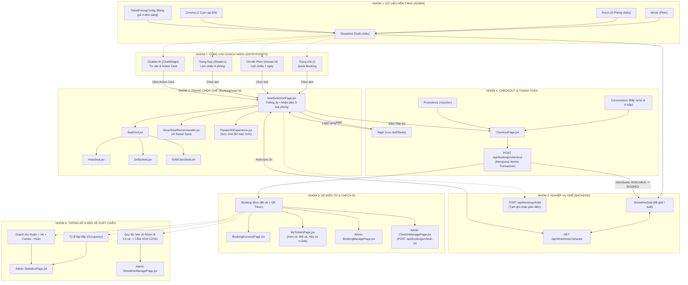

# BÁO CÁO KIỂM TOÁN TOÀN DIỆN HỆ THỐNG ĐẶT VÉ — D'AVENOR CINEMA
**Trọng tâm:** Trang Chọn Ghế (`SeatSelectionPage.jsx`) và Toàn bộ Chuỗi Quy trình Đặt vé Liên quan  
**Dự án:** `movietix-project` (Frontend React + Backend Node.js Express + MongoDB Atlas)  
**Thời điểm kiểm toán:** 25/11/2026  
**Trạng thái kiểm toán:** CHỈ ĐỌC, PHÂN TÍCH VÀ LẬP KẾ HOẠCH — TUYỆT ĐỐI CHƯA THAY ĐỔI SOURCE CODE VÀ DATABASE

---

## MỤC LỤC
1. [Tổng quan Kiến trúc Hệ thống Rạp](#1-tổng-quan-kiến-trúc-hệ-thống-rạp)
2. [Sơ đồ Phụ thuộc và Luồng Dữ liệu Toàn hệ thống (Mermaid)](#2-sơ-đồ-phụ-thuộc-và-luồng-dữ-liệu-toàn-hệ-thống-mermaid)
3. [Kiểm toán Chi tiết theo 8 Nhóm Module](#3-kiểm-toán-chi-tiết-theo-8-nhóm-module)
   - [Nhóm 1: Dữ liệu nền tảng (Phim, Phòng chiếu, Bảng giá, Suất chiếu)](#nhóm-1-dữ-liệu-nền-tảng-phim-phòng-chiếu-bảng-giá-suất-chiếu)
   - [Nhóm 2: Nghiệp vụ ghế (Tồn kho, Giữ ghế, Chống đặt trùng)](#nhóm-2-nghiệp-vụ-ghế-tồn-kho-giữ-ghế-chống-đặt-trùng)
   - [Nhóm 3: Trang chọn ghế của 3 loại phòng (IMAX Laser, Dolby Atmos, Gold Class)](#nhóm-3-trang-chọn-ghế-của-3-loại-phòng-imax-laser-dolby-atmos-gold-class)
   - [Nhóm 4: Đăng nhập, Checkout, Combo bắp nước, Khuyến mãi & Thanh toán](#nhóm-4-đăng-nhập-checkout-combo-bắp-nước-khuyến-mãi--thanh-toán)
   - [Nhóm 5: Vé điện tử, Quản lý đặt vé & Check-in soát vé](#nhóm-5-vé-điện-tử-quản-lý-đặt-vé--check-in-soát-vé)
   - [Nhóm 6: Thống kê, Bảo vệ suất chiếu & Đồng bộ Realtime](#nhóm-6-thống-kê-bảo-vệ-suất-chiếu--đồng-bộ-realtime)
   - [Nhóm 7: Trang chủ, Chi tiết phim, Cụm rạp & Chatbot AI](#nhóm-7-trang-chủ-chi-tiết-phim-cụm-rạp--chatbot-ai)
   - [Nhóm 8: Kiểm thử tích hợp toàn hệ thống](#nhóm-8-kiểm-thử-tích-hợp-toàn-hệ-thống)
4. [Bảng Tổng hợp Lỗi, Trùng lặp & Mức độ Rủi ro](#4-bảng-tổng-hợp-lỗi-trùng-lặp--mức-độ-rủi-ro)
5. [Kế hoạch và Checklist Triển khai (Chờ phê duyệt)](#5-kế-hoạch-và-checklist-triển-khai-chờ-phê-duyệt)

---

## 1. TỔNG QUAN KIẾN TRÚC HỆ THỐNG RẠP

> [!IMPORTANT]
> **ĐẶC ĐIỂM CỐT LÕI VỀ CƠ SỞ VẬT CHẤT:**  
> Hệ thống D'AVENOR CINEMA **chỉ có duy nhất 1 cụm rạp vật lý** (`D'AVENOR Thanh Khê Plaza`, Đà Nẵng) với **9 phòng chiếu vật lý** thuộc **3 loại công nghệ phòng chiếu**. Tuyệt đối không được nhầm lẫn giữa *3 loại phòng* và *3 phòng chiếu*.

### Cấu trúc 9 Phòng chiếu Vật lý thực tế trong MongoDB:
| STT | Mã Phòng (MongoDB `_id`) | Số phòng | Tên hiển thị đầy đủ | Tên ngắn | Loại phòng (`roomType`) | Tổng ghế |
| :---: | :--- | :---: | :--- | :---: | :---: | :---: |
| 1 | `6b01b798fe378d805c7c1799` | Phòng 01 | Phòng 01 - IMAX Laser (Grand Hall 1) | IMAX 01 | **IMAX Laser** | 88 ghế |
| 2 | `6b01b798fe378d805c7c179a` | Phòng 02 | Phòng 02 - IMAX Laser (Grand Hall 2) | IMAX 02 | **IMAX Laser** | 88 ghế |
| 3 | `6b01b798fe378d805c7c179b` | Phòng 03 | Phòng 03 - IMAX Laser (Grand Hall 3) | IMAX 03 | **IMAX Laser** | 88 ghế |
| 4 | `6b01b798fe378d805c7c179c` | Phòng 04 | Phòng 04 - Dolby Atmos (VIP Sound 1) | Dolby 01 | **Dolby Atmos** | 88 ghế |
| 5 | `6b01b798fe378d805c7c179d` | Phòng 05 | Phòng 05 - Dolby Atmos (VIP Sound 2) | Dolby 02 | **Dolby Atmos** | 88 ghế |
| 6 | `6b01b798fe378d805c7c179e` | Phòng 06 | Phòng 06 - Dolby Atmos (VIP Sound 3) | Dolby 03 | **Dolby Atmos** | 88 ghế |
| 7 | `6b01b798fe378d805c7c179f` | Phòng 07 | Phòng 07 - Gold Class (Luxury Lounge 1) | Gold 01 | **Gold Class** | 88 ghế |
| 8 | `6b01b798fe378d805c7c17a0` | Phòng 08 | Phòng 08 - Gold Class (Luxury Lounge 2) | Gold 02 | **Gold Class** | 88 ghế |
| 9 | `6b01b798fe378d805c7c17a1` | Phòng 09 | Phòng 09 - Gold Class (Luxury Lounge 3) | Gold 03 | **Gold Class** | 88 ghế |

**Cụm rạp duy nhất:** `D'AVENOR Thanh Khê Plaza` (`_id: 6aecb03919dd0ede75638b6e`), Tầng 4 TTTM Thanh Khê Plaza, 295 Điện Biên Phủ, P. Chính Gián, Q. Thanh Khê, Đà Nẵng.

---

## 2. SƠ ĐỒ PHỤ THUỘC VÀ LUỒNG DỮ LIỆU TOÀN HỆ THỐNG (MERMAID)



---

## 3. KIỂM TOÁN CHI TIẾT THEO 8 NHÓM MODULE

### NHÓM 1: DỮ LIỆU NỀN TẢNG (Phim, Phòng chiếu, Bảng giá, Suất chiếu)

#### 1. Chức năng hiện tại
- Định nghĩa và lưu trữ các thực thể nền tảng của rạp:
  - `Movie`: Lưu thông tin phim (*Dune 2, Kung Fu Panda 4, Mai...*), thời lượng, poster, nhãn độ tuổi (P, K, T13, T16, T18), định dạng hỗ trợ.
  - `Room`: Quản lý 9 phòng vật lý thuộc 3 công nghệ (`IMAX Laser`, `Dolby Atmos`, `Gold Class`), cấu hình 88 ghế.
  - `Cinema`: Quản lý 1 cụm rạp duy nhất tại Thanh Khê, Đà Nẵng.
  - `TicketPricingConfig`: Bảng giá ma trận theo loại phòng, ngày trong tuần/cuối tuần, khung giờ và loại ghế.
  - `Showtime`: Lịch chiếu thực tế, tự động liên kết phim, phòng và sinh 88 ghế `ShowtimeSeat`.

#### 2. Danh sách file liên quan và đường dẫn chính xác
- Backend Model:
  - [Movie.js](file:///d:/CDIO/movietix-project/backend/src/models/Movie.js)
  - [Room.js](file:///d:/CDIO/movietix-project/backend/src/models/Room.js)
  - [Cinema.js](file:///d:/CDIO/movietix-project/backend/src/models/Cinema.js)
  - [TicketPricingConfig.js](file:///d:/CDIO/movietix-project/backend/src/models/TicketPricingConfig.js)
  - [Showtime.js](file:///d:/CDIO/movietix-project/backend/src/models/Showtime.js)
- Backend Controller & Service:
  - [movieController.js](file:///d:/CDIO/movietix-project/backend/src/controllers/movieController.js)
  - [roomController.js](file:///d:/CDIO/movietix-project/backend/src/controllers/roomController.js)
  - [cinemaController.js](file:///d:/CDIO/movietix-project/backend/src/controllers/cinemaController.js)
  - [adminController.js](file:///d:/CDIO/movietix-project/backend/src/controllers/adminController.js) (hàm `scheduleInRoom`, `createShowtime`)
  - [pricingUtils.js](file:///d:/CDIO/movietix-project/backend/src/utils/pricingUtils.js) (hàm `calculatePricesFromConfig`)
- Frontend:
  - [pricing.js](file:///d:/CDIO/movietix-project/frontend/src/utils/pricing.js)
  - [RoomManagePage.jsx](file:///d:/CDIO/movietix-project/frontend/src/pages/admin/RoomManagePage.jsx)
  - [PricingManagePage.jsx](file:///d:/CDIO/movietix-project/frontend/src/pages/admin/PricingManagePage.jsx)
  - [ShowtimeManagePage.jsx](file:///d:/CDIO/movietix-project/frontend/src/pages/admin/ShowtimeManagePage.jsx)

#### 3. Mối quan hệ phụ thuộc
- `Showtime.roomId` $\rightarrow$ `Room._id` (bắt buộc phải thuộc 9 phòng có `status: 'ACTIVE'`).
- `Showtime.movieId` $\rightarrow$ `Movie._id`.
- `Showtime.cinemaId` $\rightarrow$ `Cinema._id` (cụm rạp Đà Nẵng).
- Khi tạo suất chiếu qua `scheduleInRoom`, hệ thống dùng `calculatePricesFromConfig` để điền `price` mặc định và chạy `ShowtimeSeat.insertMany` tạo 88 ghế.

#### 4. Luồng dữ liệu đầu vào và đầu ra
- **Đầu vào:** Admin chọn phim, phòng (01..09), ngày, giờ bắt đầu.
- **Xử lý:** Kiểm tra xung đột thời gian chiếu (thời lượng phim + 15 phút dọn phòng) với `Room.scheduleRevision` khóa lạc quan.
- **Đầu ra:** Suất chiếu mới kèm 88 document ghế trong MongoDB, trả về cho Admin Timeline và mở bán cho Client.

#### 5. Những lỗi đang tồn tại
- Trùng lặp logic tính giá vé: Công thức tính giá ở Backend (`pricingUtils.js`) và Frontend (`frontend/src/utils/pricing.js`) độc lập nhau. Nếu Frontend dùng cache cũ hoặc lỗi mạng, giá hiển thị ở thẻ ghế có thể lệch nhẹ với giá mà Backend hạch toán lúc checkout.
- Map định dạng phòng qua chuỗi con: Trong `calculatePricesFromConfig`, mã phòng được parse bằng `.includes('IMAX')`, `.includes('Atmos')`, `.includes('Gold')` từ `roomName`. Nếu Admin đổi tên phòng không chứa các từ khóa này, giá vé sẽ bị fallback về 2D Tiêu chuẩn.

#### 6. Những logic bị trùng lặp
- Danh sách 88 ghế ma trận (A1..H11) được code lặp lại ở cả `adminController.js` (khi sinh template) và `cinemaController.js` (khi auto-seed).

#### 7. Những chức năng đã hoạt động tốt cần giữ nguyên
- Kiểm tra xung đột lịch chiếu kèm 15 phút dọn phòng.
- Cơ chế khóa phòng lạc quan `scheduleRevision`.
- Quy định mở bán tối đa 7 ngày (`opensMoreThanSevenDaysAhead`).

#### 8. Những nội dung cần sửa
- Thay vì regex chuỗi `roomName`, đồng bộ việc map định dạng phòng chiếu trực tiếp từ enum `room.roomType` (`IMAX Laser`, `Dolby Atmos`, `Gold Class`).

#### 9. Mức độ ưu tiên & Rủi ro
- **Ưu tiên:** Trung bình (P2).
- **Rủi ro:** Thấp (không làm gián đoạn API hiện có).

#### 10. Phương án triển khai & Checklist
- [ ] Bổ sung helper chuẩn hóa định dạng phòng từ `room.roomType`.
- [ ] Kiểm tra tạo suất chiếu ở cả 3 loại phòng xem giá vé tự động điền có chuẩn xác theo bảng giá cấu hình.

---

### NHÓM 2: NGHIỆP VỤ GHẾ (Tồn kho, Giữ ghế, Chống đặt trùng)

#### 1. Chức năng hiện tại
- Lưu trạng thái độc lập của 88 ghế cho từng suất chiếu:
  - Hàng A-D: 44 ghế Tiêu chuẩn (`STANDARD`).
  - Hàng E-G: 33 ghế VIP (`VIP`).
  - Hàng H: 11 ghế Đôi/Sweetbox (`SWEETBOX` / VIP Prime).
- API `GET /api/showtimes/:id/seats`: Trả về danh sách 88 ghế, trạng thái (`AVAILABLE`, `HOLDING`, `BOOKED`), sức chứa, tỷ lệ lấp đầy.
- Thuật toán Smart Seat Recommender (`/api/showtimes/:id/recommend-seats`): Gợi ý 1-4 ghế điểm ngọt liên tiếp, không cắt ngang lối đi.
- Chống đặt trùng nguyên tử (Atomic concurrency): Kiểm tra và chiếm ghế trong transaction khi thanh toán.

#### 2. Danh sách file liên quan và đường dẫn chính xác
- [ShowtimeSeat.js](file:///d:/CDIO/movietix-project/backend/src/models/ShowtimeSeat.js)
- [showtimeRoutes.js](file:///d:/CDIO/movietix-project/backend/src/routes/showtimeRoutes.js)
- [showtimeController.js](file:///d:/CDIO/movietix-project/backend/src/controllers/showtimeController.js) (hàm `getShowtimeSeats`, `recommendSeats`, `normalizeSeatCode`)
- [bookingController.js](file:///d:/CDIO/movietix-project/backend/src/controllers/bookingController.js) (hàm `holdSeats`, `claimSeats`, `releaseSeats`)

#### 3. Mối quan hệ phụ thuộc
- `ShowtimeSeat.showtimeId` $\rightarrow$ `Showtime._id`.
- `ShowtimeSeat.roomId` $\rightarrow$ `Room._id`.
- `ShowtimeSeat.bookingId` $\rightarrow$ `Booking._id` (khi đã bán).
- Đảm bảo tính duy nhất qua compound index: `{ showtimeId: 1, seatNumber: 1 }` (unique: true).

#### 4. Luồng dữ liệu đầu vào và đầu ra
- **Đầu vào:** Client gửi request lấy sơ đồ ghế `/showtimes/:id/seats`.
- **Xử lý:** Backend lọc danh sách ghế, map normalize seat code (A01 $\rightarrow$ A1), tính tỷ lệ lấp đầy.
- **Đầu ra:** Mảng 88 object ghế kèm trạng thái `AVAILABLE` hoặc `BOOKED`.

#### 5. Những lỗi đang tồn tại
- **Hàm `holdSeats` chưa thực sự lưu vào DB:** Trong `bookingController.js` (dòng 64), `holdSeats` chỉ trả về JSON thành công mà không cập nhật trường `status: 'HOLDING'` và `holdExpiresAt` trong `ShowtimeSeat`. Hệ thống hiện đang dựa vào optimistic concurrency tại bước Checkout (`claimSeats`).
- **`getShowtimeSeats` thiếu cơ chế tự động xả ghế giữ hết hạn:** Nếu có ghế chuyển sang `HOLDING`, không có logic so sánh `holdExpiresAt < new Date()` để trả về `AVAILABLE`.
- **Lỗi hardcode trong Recommender:** Dòng 160 của `showtimeController.js` hardcode hàng H chỉ có 4 cột (`Block trái: 1-2, Block phải: 3-4`), trong khi ma trận 88 ghế thực tế hàng H có đủ 11 ghế.

#### 6. Những logic bị trùng lặp
- Logic chuẩn hóa mã ghế `normalizeSeatCode` xuất hiện ở cả `showtimeController.js` và `bookingController.js`.

#### 7. Những chức năng đã hoạt động tốt cần giữ nguyên
- Hàm `claimSeats` sử dụng Mongoose Transaction với điều kiện `{ status: 'AVAILABLE' }` bảo đảm chống đặt trùng 100%.
- Kiểm tra tính toàn vẹn số lượng ghế bị modifiedCount so với độ dài mảng yêu cầu.

#### 8. Những nội dung cần sửa
- Thống nhất cơ chế giữ ghế: Nếu kích hoạt Hold ghế thật, phải có TTL index hoặc auto-release khi hết hạn 10 phút.
- Sửa ma trận hàng H trong thuật toán gợi ý ghế thông minh (`recommendSeats`) cho đúng 11 cột.

#### 9. Mức độ ưu tiên & Rủi ro
- **Ưu tiên:** Cao (P1).
- **Rủi ro:** Trung bình (cần bảo đảm không gây race condition).

#### 10. Phương án triển khai & Checklist
- [ ] Cập nhật thuật toán `recommendSeats` hỗ trợ sơ đồ 11 cột cho hàng H.
- [ ] Viết test mô phỏng 2 khách cùng gợi ý ghế và cùng chọn ghế.

---

### NHÓM 3: TRANG CHỌN GHẾ CỦA 3 LOẠI PHÒNG (IMAX Laser, Dolby Atmos, Gold Class)

#### 1. Chức năng hiện tại
- Component trung tâm [SeatSelectionPage.jsx](file:///d:/CDIO/movietix-project/frontend/src/pages/client/SeatSelectionPage.jsx):
  - Tự động nhận diện công nghệ phòng chiếu: `IMAX`, `ATMOS`, `GOLD`.
  - Hiển thị Màn hình cong phát sáng quang học theo chủ đề riêng của từng phòng:
    + **IMAX Laser:** Màn hình cong khổ lớn 4K Laser, màu nhấn Cyan `#00D9FF` + Magenta `#E34BFF`.
    + **Dolby Atmos:** Hệ thống vòm 360°, màu nhấn Cyan `#00D5FF` + Tím `#D8B4FF`.
    + **Gold Class:** Ghế Sofa Recliner sang trọng có tay vịn kép, vương miện hoàng gia, màu nhấn Vàng kim `#FFD18A`.
  - Hiển thị góc nhìn 3D trực quan ([Theater3DExperience.jsx](file:///d:/CDIO/movietix-project/frontend/src/components/seat-booking/Theater3DExperience.jsx)).
  - Thanh chọn ghế đáy màn hình ([SeatBottomActionBar.jsx](file:///d:/CDIO/movietix-project/frontend/src/components/seat-booking/SeatBottomActionBar.jsx)): Đếm tổng ghế, ghế trống, ghế đã bán, ghế đang chọn và nút "Tiếp tục $\rightarrow$".

#### 2. Danh sách file liên quan và đường dẫn chính xác
- [SeatSelectionPage.jsx](file:///d:/CDIO/movietix-project/frontend/src/pages/client/SeatSelectionPage.jsx)
- [SeatGrid.jsx](file:///d:/CDIO/movietix-project/frontend/src/components/seat-booking/SeatGrid.jsx)
- [seatLayout.js](file:///d:/CDIO/movietix-project/frontend/src/components/seat-booking/seatLayout.js)
- [ImaxSeat.jsx](file:///d:/CDIO/movietix-project/frontend/src/components/seat-booking/ImaxSeat.jsx)
- [DolbySeat.jsx](file:///d:/CDIO/movietix-project/frontend/src/components/seat-booking/DolbySeat.jsx)
- [GoldClassSeat.jsx](file:///d:/CDIO/movietix-project/frontend/src/components/seat-booking/GoldClassSeat.jsx)
- [SeatLegendBar.jsx](file:///d:/CDIO/movietix-project/frontend/src/components/seat-booking/SeatLegendBar.jsx)
- [MovieInfoSidebar.jsx](file:///d:/CDIO/movietix-project/frontend/src/components/seat-booking/MovieInfoSidebar.jsx)
- [SmartSeatRecommender.jsx](file:///d:/CDIO/movietix-project/frontend/src/components/seat-booking/SmartSeatRecommender.jsx)
- [Theater3DExperience.jsx](file:///d:/CDIO/movietix-project/frontend/src/components/seat-booking/Theater3DExperience.jsx)

#### 3. Mối quan hệ phụ thuộc
- `SeatSelectionPage` nhận `showtimeId` từ URL params.
- Gọi API `/api/showtimes/:id/seats` để nhận layout 88 ghế.
- Truyền danh sách ghế và callback `onSeatClick` xuống `SeatGrid`.
- `SeatGrid` dựa vào `roomType` để chọn component ghế tương ứng (`ImaxSeat`, `DolbySeat`, hoặc `GoldClassSeat`).

#### 4. Luồng dữ liệu đầu vào và đầu ra
- **Đầu vào:** URL param `showtimeId`, state điều hướng `location.state.slotInfo`, `draftSeats`.
- **Xử lý:** Polling 3.000ms tải trạng thái ghế mới nhất; quản lý state `selectedSeats`; tính tổng tiền vé động theo loại ghế (`STANDARD`, `VIP`, `SWEETBOX`).
- **Đầu ra:** Khi bấm "Tiếp tục", chuyển hướng sang `/checkout` kèm state chứa `{ showtimeId, selectedSeats, seatTotal, ticketPrices }`.

#### 5. Những lỗi đang tồn tại
- Nhận diện `currentRoomType` bằng cách kiểm tra string:
  ```javascript
  const roomTechnology = (showtime?.room?.roomType || showtime?.roomType || showtime?.roomName || '').toLowerCase();
  const currentRoomType = roomTechnology.includes('atmos') ? 'ATMOS' : roomTechnology.includes('gold') ? 'GOLD' : 'IMAX';
  ```
  Nếu tên phòng không chứa các chuỗi con này thì mặc định luôn là IMAX.
- Trong `seatLayout.js`:
  ```javascript
  const splitCol = roomType === 'IMAX' && ordered.at(-1).col <= 12
    ? (label === 'H' && ordered.at(-1).col <= 4 ? 2 : 6)
    : ordered[Math.ceil(ordered.length / 2) - 1].col;
  ```
  Điều kiện `label === 'H' && ordered.at(-1).col <= 4 ? 2 : 6` là logic sót lại từ sơ đồ 4 ghế cũ, cần chuẩn hóa để hàng H (11 ghế) chia lối đi giữa ở vị trí cột 6 và 7 như các hàng khác.

#### 6. Những logic bị trùng lặp
- Định dạng ngày tiếng Việt (`formatVietnameseDate`) được viết tay trong `SeatSelectionPage.jsx` trong khi dự án đã có `cinemaCalendar.js`.

#### 7. Những chức năng đã hoạt động tốt cần giữ nguyên
- Thiết kế Holographic Dark Navy cao cấp, tinh tế.
- 3 component ghế (`ImaxSeat`, `DolbySeat`, `GoldClassSeat`) hiển thị rất đẹp, sắc nét với hiệu ứng neon và dấu $\times$ rõ ràng khi ghế đã bán.
- Cơ chế khôi phục ghế đã chọn (`draftSeats`) khi khách quay lại từ trang Đăng nhập hoặc trang Checkout.

#### 8. Những nội dung cần sửa
- Thống nhất logic chia lối đi giữa (aisle split) cho hàng H trong `seatLayout.js`.
- Đồng bộ `roomType` từ Room model thay vì parse lỏng lẻo chuỗi tên.

#### 9. Mức độ ưu tiên & Rủi ro
- **Ưu tiên:** Cao (P1).
- **Rủi ro:** Thấp.

#### 10. Phương án triển khai & Checklist
- [ ] Kiểm tra giao diện sơ đồ ghế ở cả 3 phòng mẫu: Phòng 01 (IMAX), Phòng 04 (Dolby), Phòng 07 (Gold Class).
- [ ] Xác nhận hàng H có đủ 11 ghế và lối đi giữa thẳng hàng với hàng A-G.

---

### NHÓM 4: ĐĂNG NHẬP, CHECKOUT, COMBO, KHUYẾN MÃI & THANH TOÁN

#### 1. Chức năng hiện tại
- Chuyển hướng xác thực: Khách chưa đăng nhập bấm "Tiếp tục" ở chọn ghế sẽ được đưa sang `/login`, lưu `draftSeats` và quay lại đúng trạng thái sau khi login.
- [CheckoutPage.jsx](file:///d:/CDIO/movietix-project/frontend/src/pages/client/CheckoutPage.jsx):
  - Chọn vị bắp: Ngọt truyền thống, Phô mai, Caramel (+5.000đ), Rong biển.
  - Danh mục bắp nước động từ collection `concessions`.
  - Áp dụng mã giảm giá voucher từ collection `promotions`.
  - Chọn phương thức thanh toán: VNPAY-QR, MOMO, VISA, ATM, Tiền mặt.
  - Chống double-click bằng Idempotency-Key header.
  - API `POST /api/bookings/checkout` thực hiện Mongoose Session Transaction: kiểm tra vé bán, tính giá, trừ voucher, claim ghế `BOOKED` và sinh mã đơn hàng `MTX-...`.

#### 2. Danh sách file liên quan và đường dẫn chính xác
- [CheckoutPage.jsx](file:///d:/CDIO/movietix-project/frontend/src/pages/client/CheckoutPage.jsx)
- [AuthPage.jsx](file:///d:/CDIO/movietix-project/frontend/src/pages/client/AuthPage.jsx)
- [CheckoutCombos.jsx](file:///d:/CDIO/movietix-project/frontend/src/components/checkout/CheckoutCombos.jsx)
- [CheckoutPromotions.jsx](file:///d:/CDIO/movietix-project/frontend/src/components/checkout/CheckoutPromotions.jsx)
- [CheckoutPaymentMethods.jsx](file:///d:/CDIO/movietix-project/frontend/src/components/checkout/CheckoutPaymentMethods.jsx)
- [CheckoutOrderSummary.jsx](file:///d:/CDIO/movietix-project/frontend/src/components/checkout/CheckoutOrderSummary.jsx)
- [bookingController.js](file:///d:/CDIO/movietix-project/backend/src/controllers/bookingController.js) (hàm `checkoutBooking`)
- [concessionController.js](file:///d:/CDIO/movietix-project/backend/src/controllers/concessionController.js)
- [promotionController.js](file:///d:/CDIO/movietix-project/backend/src/controllers/promotionController.js)

#### 3. Mối quan hệ phụ thuộc
- `CheckoutPage` nhận dữ liệu từ `SeatSelectionPage`.
- Đơn hàng tạo ra liên kết với `userId`, `showtimeId`, `movieId`, `roomId`.
- `Booking.priceSnapshot` lưu lại chi tiết giá từng ghế, từng combo, số tiền giảm voucher để đảm bảo tính toàn vẹn tài chính sau này (kể cả khi bảng giá rạp thay đổi).

#### 4. Luồng dữ liệu đầu vào và đầu ra
- **Đầu vào:** `showtimeId`, `seatNumbers`, `combos`, `popcornFlavor`, `voucherCode`, `paymentMethod`, thông tin người đặt.
- **Xử lý:** Backend xác thực thông tin, tính toán lại giá độc lập từ cơ sở dữ liệu rạp, chạy atomic transaction khóa ghế và lưu booking.
- **Đầu ra:** HTTP 201 Created trả về object `booking` đầy đủ (`bookingCode`, `qrToken`, `totalAmount`) $\rightarrow$ chuyển hướng sang `/booking-success`. Nếu xung đột ghế $\rightarrow$ HTTP 409 Conflict $\rightarrow$ chuyển hướng về lại sơ đồ ghế.

#### 5. Những lỗi đang tồn tại
- Thiếu đồng hồ đếm ngược giữ ghế (Countdown Timer) trên trang Checkout: Khách có thể dừng ở màn hình này vô hạn định, trong khi người khác có thể mua mất ghế nếu submit trước.
- Nút "Quay lại" (`goBackToSeats`): Nếu khách reload trang Checkout, state từ `location.state` bị mất, nút quay lại sẽ rơi vào fallback `/theaters` thay vì giữ đúng suất chiếu ban đầu.

#### 6. Những logic bị trùng lặp
- Kiểm tra tính hợp lệ của mã giảm giá (voucher validity) được kiểm tra 2 lần: 1 lần tại route `/api/promotions/apply` và 1 lần trong `checkoutBooking`.

#### 7. Những chức năng đã hoạt động tốt cần giữ nguyên
- Chống replay thanh toán bằng `Idempotency-Key`.
- Server-side authoritative pricing (Backend tự tính lại giá vé, không tin tưởng tổng tiền client gửi lên).
- Xử lý mượt mà lỗi 409 Conflict tự động đưa khách về chọn lại ghế.

#### 8. Những nội dung cần sửa
- Bổ sung bộ đếm thời gian thanh toán (ví dụ: 10 phút) tại trang Checkout để nâng cao tính trải nghiệm và cảnh báo khách thanh toán kịp thời.

#### 9. Mức độ ưu tiên & Rủi ro
- **Ưu tiên:** Trung bình (P2).
- **Rủi ro:** Thấp.

#### 10. Phương án triển khai & Checklist
- [ ] Test thanh toán với mã giảm giá hợp lệ và mã giảm giá hết hạn.
- [ ] Test trường hợp 2 tab trình duyệt cùng checkout 1 ghế để xác nhận 1 tab nhận 201 và 1 tab nhận 409.

---

### NHÓM 5: VÉ ĐIỆN TỬ, QUẢN LÝ ĐẶT VÉ & CHECK-IN SOÁT VÉ

#### 1. Chức năng hiện tại
- [BookingSuccessPage.jsx](file:///d:/CDIO/movietix-project/frontend/src/pages/client/BookingSuccessPage.jsx): Hiển thị thông tin vé, mã đặt chỗ `#MTX-...`, mã QR Token với biểu tượng phim ở tâm.
- [MyTicketsPage.jsx](file:///d:/CDIO/movietix-project/frontend/src/pages/client/MyTicketsPage.jsx): Quản lý ví vé của khách hàng.
  - Hiển thị vé sắp xem và vé đã xem.
  - Chính sách hủy vé: Cho phép hủy trước giờ chiếu $\ge 24$ giờ, tự động xả ghế về `AVAILABLE`, cập nhật trạng thái `CANCELLED` và hoàn tiền mô phỏng.
  - Chính sách đổi vé: Cho phép đổi suất chiếu khác trước giờ chiếu $\ge 24$ giờ, xoay mã QR mới và tính chênh lệch giá.
- [BookingManagePage.jsx](file:///d:/CDIO/movietix-project/frontend/src/pages/admin/BookingManagePage.jsx): Admin tìm kiếm, lọc đơn đặt vé theo ngày, phim, số điện thoại.
- [CheckInManagePage.jsx](file:///d:/CDIO/movietix-project/frontend/src/pages/admin/CheckInManagePage.jsx):
  - Nhân viên rạp quét mã QR từ điện thoại khách hàng.
  - Gọi API `POST /api/bookings/check-in`.
  - Kiểm tra điều kiện: Vé phải ở trạng thái `PAID`, chưa check-in, suất chiếu hợp lệ.
  - Chống gian lận: Nếu vé đã quét rồi, từ chối và báo rõ thời điểm đã check-in trước đó.

#### 2. Danh sách file liên quan và đường dẫn chính xác
- [BookingSuccessPage.jsx](file:///d:/CDIO/movietix-project/frontend/src/pages/client/BookingSuccessPage.jsx)
- [MyTicketsPage.jsx](file:///d:/CDIO/movietix-project/frontend/src/pages/client/MyTicketsPage.jsx)
- [TicketQr.jsx](file:///d:/CDIO/movietix-project/frontend/src/components/checkout/TicketQr.jsx)
- [BookingManagePage.jsx](file:///d:/CDIO/movietix-project/frontend/src/pages/admin/BookingManagePage.jsx)
- [CheckInManagePage.jsx](file:///d:/CDIO/movietix-project/frontend/src/pages/admin/CheckInManagePage.jsx)
- [bookingController.js](file:///d:/CDIO/movietix-project/backend/src/controllers/bookingController.js) (hàm `checkInBooking`, `cancelBooking`, `exchangeBooking`)

#### 3. Mối quan hệ phụ thuộc
- `Booking.qrToken` $\rightarrow$ Sinh ngẫu nhiên bằng crypto an toàn, dùng để tạo ảnh QR.
- `Booking.isCheckedIn` $\rightarrow$ Boolean đánh dấu trạng thái đã vào rạp.
- `Booking.showtimeId` $\rightarrow$ Liên kết với suất chiếu để hiển thị phòng và giờ chiếu trên vé.

#### 4. Luồng dữ liệu đầu vào và đầu ra
- **Đầu vào:** Nhân viên quét mã QR hoặc nhập `qrToken`.
- **Xử lý:** Backend tìm booking theo `qrToken`, kiểm tra điều kiện check-in, gán `isCheckedIn: true` và `checkedInAt: new Date()`.
- **Đầu ra:** Trả về thông tin khách, tên phim, phòng chiếu, danh sách ghế để nhân viên đối chiếu.

#### 5. Những lỗi đang tồn tại
- Nếu suất chiếu bị thiếu liên kết `roomId` (dữ liệu lịch sử cũ), thông tin hiển thị trên vé điện tử có thể bị trống tên phòng hoặc rơi vào fallback `Phòng chiếu`.
- Route check-in yêu cầu quyền Admin, nhân viên soát vé phải đăng nhập bằng tài khoản Admin.

#### 6. Những logic bị trùng lặp
- Component hiển thị mã QR `TicketQr.jsx` được import ở cả 2 trang `BookingSuccessPage` và `MyTicketsPage` (đã được tái sử dụng tốt).

#### 7. Những chức năng đã hoạt động tốt cần giữ nguyên
- Chống check-in 2 lần tuyệt đối (Once-only check-in enforcement).
- Bảo vệ không leak `qrToken` qua các API liệt kê công khai (chỉ trả `qrToken` cho chính chủ sở hữu đơn hàng).
- Quy định hủy/đổi vé trước 24 giờ hoạt động chính xác theo chính sách rạp.

#### 8. Những nội dung cần sửa
- Đảm bảo trong mọi trường hợp populate booking, luôn lồng đủ `path: 'showtimeId', populate: [{ path: 'movieId' }, { path: 'roomId' }, { path: 'cinemaId' }]` để vé luôn hiển thị đầy đủ tên phòng (ví dụ: *Phòng 01 - IMAX Laser*).

#### 9. Mức độ ưu tiên & Rủi ro
- **Ưu tiên:** Trung bình (P2).
- **Rủi ro:** Thấp.

#### 10. Phương án triển khai & Checklist
- [ ] Test quét mã QR một vé mới $\rightarrow$ thành công.
- [ ] Test quét lại vé đó lần 2 $\rightarrow$ báo lỗi đã check-in kèm thời gian cụ thể.
- [ ] Test hủy vé $\rightarrow$ ghế được trả về trống trên sơ đồ và mã QR bị vô hiệu hóa khi check-in.

---

### NHÓM 6: THỐNG KÊ, BẢO VỆ SUẤT CHIẾU & ĐỒNG BỘ REALTIME

#### 1. Chức năng hiện tại
- Thống kê doanh thu & Tỷ lệ lấp đầy:
  - Tính toán dựa trên các đơn hàng thực tế `PAID`.
  - Tỷ lệ lấp đầy (`occupancyRate`): $\frac{\text{Số ghế đã bán}}{\text{Tổng ghế có thể bán}} \times 100\%$.
  - Dữ liệu chi phí và lợi nhuận đã được dọn sạch dữ liệu ảo, phản ánh đúng dòng tiền thực.
- Quy tắc bảo vệ suất chiếu (Showtime Protection):
  - Phân loại rõ ràng 2 nhóm:
    + **Nhóm A (Được phép xóa cứng):** Suất chiếu 0 vé đặt, không phát sinh giao dịch, chưa bắt đầu.
    + **Nhóm B (Được bảo vệ tuyệt đối):** Suất chiếu đã có bất kỳ đơn vé nào (kể cả đã thanh toán, đã hủy, đã đổi hoặc đã check-in). CẤM XÓA CỨNG khỏi database để bảo vệ tính toàn vẹn tài chính và lịch sử kế toán.
  - Admin chỉ có thể **Khóa suất** hoặc **Hủy có hoàn tiền**.
- Đồng bộ Realtime trên Client:
  - `SeatSelectionPage.jsx` duy trì polling 3.000ms.
  - Tự động phát hiện xung đột: Nếu ghế khách đang chọn bị người khác mua, hệ thống lập tức nhả ghế đó ra và hiện toast cảnh báo.

#### 2. Danh sách file liên quan và đường dẫn chính xác
- [statisticsService.js](file:///d:/CDIO/movietix-project/backend/src/services/statisticsService.js)
- [statisticsController.js](file:///d:/CDIO/movietix-project/backend/src/controllers/statisticsController.js)
- [bulkShowtimeController.js](file:///d:/CDIO/movietix-project/backend/src/controllers/bulkShowtimeController.js) (hàm `deleteShowtimeSafe`, `previewBulkDeleteShowtimes`, `commitBulkDeleteShowtimes`)
- [StatisticsPage.jsx](file:///d:/CDIO/movietix-project/frontend/src/pages/admin/statistics/StatisticsPage.jsx)
- [ShowtimeManagePage.jsx](file:///d:/CDIO/movietix-project/frontend/src/pages/admin/ShowtimeManagePage.jsx)
- [SeatSelectionPage.jsx](file:///d:/CDIO/movietix-project/frontend/src/pages/client/SeatSelectionPage.jsx)

#### 3. Mối quan hệ phụ thuộc
- Bất kỳ thay đổi nào từ `Booking` (đặt mới, hủy, hoàn tiền) lập tức ảnh hưởng đến số liệu của `StatisticsPage` và đưa suất chiếu vào diện bảo vệ của `ShowtimeManagePage`.

#### 4. Luồng dữ liệu đầu vào và đầu ra
- **Đầu vào:** Admin gọi thao tác xóa suất hoặc xem báo cáo doanh thu.
- **Xử lý:** Backend đếm số lượng `Booking` của suất chiếu. Nếu count > 0 $\rightarrow$ Chặn xóa và trả về thông tin bảo vệ Nhóm B.
- **Đầu ra:** Báo cáo KPI chính xác; bảo vệ database không bị mất dữ liệu giao dịch.

#### 5. Những lỗi đang tồn tại
- Polling 3s từ nhiều client đồng thời có thể gây tăng số lượng truy vấn đọc vào collection `showtimeseats`. Cần đảm bảo projection chỉ lấy các trường cần thiết (`seatNumber`, `status`) để tối ưu băng thông.

#### 6. Những logic bị trùng lặp
- Logic tính tỷ lệ lấp đầy xuất hiện ở cả `showtimeController.js` và `statisticsService.js`.

#### 7. Những chức năng đã hoạt động tốt cần giữ nguyên
- Kiểm tra bảo vệ Nhóm B trong `bulkShowtimeController.js`.
- Báo cáo tài chính sạch, không còn chi phí ảo seed cũ.

#### 8. Những nội dung cần sửa
- Tối ưu hóa API `GET /api/showtimes/:id/seats` để phản hồi cực nhanh dưới 50ms khi client polling liên tục.

#### 9. Mức độ ưu tiên & Rủi ro
- **Ưu tiên:** Cao (P1).
- **Rủi ro:** Thấp.

#### 10. Phương án triển khai & Checklist
- [ ] Thử xóa 1 suất chiếu đã có đơn vé test $\rightarrow$ Xác nhận hệ thống chặn và báo lỗi Nhóm B.
- [ ] Thử xóa 1 suất chiếu trống vừa tạo $\rightarrow$ Xóa thành công sạch sẽ cả suất lẫn 88 ghế.

---

### NHÓM 7: TRANG CHỦ, CHI TIẾT PHIM, CỤM RẠP & CHATBOT AI

#### 1. Chức năng hiện tại
- [HomeQuickBooking.jsx](file:///d:/CDIO/movietix-project/frontend/src/components/home/HomeQuickBooking.jsx): Thanh chọn nhanh Phim $\rightarrow$ Rạp $\rightarrow$ Ngày $\rightarrow$ Giờ $\rightarrow$ Chuyển thẳng vào `/booking/seat/:id`.
- [MovieDetailPage.jsx](file:///d:/CDIO/movietix-project/frontend/src/pages/client/MovieDetailPage.jsx): Hiển thị lịch chiếu 7 ngày của phim, phân nhóm theo loại phòng chiếu (`IMAX Laser`, `Dolby Atmos`, `Gold Class`).
- [TheatersPage.jsx](file:///d:/CDIO/movietix-project/frontend/src/pages/client/TheatersPage.jsx): Trang thông tin cụm rạp D'AVENOR Thanh Khê Plaza (Đà Nẵng), lịch chiếu theo từng phòng vật lý.
- [ChatWidget.jsx](file:///d:/CDIO/movietix-project/frontend/src/components/chat/ChatWidget.jsx) & [cinemaContextService.js](file:///d:/CDIO/movietix-project/backend/src/services/ai/cinemaContextService.js): Chatbot AI thông minh trả lời lịch chiếu và sinh thẻ hành động (Action Card) có nút "Đặt vé ngay" dẫn vào trang chọn ghế.

#### 2. Danh sách file liên quan và đường dẫn chính xác
- [HomePage.jsx](file:///d:/CDIO/movietix-project/frontend/src/pages/client/HomePage.jsx)
- [HomeQuickBooking.jsx](file:///d:/CDIO/movietix-project/frontend/src/components/home/HomeQuickBooking.jsx)
- [MovieDetailPage.jsx](file:///d:/CDIO/movietix-project/frontend/src/pages/client/MovieDetailPage.jsx)
- [MovieShowtimesSection.jsx](file:///d:/CDIO/movietix-project/frontend/src/components/movie-detail/MovieShowtimesSection.jsx)
- [TheatersPage.jsx](file:///d:/CDIO/movietix-project/frontend/src/pages/client/TheatersPage.jsx)
- [ChatWidget.jsx](file:///d:/CDIO/movietix-project/frontend/src/components/chat/ChatWidget.jsx)
- [cinemaContextService.js](file:///d:/CDIO/movietix-project/backend/src/services/ai/cinemaContextService.js)
- [aiController.js](file:///d:/CDIO/movietix-project/backend/src/controllers/aiController.js)

#### 3. Mối quan hệ phụ thuộc
- Tất cả các trang này đều là **Cổng vào (Entrypoints)** dẫn người dùng về [SeatSelectionPage.jsx](file:///d:/CDIO/movietix-project/frontend/src/pages/client/SeatSelectionPage.jsx).
- Các API lấy lịch chiếu (`/movies/:id/schedule`, `/cinemas/:id/schedule`, AI Context) đều phải tuân thủ điều kiện loại trừ các suất chiếu đã bị Admin hủy (`cancelledAt: null`) hoặc đang tạm khóa (`isLocked: { $ne: true }`).

#### 4. Luồng dữ liệu đầu vào và đầu ra
- **Đầu vào:** Khách hàng click vào một khung giờ chiếu trên bất kỳ trang nào.
- **Đầu ra:** Điều hướng tới `/booking/seat/:showtimeId` kèm theo state `slotInfo`.

#### 5. Những lỗi đang tồn tại
- `TheatersPage.jsx` khi click vào suất chiếu chỉ điều hướng `navigate('/booking/seat/' + showtimeId)` mà không gửi kèm `state: { slotInfo }` như `HomeQuickBooking` và `MovieShowtimesSection`. Điều này khiến trang chọn ghế phải chờ API fetch xong mới có thông tin phim và phòng.
- Bộ lọc ngày ở Trang chủ đôi khi chưa đồng bộ định dạng ngày chuẩn (`YYYY-MM-DD`) giữa múi giờ Việt Nam (+07:00) và UTC.

#### 6. Những logic bị trùng lặp
- Logic lọc suất chiếu hợp lệ (chưa bắt đầu, trong vòng 7 ngày, chưa bị hủy/khóa) được viết lại ở cả `movieController.js`, `cinemaController.js` và `cinemaContextService.js`.

#### 7. Những chức năng đã hoạt động tốt cần giữ nguyên
- Chatbot AI đã được cập nhật loại bỏ suất chiếu hủy/khóa và xuất Action Card chính xác.
- Quick Booking bar hoạt động mượt mà, dropdown chọn phim và popover khung giờ hiển thị sắc nét.

#### 8. Những nội dung cần sửa
- Thêm `state: { slotInfo }` vào lệnh điều hướng của `TheatersPage.jsx` để tăng tốc độ tải trang chọn ghế.

#### 9. Mức độ ưu tiên & Rủi ro
- **Ưu tiên:** Thấp (P3).
- **Rủi ro:** Rất thấp.

#### 10. Phương án triển khai & Checklist
- [ ] Bổ sung payload slotInfo vào `TheatersPage.jsx`.
- [ ] Kiểm tra click từ 4 nguồn: Trang chủ, Chi tiết phim, Trang rạp, Chatbot AI đều mở trang chọn ghế trơn tru.

---

### NHÓM 8: KIỂM THỬ TÍCH HỢP TOÀN HỆ THỐNG

#### 1. Chức năng hiện tại
- Bộ kiểm thử tích hợp [booking-and-admin.test.js](file:///d:/CDIO/movietix-project/backend/test/booking-and-admin.test.js) chạy trên môi trường Node.js native test runner, bao phủ toàn bộ vòng đời của một đơn đặt vé:
  1. Kiểm tra chính sách mở bán 7 ngày xuyên đêm giao thừa.
  2. Xác thực phân quyền tài khoản Admin vs Khách hàng.
  3. Chọn ghế không làm thay đổi trạng thái trong DB.
  4. Thanh toán tính toán lại giá vé, combo, voucher phía máy chủ.
  5. Chống replay đơn hàng bằng `Idempotency-Key`.
  6. Xung đột đặt vé đồng thời (Concurrent checkout collision).
  7. Hủy vé hoàn lại ghế `AVAILABLE` và vô hiệu hóa QR check-in.
  8. Đổi suất chiếu (Exchange) thất bại giữ nguyên ghế cũ, thành công xoay mã QR mới và cập nhật chênh lệch giá.
  9. Quét QR check-in đồng thời chỉ thành công 1 lần duy nhất.

#### 2. Danh sách file liên quan và đường dẫn chính xác
- [booking-and-admin.test.js](file:///d:/CDIO/movietix-project/backend/test/booking-and-admin.test.js)
- [testAll.js](file:///d:/CDIO/movietix-project/backend/scripts/testAll.js)
- [testBackupRollback.js](file:///d:/CDIO/movietix-project/backend/scripts/testBackupRollback.js)

#### 3. Mối quan hệ phụ thuộc
- Phụ thuộc vào Express app, MongoDB connection (hoặc in-memory replSet), JWT Secret, và các models Mongoose.

#### 4. Những lỗi đang tồn tại & Cần cải tiến
- File test `booking-and-admin.test.js` yêu cầu biến môi trường `DAVENOR_TEST_MONGO_MODULE` trỏ tới `mongodb-memory-server` nếu muốn chạy cô lập. Khi chạy trực tiếp trên môi trường dev mà không có in-memory replica set thì các test case sẽ bị skip.
- Cần có 1 script kiểm thử sandbox kết nối trực tiếp vào MongoDB Atlas, tạo suất chiếu tạm thời trên phòng test, chạy toàn bộ luồng E2E và tự động dọn dẹp sạch tài liệu test mà không ảnh hưởng tới dữ liệu vận hành.

#### 5. Mức độ ưu tiên & Rủi ro
- **Ưu tiên:** Cao (P1).
- **Rủi ro:** Không có (chỉ là kiểm thử).

---

## 4. BẢNG TỔNG HỢP LỖI, TRÙNG LẶP & MỨC ĐỘ RỦI RO

| STT | Vấn đề / Lỗ hổng phát hiện | Vị trí file | Mức độ ưu tiên | Mức độ rủi ro | Hướng giải quyết đề xuất |
| :---: | :--- | :--- | :---: | :---: | :--- |
| **1** | `holdSeats` chưa lưu trạng thái `HOLDING` vào DB | `backend/src/controllers/bookingController.js:64` | **P1 (Cao)** | Trung bình | Hiện hệ thống áp dụng cơ chế khóa ở bước Checkout; cần quyết định giữ nguyên cơ chế Optimistic Checkout hoặc bổ sung TTL Hold |
| **2** | Ma trận hàng H trong thuật toán gợi ý ghế (`recommendSeats`) bị hardcode 4 cột thay vì 11 cột | `backend/src/controllers/showtimeController.js:160` | **P1 (Cao)** | Thấp | Cập nhật thuật toán hỗ trợ đúng ma trận 11 cột cho hàng H |
| **3** | Lối đi giữa (aisle split) hàng H trong `seatLayout.js` có điều kiện cũ `<= 4` | `frontend/src/components/seat-booking/seatLayout.js:20` | **P1 (Cao)** | Thấp | Sửa lại logic chia đôi cột 6 và 7 đồng nhất với hàng A-G |
| **4** | Nhận diện loại phòng bằng regex chuỗi tên thay vì dùng enum `room.roomType` | `frontend/src/pages/client/SeatSelectionPage.jsx:88` | **P2 (Trung bình)** | Thấp | Ưu tiên đọc trực tiếp từ `room.roomType` (`IMAX Laser`, `Dolby Atmos`, `Gold Class`) |
| **5** | Trùng lặp công thức tính giá vé giữa Backend và Frontend | `frontend/src/utils/pricing.js` vs `backend/src/utils/pricingUtils.js` | **P2 (Trung bình)** | Trung bình | Đảm bảo đồng bộ hằng số và quy tắc khung giờ giữa 2 bên |
| **6** | `TheatersPage.jsx` khi chuyển sang chọn ghế thiếu `state: { slotInfo }` | `frontend/src/pages/client/TheatersPage.jsx:193` | **P3 (Thấp)** | Rất thấp | Bổ sung `slotInfo` vào state navigate để màn hình không bị chớp |
| **7** | Thiếu bộ đếm thời gian giữ vé (Countdown Timer) tại trang Checkout | `frontend/src/pages/client/CheckoutPage.jsx` | **P2 (Trung bình)** | Thấp | Thêm component đếm ngược 10 phút để tăng trải nghiệm cho khách |

---

## 5. KẾ HOẠCH VÀ CHECKLIST TRIỂN KHAI (CHỜ PHÊ DUYỆT)

Sau khi được phê duyệt báo cáo kiểm toán này, quá trình triển khai sẽ được tiến hành theo 4 giai đoạn chuẩn mực, tuyệt đối an toàn và không gây gián đoạn hệ thống:

### Giai đoạn 1: Chuẩn hóa Schema và Nghiệp vụ Backend
- [ ] Chuẩn hóa thuật toán `recommendSeats` cho hàng H (11 cột).
- [ ] Đồng bộ map loại phòng trong `pricingUtils.js` dựa trên enum `room.roomType`.
- [ ] Tối ưu hóa query `getShowtimeSeats` trả về payload siêu nhẹ cho polling.

### Giai đoạn 2: Tinh chỉnh Giao diện Sơ đồ Ghế (Frontend)
- [ ] Sửa logic chia lối đi giữa của hàng H trong `seatLayout.js`.
- [ ] Đồng bộ nhận diện 3 loại phòng trong `SeatSelectionPage.jsx` dựa trên `showtime.room.roomType`.
- [ ] Bổ sung `slotInfo` khi điều hướng từ `TheatersPage.jsx`.

### Giai đoạn 3: Nâng cấp Trải nghiệm Checkout & Đặt vé
- [ ] Thêm thanh Countdown đếm ngược thời gian thanh toán (10 phút) trong `CheckoutPage.jsx`.
- [ ] Hoàn thiện thông báo xung đột thời gian thực mượt mà khi khách bị mua mất ghế.

### Giai đoạn 4: Kiểm thử E2E Toàn diện Sandbox
- [ ] Chạy test suite sandbox 9 phòng chiếu thuộc 3 loại phòng.
- [ ] Kiểm thử đặt vé đồng thời 2 khách cùng chọn 1 ghế.
- [ ] Kiểm thử luồng check-in QR Code và bảo vệ suất chiếu Nhóm B.
- [ ] Kiểm tra `npm --prefix frontend run build` đạt 0 lỗi.
