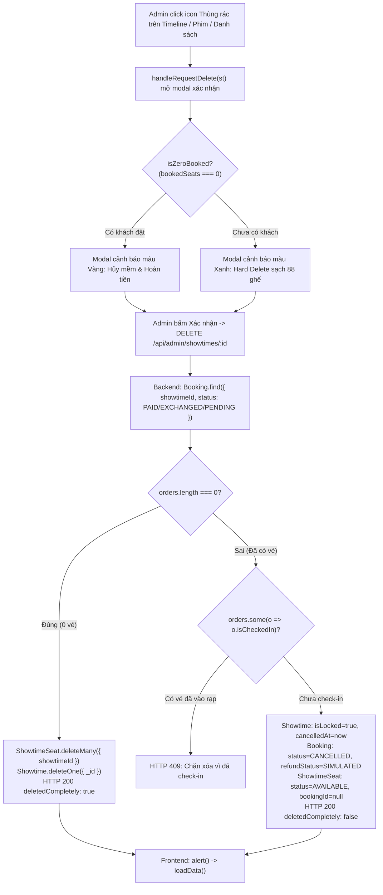

# BÁO CÁO KIỂM TOÁN SOURCE CODE TRƯỚC KHI TRIỂN KHAI QUẢN LÝ VÀ XÓA SUẤT CHIẾU HÀNG LOẠT
**Dự án:** D'AVENOR CINEMA (`movietix-project`)  
**Thời điểm kiểm toán:** 24/11/2026  
**Trạng thái kiểm toán:** CHỈ ĐỌC, PHÂN TÍCH VÀ XUẤT BÁO CÁO. CHƯA THAY ĐỔI SOURCE CODE VÀ CHƯA THAY ĐỔI DATABASE.

---

## 1. CÂY THƯ MỤC CÁC FILE LIÊN QUAN

```
d:\CDIO\movietix-project\
├── backend\
│   └── src\
│       ├── controllers\
│       │   ├── adminController.js         # Chứa getAdminShowtimes, deleteShowtime, toggleShowtimeLock, commitRecurringShowtimes, scheduleInRoom, lockRoom
│       │   ├── bookingController.js       # Chứa assertSellableShowtime, claimSeats, releaseSeats, checkInBooking
│       │   ├── movieController.js         # Chứa getMovieSchedule (bị hở cancelledAt)
│       │   └── showtimeController.js      # Chứa getShowtimeById, getShowtimeSeats, getStoredShowtimeSeats
│       ├── middleware\
│       │   └── authMiddleware.js          # Chứa authenticateAdmin, authenticateCustomer
│       ├── models\
│       │   ├── AdminUser.js               # Model AdminUser
│       │   ├── AiChatLog.js               # Model lưu log trợ lý AI
│       │   ├── AiConfig.js                # Model cấu hình AI
│       │   ├── Booking.js                 # Model đơn đặt vé, trạng thái thanh toán & hoàn tiền
│       │   ├── Cinema.js                  # Model cụm rạp
│       │   ├── Concession.js              # Model bắp nước
│       │   ├── Expense.js                 # Model chi phí vận hành
│       │   ├── Movie.js                   # Model phim (kèm subdocument reviews)
│       │   ├── Room.js                    # Model phòng chiếu vật lý (scheduleRevision)
│       │   ├── Showtime.js                # Model suất chiếu (bookingRevision)
│       │   ├── ShowtimeSeat.js            # Model 88 ghế vật lý theo suất chiếu
│       │   ├── SupportTicket.js           # Model phiếu hỗ trợ
│       │   └── User.js                    # Model khách hàng/thành viên
│       ├── routes\
│       │   ├── adminRoutes.js             # Khai báo các endpoint admin quản trị suất chiếu
│       │   ├── bookingRoutes.js           # Khai báo endpoint đặt vé, check-in
│       │   ├── movieRoutes.js             # Khai báo endpoint lịch chiếu phía khách hàng
│       │   └── showtimeRoutes.js          # Khai báo endpoint tra cứu ghế suất chiếu
│       └── services\
│           ├── ai\
│           │   └── cinemaContextService.js# Context dữ liệu cho Chatbot AI (kiểm tra suất khả dụng)
│           ├── bookingPolicy.js           # Chính sách mở bán vé (opensMoreThanSevenDaysAhead, businessDate)
│           ├── pricingConfigService.js    # Bảng giá vé động theo phòng và khung giờ
│           └── statisticsService.js       # Báo cáo thống kê, doanh thu, vé bán
└── frontend\
    └── src\
        ├── components\
        │   ├── home\
        │   │   └── HomeQuickBooking.jsx   # Thanh đặt vé nhanh trên trang chủ
        │   └── movie-detail\
        │       └── MovieShowtimesSection.jsx # Khung chọn suất chiếu trang chi tiết phim
        ├── pages\
        │   ├── admin\
        │   │   ├── ShowtimeManagePage.jsx # Giao diện chính Quản lý Suất chiếu (Timeline, Movie, List, Delete Modal)
        │   │   └── statistics\
        │   │       └── drawers\
        │   │           └── ShowtimeDetailDrawer.jsx # Drawer chi tiết suất chiếu (nút Xóa suất)
        │   └── booking\
        │       ├── CheckoutPage.jsx       # Trang thanh toán đặt vé
        │       ├── SeatSelectionPage.jsx  # Trang chọn ghế 2D
        │       └── SeatSelection3DPage.jsx# Trang chọn ghế 3D
        └── services\
            └── api.js                     # Axios client kết nối backend API
```

---

## 2. SOURCE CODE THỰC TẾ CỦA TỪNG HÀM LIÊN QUAN

### 2.1. Frontend – `ShowtimeManagePage.jsx`

#### A. State quản lý suất chiếu, ngày xem và bộ lọc
*Đường dẫn:* `frontend/src/pages/admin/ShowtimeManagePage.jsx` (Dòng 28–70)
```javascript
const [showtimes, setShowtimes] = useState([]);
const [movies, setMovies] = useState([]);
const [cinemas, setCinemas] = useState([]);
const [rooms, setRooms] = useState([]);
const [pricingConfig, setPricingConfig] = useState(DEFAULT_PRICING_CONFIG);
const [loading, setLoading] = useState(true);

// Chế độ xem: 'timeline' (Theo phòng - mặc định), 'movie' (Theo phim), 'list' (Danh sách)
const [viewMode, setViewMode] = useState('timeline');

// Quản lý ngày đang xem (YYYY-MM-DD)
const todayStr = useMemo(() => {
  const now = new Date();
  const y = now.getFullYear();
  const m = String(now.getMonth() + 1).padStart(2, '0');
  const d = String(now.getDate()).padStart(2, '0');
  return `${y}-${m}-${d}`;
}, []);

const [viewDate, setViewDate] = useState(todayStr);

// Bộ lọc
const [filterMovieId, setFilterMovieId] = useState('ALL');
const [filterRoomType, setFilterRoomType] = useState('ALL');
const [quickFilter, setQuickFilter] = useState('ALL'); // 'ALL' | 'CONFLICTS' | 'MISSING_SEATS' | 'HIDE_CONFLICTS'

// Drawer chi tiết suất chiếu
const [drawerShowtimeId, setDrawerShowtimeId] = useState(null);

// Modal xóa đơn lẻ hiện tại
const [showtimeToDelete, setShowtimeToDelete] = useState(null);
const [isDeleting, setIsDeleting] = useState(false);
```

#### B. Cơ chế tải lại dữ liệu `loadData()`
*Đường dẫn:* `frontend/src/pages/admin/ShowtimeManagePage.jsx` (Dòng 131–185)
```javascript
const loadData = async () => {
  try {
    setLoading(true);
    const params = { viewDate };

    const [stResult, mResult, cResult, rResult, cfgResult] = await Promise.allSettled([
      api.get('/admin/showtimes', { params }),
      api.get('/movies'),
      api.get('/admin/cinemas'),
      api.get('/admin/rooms'),
      loadPricingConfig(true),
    ]);

    const activeCfg = (cfgResult.status === 'fulfilled' && cfgResult.value) || DEFAULT_PRICING_CONFIG;
    setPricingConfig(activeCfg);

    const stList = (stResult.status === 'fulfilled' && Array.isArray(stResult.value?.data)) ? stResult.value.data : [];
    const mList = (mResult.status === 'fulfilled' && Array.isArray(mResult.value?.data)) ? mResult.value.data : [];
    const cList = (cResult.status === 'fulfilled' && Array.isArray(cResult.value?.data)) ? cResult.value.data : [];
    const rList = (rResult.status === 'fulfilled' && Array.isArray(rResult.value?.data)) ? rResult.value.data : [];

    setShowtimes(stList);
    setMovies(mList);
    setCinemas(cList);
    setRooms(rList);
  } catch (err) {
    console.error('Lỗi khi tải dữ liệu suất chiếu:', err);
  } finally {
    setLoading(false);
  }
};
```

#### C. Hàm xử lý xóa suất chiếu hiện tại
*Đường dẫn:* `frontend/src/pages/admin/ShowtimeManagePage.jsx` (Dòng 666–690)
```javascript
// Mở modal xác nhận xóa / hủy suất chiếu
const handleRequestDelete = (st) => {
  setShowtimeToDelete(st);
};

// Thực hiện xóa suất chiếu sau khi xác nhận
const handleConfirmDelete = async () => {
  if (!showtimeToDelete) return;
  const id = showtimeToDelete.id || showtimeToDelete._id;
  try {
    setIsDeleting(true);
    const res = await api.delete(`/admin/showtimes/${id}`);
    const msg = res.data?.message || 'Đã xóa suất chiếu thành công!';
    alert(msg);
    if (drawerShowtimeId === id) {
      setDrawerShowtimeId(null);
    }
    setShowtimeToDelete(null);
    await loadData();
  } catch (err) {
    console.error('Lỗi khi xóa suất chiếu:', err);
    alert('Không thể xóa suất chiếu: ' + (err.response?.data?.message || err.message));
  } finally {
    setIsDeleting(false);
  }
};
```

#### D. Thao tác Click trên Timeline
*Đường dẫn:* `frontend/src/pages/admin/ShowtimeManagePage.jsx` (Dòng 1354–1366 và 1432–1474)
```javascript
// 1. Click vào khoảng trống Timeline -> Mở modal tạo suất tại giờ bấm
<div
  className="flex-1 relative bg-slate-950/20 cursor-pointer overflow-hidden"
  onClick={(e) => {
    if (e.target === e.currentTarget) {
      const rect = e.currentTarget.getBoundingClientRect();
      const clickX = e.clientX - rect.left;
      const ratio = clickX / rect.width;
      const clickedMinutes = Math.floor(ratio * totalTimelineMinutes) + startHour * 60;
      const hour = Math.floor(clickedMinutes / 60);
      const minute = Math.floor((clickedMinutes % 60) / 15) * 15;
      handleTimelineSlotClick(room, hour, minute);
    }
  }}
>

// 2. Click vào khối suất chiếu -> Mở Drawer chi tiết
<div
  onClick={(e) => {
    e.stopPropagation();
    setDrawerShowtimeId(st.id || st._id);
  }}
  className={`absolute border rounded-lg px-2 py-0.5 flex flex-col justify-between overflow-hidden shadow-lg hover:brightness-125 transition-all cursor-pointer z-10 group ${blockBg}`}
>
  {/* Nút thùng rác hiện khi hover */}
  <button
    type="button"
    onClick={(e) => {
      e.stopPropagation();
      handleRequestDelete(st);
    }}
    className="opacity-0 group-hover:opacity-100 hover:bg-red-500/30 p-0.5 rounded text-red-300 hover:text-white transition-all cursor-pointer"
  >
    <Trash2 className="w-3 h-3" />
  </button>
</div>
```

---

### 2.2. Backend – `backend/src/controllers/adminController.js`

#### A. Hàm `deleteShowtime`
*Đường dẫn:* `backend/src/controllers/adminController.js` (Dòng 923–990)
```javascript
export const deleteShowtime = async (req, res) => {
  const { id } = req.params;
  if (!mongoose.isObjectIdOrHexString(id)) return res.sendStatus(400);

  try {
    const slot = await Showtime.findById(id);
    if (!slot) {
      return res.status(404).json({ message: 'Không tìm thấy suất chiếu cần xóa hoặc suất đã bị xóa.' });
    }

    // Kiểm tra các đơn đặt vé gắn với suất chiếu này
    const orders = await Booking.find({
      showtimeId: slot._id,
      status: { $in: ['PAID', 'EXCHANGED', 'PENDING'] },
    }).lean();

    // TRƯỜNG HỢP 1: Suất chiếu chưa có bất kỳ đơn đặt vé nào (0 vé)
    // -> Xóa sạch hoàn toàn (Hard delete) để không để lại rác trong database
    if (!orders || orders.length === 0) {
      await ShowtimeSeat.deleteMany({ showtimeId: slot._id });
      await Showtime.deleteOne({ _id: slot._id });

      return res.json({
        success: true,
        deletedCompletely: true,
        message: 'Đã xóa hoàn toàn suất chiếu và giải phóng toàn bộ ghế phòng chiếu thành công!',
      });
    }

    // TRƯỜNG HỢP 2: Suất chiếu đã có khách đặt vé
    // Kiểm tra xem đã có vé nào check-in vào rạp chưa
    if (orders.some(order => order.isCheckedIn)) {
      return res.status(409).json({
        message: 'Không thể xóa suất chiếu: Đã có vé được check-in vào phòng chiếu.',
      });
    }

    // Thực hiện hủy mềm và bảo tồn lịch sử đơn hàng
    await Showtime.findByIdAndUpdate(slot._id, {
      $set: {
        isLocked: true,
        cancelledAt: new Date(),
        cancelReason: 'Hủy bởi Admin quản lý rạp',
      },
    });

    const orderIds = orders.map(o => o._id);
    await Booking.updateMany(
      { _id: { $in: orderIds } },
      { $set: { status: 'CANCELLED', refundStatus: 'SIMULATED' } }
    );

    await ShowtimeSeat.updateMany(
      { showtimeId: slot._id },
      { $set: { status: 'AVAILABLE', bookingId: null } }
    );

    return res.json({
      success: true,
      deletedCompletely: false,
      affectedOrdersCount: orders.length,
      message: `Đã hủy suất chiếu thành công. Có ${orders.length} đơn đặt vé bị ảnh hưởng đã được chuyển sang trạng thái hủy và ghi nhận hoàn tiền.`,
    });
  } catch (error) {
    console.error('Lỗi khi xóa suất chiếu:', error);
    return res.status(500).json({ message: 'Lỗi máy chủ khi xóa suất chiếu: ' + error.message });
  }
};
```

#### B. Hàm `lockRoom` & `scheduleInRoom`
*Đường dẫn:* `backend/src/controllers/adminController.js` (Dòng 261–331)
```javascript
async function lockRoom(roomId, session) {
  const room = await Room.findOneAndUpdate(
    { _id: roomId, status: 'ACTIVE' }, { $inc: { scheduleRevision: 1 } }, { new: true, session }
  );
  if (!room) throw new ScheduleConflict('Phòng không có hoặc đang bảo trì.');
  return room;
}

async function scheduleInRoom({ room, movie, start, price, pricing, session, formatFeature: fmtOverride }) {
  const duration = Number(movie.duration);
  const cleaningMinutes = 15;
  if (!Number.isFinite(duration) || duration <= 0) throw new ScheduleConflict('Phim chưa có thời lượng hợp lệ.');
  if (movie.releaseDate && businessDate(start) < businessDate(movie.releaseDate)) {
    throw new ScheduleConflict('Suất chiếu sớm hơn ngày khởi chiếu.');
  }
  const endTime = new Date(start.getTime() + duration * 60000);
  const blockedUntil = endTime.getTime() + cleaningMinutes * 60000;

  const existing = await Showtime.find({
    $or: [{ roomId: room._id }, { roomId: null, cinemaId: room.cinemaId, roomName: { $in: [room.name, room.shortName].filter(Boolean) } }],
    cancelledAt: null,
  }).select('movieId startTime endTime cleaningMinutes').populate('movieId', 'duration').session(session).lean();
  const overlaps = existing.some(slot => {
    const legacyDuration = Number(slot.movieId?.duration) || 120;
    const slotStart = slot.startTime.getTime();
    const slotEnd = slot.endTime?.getTime() ?? (slotStart + legacyDuration * 60000);
    const slotClean = (slot.cleaningMinutes ?? cleaningMinutes) * 60000;
    const slotBlockedUntil = slotEnd + slotClean;
    return start.getTime() < slotBlockedUntil && blockedUntil > slotStart;
  });
  if (overlaps) throw new ScheduleConflict('Khung giờ chồng lịch chiếu hoặc không đủ 15 phút dọn dẹp vệ sinh phòng.');

  // Tạo 88 ghế vật lý (fallback ma trận A-H x 11 cột)
  let seatTemplates = [];
  const rows = ['A', 'B', 'C', 'D', 'E', 'F', 'G', 'H'];
  for (const r of rows) {
    const type = ['E', 'F', 'G'].includes(r) ? 'VIP' : (r === 'H' ? 'SWEETBOX' : 'STANDARD');
    for (let c = 1; c <= 11; c++) {
      seatTemplates.push({ row: r, col: c, seatNumber: `${r}${c}`, type });
    }
  }

  const calculated = calculatePricesFromConfig({
    roomName: room.name, roomType: room.roomType, formatFeature: room.formatFeature, startTime: start,
  }, pricing);
  const [showtime] = await Showtime.create([{
    movieId: movie._id, cinemaId: room.cinemaId, roomId: room._id, roomName: room.name,
    formatFeature: fmtOverride ?? room.formatFeature, startTime: start, endTime, cleaningMinutes,
    price: price ?? calculated.priceStandard,
  }], { session });
  await ShowtimeSeat.insertMany(seatTemplates.map(({ row, col, seatNumber, type }) => ({
    roomId: room._id, showtimeId: showtime._id, row, col, seatNumber, type, status: 'AVAILABLE',
  })), { session });
  return showtime;
}
```

#### C. Hàm `toggleShowtimeLock`
*Đường dẫn:* `backend/src/controllers/adminController.js` (Dòng 1814–1834)
```javascript
export const toggleShowtimeLock = async (req, res) => {
  try {
    const { id } = req.params;
    if (!mongoose.Types.ObjectId.isValid(id)) {
      return res.status(400).json({ message: 'ID suất chiếu không hợp lệ' });
    }
    const showtime = await Showtime.findById(id);
    if (!showtime) {
      return res.status(404).json({ message: 'Không tìm thấy suất chiếu' });
    }
    if (showtime.cancelledAt) return res.status(409).json({ message: 'Suất đã hủy.' });
    showtime.isLocked = !showtime.isLocked;
    await showtime.save();
    res.json({
      success: true,
      isLocked: showtime.isLocked,
      message: showtime.isLocked ? 'Đã khóa suất chiếu thành công' : 'Đã mở khóa suất chiếu thành công',
    });
  } catch (error) {
    res.status(500).json({ message: 'Lỗi cập nhật trạng thái khóa suất chiếu', error: error.message });
  }
};
```

---

### 2.3. Backend – `backend/src/controllers/bookingController.js`

#### Hàm `assertSellableShowtime` (Khóa lạc quan bảo vệ đơn đặt vé)
*Đường dẫn:* `backend/src/controllers/bookingController.js` (Dòng 21–31)
```javascript
async function assertSellableShowtime(showtime, session) {
  const result = await Showtime.updateOne({
    _id: showtime._id,
    startTime: { $gt: new Date() },
    roomId: showtime.roomId,
    price: showtime.price,
    isLocked: { $ne: true },
    cancelledAt: null,
  }, { $inc: { bookingRevision: 1 } }, { session });
  if (result.modifiedCount !== 1) throw new BookingConflict('Suất chiếu vừa thay đổi. Vui lòng tải lại.');
}
```

---

## 3. SCHEMA VÀ INDEXES MONGODB

### 3.1. `Showtime.js`
```javascript
const showtimeSchema = new mongoose.Schema({
  movieId: { type: mongoose.Schema.Types.ObjectId, ref: 'Movie', required: true, index: true },
  cinemaId: { type: mongoose.Schema.Types.ObjectId, ref: 'Cinema', index: true },
  roomId: { type: mongoose.Schema.Types.ObjectId, ref: 'Room', index: true },
  roomName: { type: String, required: true, default: 'Phòng 01 - 2D' },
  formatFeature: { type: String, default: '' },
  startTime: { type: Date, required: true, index: true },
  endTime: Date,
  cancelledAt: Date,
  bookingRevision: { type: Number, default: 0, select: false },
  cleaningMinutes: { type: Number, min: 0 },
  price: { type: Number, required: true, default: 95000 },
  isLocked: { type: Boolean, default: false },
}, { timestamps: true });

// Indexes:
showtimeSchema.index({ movieId: 1, startTime: 1 });
showtimeSchema.index({ roomId: 1, startTime: 1, cancelledAt: 1 });
```
> [!IMPORTANT]
> **Trường đợt tạo lịch:** `batchId`, `scheduleBatchId`, `recurringGroupId`, `requestId` **CHƯA CÓ** trong schema `Showtime`.  
> Không có trường nào lưu `createdBy` (Admin ID tạo suất).

### 3.2. `ShowtimeSeat.js`
```javascript
const showtimeSeatSchema = new mongoose.Schema({
  showtimeId: { type: mongoose.Schema.Types.ObjectId, ref: 'Showtime', required: true, index: true },
  roomId: { type: mongoose.Schema.Types.ObjectId, ref: 'Room', index: true },
  seatNumber: { type: String, required: true },
  row: { type: String, required: true },
  col: { type: Number, required: true },
  type: { type: String, enum: ['STANDARD', 'VIP', 'SWEETBOX'], default: 'STANDARD' },
  status: { type: String, enum: ['AVAILABLE', 'HOLDING', 'BOOKED'], default: 'AVAILABLE', index: true },
  holdExpiresAt: { type: Date, default: null },
  bookingId: { type: mongoose.Schema.Types.ObjectId, ref: 'Booking', default: null },
}, { timestamps: true });

// Indexes:
showtimeSeatSchema.index({ showtimeId: 1, seatNumber: 1 }, { unique: true });
showtimeSeatSchema.index({ showtimeId: 1, status: 1, holdExpiresAt: 1 });
```

### 3.3. `Booking.js`
```javascript
const bookingSchema = new mongoose.Schema({
  bookingCode: { type: String, required: true, unique: true, index: true },
  requestSignature: { type: String, select: false },
  userId: { type: mongoose.Schema.Types.ObjectId, ref: 'User' },
  movieId: { type: mongoose.Schema.Types.ObjectId, ref: 'Movie' },
  roomId: { type: mongoose.Schema.Types.ObjectId, ref: 'Room' },
  showtimeId: { type: mongoose.Schema.Types.ObjectId, ref: 'Showtime', required: true }, // LƯU Ý: Chưa có index: true ở field này!
  customerName: { type: String, required: true, trim: true },
  customerPhone: { type: String, required: true, trim: true },
  customerEmail: { type: String, default: '', trim: true },
  seats: { type: String, required: true }, // "A1, A2"
  concessions: { type: String, default: '' },
  totalAmount: { type: Number, required: true },
  status: { type: String, enum: ['PENDING', 'PAID', 'CANCELLED', 'EXCHANGED'], default: 'PAID' },
  paymentStatus: { type: String, enum: ['PENDING', 'SIMULATED', 'VERIFIED', 'FAILED', 'LEGACY_UNVERIFIED'], default: 'LEGACY_UNVERIFIED' },
  priceSnapshot: {
    tickets: [{ _id: false, seatNumber: String, price: Number }],
    combos: [{ _id: false, concessionId: mongoose.Schema.Types.ObjectId, name: String, flavor: String, quantity: Number, price: Number }],
    voucherCode: String,
    discount: Number,
  },
  paymentMethod: { type: String, enum: ['MOMO', 'VNPAY', 'CASH', 'ATM', 'VISA'], default: 'MOMO' },
  qrToken: { type: String, default: null, index: true },
  isCheckedIn: { type: Boolean, default: false },
  checkedInAt: { type: Date, default: null },
  refundStatus: { type: String, enum: ['NONE', 'SIMULATED', 'PENDING', 'REFUNDED', 'FAILED'], default: 'NONE' },
  refundAmount: { type: Number, default: 0 },
  exchangeHistory: { type: Array, default: [] },
}, { timestamps: true });
```

### 3.4. Bảng tổng hợp trạng thái các Model liên quan

| Model | Tồn tại thực tế? | Vai trò trong hệ thống |
|---|---|---|
| `Showtime` | **CÓ** | Lưu suất chiếu, phòng, giờ, trạng thái hủy `cancelledAt`, khóa `isLocked` |
| `ShowtimeSeat` | **CÓ** | 88 ghế theo suất, trạng thái ghế `AVAILABLE/HOLDING/BOOKED` |
| `Booking` | **CÓ** | Lưu đơn vé, trạng thái thanh toán, hoàn tiền, check-in |
| `Room` | **CÓ** | Phòng chiếu vật lý, `scheduleRevision` |
| `Movie` | **CÓ** | Danh mục phim, thời lượng, thể loại |
| `User` | **CÓ** | Khách hàng và quản trị viên |
| `Payment` | **CHƯA CÓ RIÊNG** | Gộp trực tiếp trong `Booking.paymentStatus`, `Booking.paymentMethod` |
| `Ticket` | **CHƯA CÓ RIÊNG** | Gộp trong `ShowtimeSeat` + chuỗi `Booking.seats` + `Booking.priceSnapshot.tickets` |
| `Refund` | **CHƯA CÓ RIÊNG** | Gộp trong `Booking.refundStatus` và `Booking.refundAmount` |
| `Review` | **CHƯA CÓ RIÊNG** | Lưu dạng mảng nhúng `Movie.reviews[]` |
| `Notification`| **CHƯA CÓ** | Chưa có bảng thông báo |
| `AuditLog` | **CHƯA CÓ** | Chưa có bảng ghi nhật ký hành động Admin |

---

## 4. DANH SÁCH API HIỆN CÓ LIÊN QUAN

| Method | Endpoint | Quyền (Auth) | Controller | Mục đích |
|---|---|---|---|---|
| `GET` | `/api/admin/showtimes` | `authenticateAdmin` | `getAdminShowtimes` | Lấy danh sách suất chiếu ngày xem, tính ghế đã đặt, gắn cờ va chạm |
| `POST` | `/api/admin/showtimes` | `authenticateAdmin` | `createShowtime` | Tạo 1 suất chiếu đơn lẻ kèm 88 ghế |
| `PUT` | `/api/admin/showtimes/:id` | `authenticateAdmin` | `updateShowtime` | Sửa giá vé hoặc thông tin suất |
| `DELETE` | `/api/admin/showtimes/:id` | `authenticateAdmin` | `deleteShowtime` | Xóa 1 suất (Hard delete nếu 0 vé, Soft delete nếu có vé) |
| `PUT` | `/api/admin/showtimes/:id/toggle-lock` | `authenticateAdmin` | `toggleShowtimeLock` | Khóa / mở khóa bán vé 1 suất chiếu |
| `GET` | `/api/admin/showtimes/:id/bookings` | `authenticateAdmin` | `getShowtimeBookings` | Xem danh sách đơn vé của 1 suất chiếu |
| `POST` | `/api/admin/showtimes/recurring/preview` | `authenticateAdmin` | `previewRecurringShowtimes` | Kiểm tra va chạm & xem trước lịch lặp (Read-only) |
| `POST` | `/api/admin/showtimes/recurring/commit` | `authenticateAdmin` | `commitRecurringShowtimes` | Tạo hàng loạt suất chiếu lặp đã duyệt (Per-slot tx) |
| `POST` | `/api/admin/showtimes/schedule-batch` | `authenticateAdmin` | `batchScheduleShowtimes` | Xếp lịch hàng loạt ma trận phòng/phim |

> [!WARNING]
> **Endpoint xóa hàng loạt:** **CHƯA CÓ**. Hiện tại Admin chỉ có thể xóa từng suất một (`DELETE /api/admin/showtimes/:id`).

---

## 5. REQUEST VÀ RESPONSE THỰC TẾ

### 5.1. Xóa 1 suất chưa có đơn vé (Hard Delete)
**Request:**
```http
DELETE /api/admin/showtimes/6b01b7b4fe378d805c7c186f
Authorization: Bearer <ADMIN_JWT_TOKEN>
```
**Response (HTTP 200 OK):**
```json
{
  "success": true,
  "deletedCompletely": true,
  "message": "Đã xóa hoàn toàn suất chiếu và giải phóng toàn bộ ghế phòng chiếu thành công!"
}
```

### 5.2. Hủy 1 suất đã có khách đặt vé (Soft Delete)
**Request:**
```http
DELETE /api/admin/showtimes/6b01b7b4fe378d805c7c1875
Authorization: Bearer <ADMIN_JWT_TOKEN>
```
**Response (HTTP 200 OK):**
```json
{
  "success": true,
  "deletedCompletely": false,
  "affectedOrdersCount": 2,
  "message": "Đã hủy suất chiếu thành công. Có 2 đơn đặt vé bị ảnh hưởng đã được chuyển sang trạng thái hủy và ghi nhận hoàn tiền."
}
```

### 5.3. Hủy 1 suất có vé đã Check-in (Bị chặn)
**Response (HTTP 409 Conflict):**
```json
{
  "message": "Không thể xóa suất chiếu: Đã có vé được check-in vào phòng chiếu."
}
```

---

## 6. LUỒNG XÓA MỘT SUẤT HIỆN TẠI



---

## 7. LUỒNG HỦY SUẤT HIỆN TẠI

1. **Khóa bán tức thì:** Đặt `Showtime.isLocked = true` và `Showtime.cancelledAt = new Date()`.
2. **Bảo tồn dữ liệu kế toán:** `Booking` document không bị xóa mà chuyển `status = 'CANCELLED'`, `refundStatus = 'SIMULATED'`. Doanh thu trong quá khứ được điều chỉnh theo luồng hoàn tiền, không bị mất vết lịch sử.
3. **Giải phóng ghế phòng:** Toàn bộ ghế trong `ShowtimeSeat` được chuyển về `status = 'AVAILABLE'`, `bookingId = null` để phòng chiếu sẵn sàng nhận suất chiếu thay thế nếu cần.
4. **Chốt chặn an toàn:** Nếu có bất kỳ vé nào trong đơn hàng đã qua cửa kiểm soát (`isCheckedIn === true`), hệ thống từ chối hủy ngay lập tức với mã HTTP 409.

---

## 8. LUỒNG TẠO LỊCH LẶP VỪA TRIỂN KHAI

Luồng khi tạo đợt lặp (Ví dụ: Deadpool, Phòng 07, 24/11–30/11, 5 khung giờ = 35 suất):
1. **Frontend:**
   - Admin chọn khoảng ngày, ngày trong tuần, các khung giờ.
   - Bấm "Kiểm tra & Xem trước" $\rightarrow$ gọi `POST /api/admin/showtimes/recurring/preview`.
   - Backend quét đọc `Showtime` hiện có + quét intra-batch, trả về danh sách `validSlots` (Hợp lệ) và `conflictSlots` (Xung đột).
   - Frontend hiển thị bảng xem trước. Admin có thể loại bỏ từng slot (`previewRemovedKeys`).
   - Bấm "Xác nhận tạo N suất" $\rightarrow$ sinh chuỗi `requestId` ngẫu nhiên và gửi danh sách confirmedSlots đến `POST /api/admin/showtimes/recurring/commit`.
2. **Backend Commit:**
   - Kiểm tra `_recurringRequestCache.has(requestId)` chống click đúp / replay.
   - Chạy vòng lặp duyệt từng slot: **Mỗi slot là 1 MongoDB Transaction độc lập**:
     - `lockRoom(roomId, session)` $\rightarrow$ tăng `scheduleRevision`.
     - `scheduleInRoom(...)` $\rightarrow$ tạo `Showtime` + chèn 88 document `ShowtimeSeat`.
   - Trả về danh sách `created: [{ id, movieId, roomId, startTime, ... }]`.

---

## 9. CƠ CHẾ XÁC ĐỊNH ĐỢT TẠO LỊCH

### Phân tích hiện trạng thực tế:
- **Câu hỏi 1: Các suất có được liên kết thành cùng một đợt tạo lịch không?**  
  $\rightarrow$ **KHÔNG**. Trong MongoDB `Showtime` collection, không có trường nào lưu `batchId` hay `recurringGroupId`. Mỗi suất chiếu tồn tại hoàn toàn độc lập.
- **Câu hỏi 2: Backend có trả về danh sách Showtime ID đã tạo không?**  
  $\rightarrow$ **CÓ**. API `commitRecurringShowtimes` có trả về mảng `created: [{ id: String(showtime._id), ... }]` ngay trong phản hồi lúc vừa commit xong.
- **Câu hỏi 3: Có lưu thông tin Admin tạo lịch không?**  
  $\rightarrow$ **KHÔNG**. Model `Showtime` không có trường `createdBy` hay `adminId`.
- **Câu hỏi 4: Có phân biệt các suất tạo thủ công và tạo lặp không?**  
  $\rightarrow$ **KHÔNG**. Schema lưu giống hệt nhau giữa suất đơn lẻ và suất tạo lặp.
- **Câu hỏi 5: Có thể truy xuất chính xác toàn bộ suất thuộc một đợt sau này không?**  
  $\rightarrow$ **KHÔNG THỂ TRUY XUẤT NẾU CHỈ DỰA VÀO DATABASE HIỆN TẠI**. Sau khi đóng modal hoặc tải lại trang, thông tin liên kết đợt bị mất hoàn toàn (chỉ còn thời gian `createdAt` gần nhau, nhưng không an toàn để làm khóa nhận diện).
- **Câu hỏi 6: Có thể hoàn tác (Undo) đợt tạo lịch vừa thực hiện không?**  
  $\rightarrow$ **CHỈ LÀM ĐƯỢC NGAY TẠI BƯỚC VỪA COMMIT XONG** (nếu Frontend giữ mảng `created` ID trong memory). Khi Admin F5 lại trang thì **CHƯA THỂ HOÀN TÁC ĐƯỢC** nếu DB chưa bổ sung trường nhận diện đợt.

> [!NOTE]
> **Đề xuất giải pháp kiến trúc (Chưa áp dụng vào schema ở phase này):**  
> Khi bước vào triển khai, có thể bổ sung trường `batchId: { type: String, default: null, index: true }` vào `Showtime.js`. Khi tạo lặp, sinh 1 mã `BATCH-YYYYMMDD-UUID` gán cho toàn bộ 35 suất đó. Khi cần xóa toàn bộ đợt, chỉ cần truy vấn `Showtime.find({ batchId })`.

---

## 10. CƠ CHẾ BẢO VỆ BOOKING VÀ PAYMENT

### 10.1. Bảo vệ khi đặt vé (`createBooking`)
Hàm `assertSellableShowtime` trong `bookingController.js` (dòng 22–30) sử dụng cơ chế **Atomic Update Condition**:
```javascript
Showtime.updateOne({
  _id: showtime._id,
  startTime: { $gt: new Date() },
  isLocked: { $ne: true },
  cancelledAt: null,
}, { $inc: { bookingRevision: 1 } }, { session });
```
- Nếu Admin xóa suất (Hard delete): Document không còn tồn tại $\rightarrow$ `modifiedCount === 0` $\rightarrow$ ném `BookingConflict`, giao dịch của khách bị hủy an toàn, không thể thanh toán vé ma.
- Nếu Admin hủy suất (Soft delete): `cancelledAt` khác null và `isLocked === true` $\rightarrow$ `modifiedCount === 0` $\rightarrow$ ném `BookingConflict`.

### 10.2. Lỗ hổng tiềm ẩn giữa giao diện và MongoDB
- Trên giao diện Timeline và Danh sách: `st.bookedSeats` được lấy từ `ShowtimeSeat.countDocuments({ status: 'BOOKED' })`.
- **Rủi ro:** Nếu một suất có đơn hàng đang ở trạng thái `PENDING` (chờ thanh toán), ghế có thể đang ở trạng thái `HOLDING` chứ không phải `BOOKED`. Nếu Admin chỉ nhìn số `0/88` trên giao diện và tưởng là an toàn để xóa:
  - Hàm `deleteShowtime` ở backend có chốt chặn kiểm tra:  
    `Booking.find({ showtimeId: slot._id, status: { $in: ['PAID', 'EXCHANGED', 'PENDING'] } })`.
  - Nếu có đơn `PENDING`, backend sẽ không xóa sạch mà đưa vào luồng hủy mềm.
  - **Tuy nhiên**, đối với xóa hàng loạt, nếu chỉ dựa vào `bookedSeats === 0` từ frontend gửi lên là **CỰC KỲ NGUY HIỂM**. Backend bắt buộc phải tự query lại database cho từng suất trước khi xóa!

---

## 11. CƠ CHẾ TRANSACTION VÀ CONCURRENCY

1. **Thiếu sót nghiêm trọng trong hàm `deleteShowtime` hiện tại:**
   - `deleteShowtime` hiện **KHÔNG DÙNG TRANSACTION**!
   - Đoạn mã:
     ```javascript
     await ShowtimeSeat.deleteMany({ showtimeId: slot._id });
     await Showtime.deleteOne({ _id: slot._id });
     ```
     Nếu máy chủ bị ngắt kết nối giữa 2 dòng này: 88 ghế bị xóa nhưng suất chiếu vẫn còn $\rightarrow$ sinh ra suất chiếu mồ côi (không có ghế).
   - `Room.scheduleRevision` **không được cập nhật** khi xóa suất.
2. **Cơ chế Transaction trong các hàm khác:**
   - `createShowtime`, `scheduleInRoom`, `createBooking`, `exchangeBookingTickets` đều bọc trong `mongoose.connection.transaction(session => ...)`.
   - `commitRecurringShowtimes` sử dụng Per-slot Independent Transaction.
3. **Cơ chế Idempotency:**
   - Đặt vé dùng `Idempotency-Key` header và `requestSignature` mã hóa SHA-256.
   - Commit lịch lặp dùng `requestId` cache in-process `Set` trong 10 phút.
   - API xóa hiện tại: **CHƯA CÓ Idempotency check**. Nếu Admin bấm nhanh nhiều lần có thể gây lỗi 404 cho lần bấm thứ 2.

---

## 12. CÁC LỖI VÀ RỦI RO PHÁT HIỆN ĐƯỢC

### 🔴 Lỗi 1: `movieController.js` không lọc suất đã hủy (`cancelledAt: null`)
*Vị trí:* `backend/src/controllers/movieController.js` (Dòng 221–226)
```javascript
const showtimes = localRelease && date < localRelease
  ? [] : await Showtime.find({
  movieId: movie._id,
  startTime: { $gte: start, $lt: new Date(start.getTime() + dayMs) },
  // THIẾU: cancelledAt: null và isLocked: false
})
```
*Hậu quả:* Khi Admin hủy suất chiếu (Soft Delete), suất đó **vẫn hiển thị trên trang lịch chiếu của khách hàng**! Khách bấm vào mới bị báo lỗi hoặc thấy suất bị khóa.

### 🔴 Lỗi 2: Trợ lý AI gợi ý suất đã hủy do thiếu projection `isLocked`
*Vị trí:* `backend/src/services/ai/cinemaContextService.js` (Dòng 582)
```javascript
.select('movieId cinemaId roomId roomName formatFeature startTime price')
```
*Hậu quả:* Vì câu query không select trường `isLocked`, khi kiểm tra `st.isLocked` giá trị luôn là `undefined`. AI vẫn có thể gợi ý suất chiếu đã bị Admin khóa hoặc hủy!

### 🟡 Lỗi 3: `deleteShowtime` không dùng Mongoose Transaction
*Vị trí:* `backend/src/controllers/adminController.js` (Dòng 942–978)
*Hậu quả:* Không đảm bảo tính nguyên tử (Atomicity). Nếu quá trình xóa/hủy ghế hoặc đơn hàng bị gián đoạn, database sẽ rơi vào trạng thái bất nhất.

### 🟡 Lỗi 4: Model `Booking` thiếu index trên trường `showtimeId`
*Vị trí:* `backend/src/models/Booking.js` (Dòng 15–19)
*Hậu quả:* Khi xóa hàng loạt 50 suất chiếu, hệ thống phải gọi `Booking.find({ showtimeId: ... })` 50 lần. Việc thiếu index trên `showtimeId` sẽ gây Full Collection Scan, làm nghẽn CPU MongoDB khi database có nhiều đơn hàng.

### 🟡 Lỗi 5: Chưa có trường nhận diện đợt tạo lịch (`batchId`)
*Hậu quả:* Không thể hỗ trợ tính năng "Hoàn tác đợt vừa tạo" hoặc "Xóa toàn bộ đợt lặp" một cách chính xác sau khi reload trang.

---

## 13. CÁC CHỨC NĂNG CÓ THỂ TÁI SỬ DỤNG

1. **Phân loại Hard Delete vs Soft Delete trong `deleteShowtime`:** Logic phân nhánh (0 đơn vé $\rightarrow$ xóa sạch; có đơn vé $\rightarrow$ hủy mềm + hoàn tiền giả lập; có vé check-in $\rightarrow$ chặn) là logic cốt lõi rất chuẩn, cần được tái sử dụng nguyên vẹn cho từng suất trong luồng xóa hàng loạt.
2. **Cơ chế Preview 2 bước (Preview & Commit):** Tái sử dụng mô hình của `previewRecurringShowtimes` / `commitRecurringShowtimes`:
   - Bước 1: Preview chỉ đọc, phân loại danh sách ID thành: Đủ điều kiện xóa sạch, Phải hủy mềm, Bị chặn xóa (kèm lý do).
   - Bước 2: Commit với `requestId` chống trùng lặp.
3. **Cơ chế Per-slot Transaction:** Tái sử dụng để 1 suất gặp lỗi không làm sập toàn bộ đợt xóa của các suất hợp lệ khác.
4. **Modal tóm tắt xác nhận:** Tái sử dụng giao diện modal của `showtimeToDelete` để mở rộng thành Modal Xóa hàng loạt.

---

## 14. CÁC CHỨC NĂNG CÒN THIẾU

1. **API Backend:**
   - `POST /api/admin/showtimes/bulk-delete/preview` (CHƯA CÓ).
   - `POST /api/admin/showtimes/bulk-delete/commit` (CHƯA CÓ).
2. **Frontend UI:**
   - Chế độ chọn nhiều suất (Selection Mode / Checkbox trên Timeline, Movie card, List row) (CHƯA CÓ).
   - Thanh công cụ nổi (Floating Action Bar) khi đang chọn nhiều suất (CHƯA CÓ).
   - Bộ chọn nhanh: Chọn tất cả đang hiển thị, Chọn theo phòng, Chọn theo phim, Chọn theo khoảng giờ (CHƯA CÓ).
   - Modal xem trước danh sách xóa hàng loạt (CHƯA CÓ).
3. **Database Schema:**
   - Index cho `Booking.showtimeId` (CHƯA CÓ).
   - Trường `batchId` trong `Showtime.js` (CHƯA CÓ).
   - Hệ thống AuditLog ghi nhận Admin nào xóa những suất nào (CHƯA CÓ).

---

## 15. PHƯƠNG ÁN TRIỂN KHAI XÓA HÀNG LOẠT PHÙ HỢP

### 15.1. Thiết kế Giao diện Frontend (Không làm ảnh hưởng thao tác hiện tại)
1. **Thêm công tắc "Quản lý hàng loạt" (Bulk Mode Toggle):**
   - Đặt cạnh thanh điều hướng ngày hoặc bộ lọc: `[ ☑ Chọn nhiều ]`.
   - **Khi tắt (Mặc định):** Giữ nguyên 100% hành vi hiện tại: click khoảng trống tạo suất, click khối mở Drawer chi tiết, hover click thùng rác xóa đơn lẻ.
   - **Khi bật (Selection Mode):**
     - Trên mỗi khối Timeline, card Phim và dòng Danh sách xuất hiện ô Checkbox.
     - Click vào khối suất chiếu sẽ chuyển thành thao tác Toggle chọn / bỏ chọn (thêm/xóa ID trong `selectedShowtimeIds: Set`).
     - Xuất hiện **Thanh tác vụ nổi (Floating Action Bar)** ở đáy màn hình:
       - Hiển thị: `Đã chọn [X] suất chiếu`.
       - Các nút chọn nhanh: `Chọn tất cả trên màn hình`, `Bỏ chọn tất cả`.
       - Nút chính: `🗑️ Xóa [X] suất đã chọn` (màu đỏ Holographic).
2. **Quy trình Xác nhận & Xem trước 2 giai đoạn (Two-Phase Safety):**
   - Bấm nút Xóa $\rightarrow$ Mở Modal **"Xem trước & Xác nhận xóa hàng loạt"**.
   - Frontend gửi danh sách IDs lên `POST /api/admin/showtimes/bulk-delete/preview`.
   - Modal phân loại rõ 3 nhóm:
     - 🟢 **Nhóm 1 (Xóa hoàn toàn - Hard delete):** X suất chưa có vé.
     - 🟡 **Nhóm 2 (Hủy mềm & Hoàn tiền):** Y suất đã có khách đặt vé (hiển thị số vé và số tiền hoàn dự kiến).
     - 🔴 **Nhóm 3 (Bị chặn xóa):** Z suất có vé đã check-in hoặc suất đang chiếu (tự động loại ra khỏi đợt xóa).
   - Admin xác nhận $\rightarrow$ Gọi `POST /api/admin/showtimes/bulk-delete/commit` $\rightarrow$ Tải lại Timeline.

### 15.2. Thiết kế Backend API
1. **Endpoint `POST /api/admin/showtimes/bulk-delete/preview` (Read-only):**
   - Input: `{ showtimeIds: string[] }`.
   - Query DB lấy thông tin chi tiết từng suất và các đơn `Booking` liên quan.
   - Trả về: `{ hardDeleteSlots: [], softDeleteSlots: [], blockedSlots: [], summary: { total, canHardDelete, canSoftDelete, blocked } }`.
2. **Endpoint `POST /api/admin/showtimes/bulk-delete/commit`:**
   - Input: `{ showtimeIds: string[], requestId: string, reason?: string }`.
   - Kiểm tra `requestId` chống trùng lặp.
   - Lặp qua từng suất với **Mongoose Transaction riêng biệt**:
     - Kiểm tra lại an toàn (Re-validate điều kiện ngay tại thời điểm commit).
     - Nếu 0 vé $\rightarrow$ Hard delete (`ShowtimeSeat.deleteMany` + `Showtime.deleteOne`).
     - Nếu có vé & chưa check-in $\rightarrow$ Soft delete (`Showtime` cancelledAt, `Booking` CANCELLED, `ShowtimeSeat` AVAILABLE).
     - Nếu đã check-in $\rightarrow$ Đưa vào mảng `skipped` hoặc `failed`.
   - Trả về kết quả chi tiết từng suất.

---

## 16. DANH SÁCH FILE DỰ KIẾN CHỈNH SỬA VÀ LÝ DO

| STT | Đường dẫn file | Thao tác dự kiến | Lý do kỹ thuật |
|---|---|---|---|
| 1 | `backend/src/models/Booking.js` | Thêm index | Thêm `index: true` cho `showtimeId` để tối ưu truy vấn xóa hàng loạt |
| 2 | `backend/src/controllers/adminController.js` | Sửa & Thêm mới | - Sửa `deleteShowtime` bọc Mongoose Session Transaction.<br>- Thêm `previewBulkDeleteShowtimes`.<br>- Thêm `commitBulkDeleteShowtimes`. |
| 3 | `backend/src/controllers/movieController.js` | Sửa lỗi | Thêm `cancelledAt: null, isLocked: { $ne: true }` vào câu query `getMovieSchedule` để giấu suất đã hủy khỏi khách hàng |
| 4 | `backend/src/services/ai/cinemaContextService.js` | Sửa lỗi | Thêm `isLocked` và `cancelledAt` vào projection `.select(...)` dòng 582 để AI không tư vấn suất đã hủy |
| 5 | `backend/src/routes/adminRoutes.js` | Đăng ký route | Khai báo 2 endpoint `/showtimes/bulk-delete/preview` và `/showtimes/bulk-delete/commit` |
| 6 | `frontend/src/pages/admin/ShowtimeManagePage.jsx` | Thêm tính năng UI | Thêm State `isSelectionMode`, `selectedIds`, Checkbox trên Timeline/Movie/List, Thanh tác vụ nổi, Modal xác nhận hàng loạt |

---

## 17. DANH SÁCH KỊCH BẢN KIỂM THỬ CẦN THỰC HIỆN (TEST MATRIX)

| STT | Kịch bản kiểm thử | Hành vi mong đợi |
|---|---|---|
| 1 | Chọn 5 suất chưa có đơn vé nào (0 vé) | Preview xếp vào nhóm Hard Delete. Commit xóa sạch 5 suất và 440 ghế tương ứng. |
| 2 | Chọn 3 suất đã có Booking PAID (chưa check-in) | Preview xếp vào nhóm Soft Delete. Commit chuyển 3 suất sang cancelledAt, vé chuyển CANCELLED + SIMULATED refund, ghế chuyển AVAILABLE. |
| 3 | Chọn 1 suất đã có vé check-in vào rạp | Preview xếp vào nhóm BỊ CHẶN (Blocked). Commit bỏ qua suất này, không xóa. |
| 4 | Chọn hỗn hợp: 2 suất 0 vé + 2 suất có vé + 1 suất đã check-in | Xóa sạch 2 suất 0 vé, hủy mềm 2 suất có vé, giữ nguyên suất đã check-in. Báo cáo rõ số lượng từng loại. |
| 5 | Khách hàng mua vé đúng lúc Admin đang xem Preview xóa | Khi commit, backend re-validate thấy suất đã có vé $\rightarrow$ tự động chuyển từ Hard Delete sang Soft Delete (hoặc cảnh báo), không làm mất đơn vé của khách. |
| 6 | Kiểm tra Website khách hàng sau khi hủy suất | Suất bị hủy biến mất hoàn toàn khỏi danh sách chọn suất trang chi tiết phim. |
| 7 | Khách cố tình gửi request checkout suất đã bị xóa | API `createBooking` trả về lỗi 409 `BookingConflict`, giao dịch bị từ chối an toàn. |
| 8 | Bấm xác nhận xóa 2 lần liên tiếp (Click đúp) | `requestId` ngăn chặn request thứ 2 thực thi trùng lặp. |
| 9 | Kiểm tra Thống kê Dashboard sau khi xóa | Doanh thu các đơn của suất bị hủy được trừ ra khỏi doanh thu hợp lệ, số vé bán giảm tương ứng. |
| 10 | Bật tắt Selection Mode trên Timeline | Thao tác click xem chi tiết và click tạo suất ở khoảng trống vẫn hoạt động chuẩn xác khi tắt chế độ chọn. |

---

## 18. KẾT LUẬN VÀ KIẾN NGHỊ

Hệ thống hiện tại đã có nền tảng phân loại Hard Delete / Soft Delete rất chuẩn trong hàm `deleteShowtime`, tuy nhiên:
1. Còn thiếu hoàn toàn API và UI cho việc xử lý hàng loạt.
2. Tồn tại 2 lỗi hiển thị phía khách hàng (Website và Chatbot AI) khi suất chiếu bị hủy mềm.
3. Thiếu Mongoose Transaction trong hàm xóa đơn lẻ hiện tại.

**Khuyến nghị:** Sau khi báo cáo kiểm toán này được xem xét và phê duyệt, tiến hành triển khai theo 6 file đã liệt kê ở Mục 16 để đảm bảo hệ thống an toàn tuyệt đối, không mất mát dữ liệu tài chính và hoạt động mượt mà.
