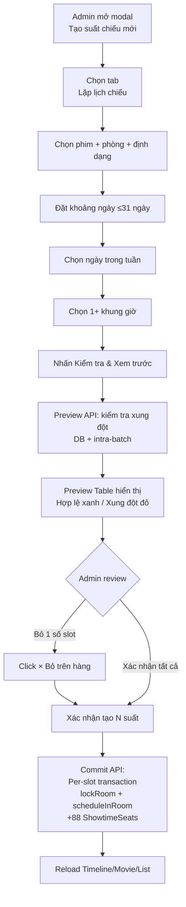

# SHOWTIME RECURRING IMPLEMENTATION REPORT – D'AVENOR CINEMA
> Generated: 2026-11-24  
> Session: Context-resumed from SHOWTIME_RECURRING_SOURCE_AUDIT.md

---

## 1. Tổng quan

Tính năng **Lặp lịch chiếu** đã được triển khai hoàn chỉnh vào modal "Tạo suất chiếu mới" tại `/admin/showtimes`. Admin có thể chọn 1 phim + 1 phòng + khoảng ngày + ngày trong tuần + nhiều khung giờ → xem trước → xác nhận tạo tất cả suất chiếu hợp lệ trong 1 thao tác.

### Deliverables

| Hạng mục | Trạng thái |
|---|---|
| Fix `movieController.js` month-filter bug | ✅ DONE |
| Fix `formatFeature` không được lưu từ request | ✅ DONE |
| Backend endpoint `POST /api/admin/showtimes/recurring/preview` | ✅ DONE |
| Backend endpoint `POST /api/admin/showtimes/recurring/commit` | ✅ DONE |
| Register routes trong `adminRoutes.js` | ✅ DONE |
| Frontend Segmented Control (Một ngày / Lặp lịch chiếu) | ✅ DONE |
| Frontend Recurring UI (date range, day picker, time picker, preview table) | ✅ DONE |
| `npm run build` → 0 errors | ✅ PASS |

---

## 2. Các file đã thay đổi

| File | Thay đổi |
|---|---|
| `backend/src/controllers/movieController.js` | Xóa điều kiện `date.slice(0,7) !== localRelease.slice(0,7)` khỏi `getMovieSchedule` |
| `backend/src/controllers/adminController.js` | Fix `scheduleInRoom` + `createShowtime` để lưu `formatFeature` từ request; Thêm `previewRecurringShowtimes` và `commitRecurringShowtimes` |
| `backend/src/routes/adminRoutes.js` | Import và register 2 route mới `/showtimes/recurring/preview` + `/showtimes/recurring/commit` |
| `frontend/src/pages/admin/ShowtimeManagePage.jsx` | Thêm state variables, handlers, Segmented Control và toàn bộ Recurring UI |

---

## 3. Chi tiết triển khai Backend

### 3.1 Fix movieController.js — Month Filter Bug

**Bug:** Dòng 220 có điều kiện `|| date.slice(0, 7) !== localRelease.slice(0, 7)` khiến khách hàng không thể xem lịch chiếu của phim ở tháng khác tháng khởi chiếu.

**Fix:** Chỉ giữ điều kiện `date < localRelease` (không hiển thị lịch trước ngày ra mắt). Xóa hoàn toàn điều kiện same-month.

```js
// TRƯỚC
const showtimes = localRelease && (date < localRelease || date.slice(0, 7) !== localRelease.slice(0, 7))
// SAU
const showtimes = localRelease && date < localRelease
```

### 3.2 Fix formatFeature trong createShowtime + scheduleInRoom

**Bug:** `createShowtime` không đọc `formatFeature` từ `req.body`. `scheduleInRoom` luôn dùng `room.formatFeature` thay vì giá trị admin chọn.

**Fix:**
- `scheduleInRoom` nhận thêm param `formatFeature: fmtOverride`, dùng `fmtOverride ?? room.formatFeature`.
- `createShowtime` destructure `formatFeature: bodyFormat` từ `req.body`, pass vào `scheduleInRoom`.
- Backward compatible: nếu không có `formatFeature` trong request → fallback về `room.formatFeature`.

### 3.3 previewRecurringShowtimes

**Endpoint:** `POST /api/admin/showtimes/recurring/preview` (protected by `authenticateAdmin`)

**Input:**
```json
{
  "movieId": "...", "roomId": "...", "cinemaId": "...", "formatFeature": "...",
  "startDate": "YYYY-MM-DD", "endDate": "YYYY-MM-DD",
  "daysOfWeek": [0,1,2,3,4,5,6],
  "timeSlots": ["09:00", "14:00", "19:00"],
  "pricingMode": "fixed" | "auto",
  "price": 80000
}
```

**Logic:**
1. Validate tất cả inputs, kiểm tra rangeDays ≤ 31.
2. Load movie, room (phải ACTIVE), pricing config.
3. Load tất cả showtime hiện có trong khoảng ngày (không CANCELLED).
4. Build `existingIntervals` với `blockedUntil = endTime + 15 phút`.
5. Với mỗi ngày × khung giờ: kiểm tra xung đột với `existingIntervals + batchIntervals` (intra-batch conflict detection).
6. Nếu valid → push vào `batchIntervals` và `validSlots`; nếu conflict → `conflictSlots`.
7. **KHÔNG tạo bất kỳ document nào** (read-only).
8. Return `{ validSlots, conflictSlots, validCount, conflictCount, totalExpected, slotAvailability }`.

### 3.4 commitRecurringShowtimes

**Endpoint:** `POST /api/admin/showtimes/recurring/commit` (protected by `authenticateAdmin`)

**Input:**
```json
{
  "confirmedSlots": [{ "movieId", "roomId", "cinemaId", "formatFeature", "startTime", "price" }],
  "requestId": "unique-string-for-idempotency"
}
```

**Logic:**
1. `requestId` idempotency: in-process `Set` cache, auto-evict sau 10 phút.
2. Validate array length ≤ 200.
3. Per-slot **independent transactions**: mỗi slot gọi `mongoose.connection.transaction(session => { lockRoom → scheduleInRoom })` riêng lẻ.
4. Nếu 1 slot fail (conflict hoặc lỗi) → chỉ rollback slot đó, các slot khác vẫn thành công.
5. Return `{ created, conflicts, failed, skipped }`. HTTP 201 nếu tất cả thành công, 207 nếu có lỗi một phần.

---

## 4. Chi tiết triển khai Frontend

### 4.1 State mới (ShowtimeManagePage.jsx)

```js
const [createMode, setCreateMode] = useState('single'); // 'single' | 'recurring'
const [recurringData, setRecurringData] = useState({
  startDate: '', endDate: '',
  daysOfWeek: [0,1,2,3,4,5,6],
  timeSlots: [],
  pricingMode: 'fixed',
  manualTimeInput: '',
});
const [recurringPreview, setRecurringPreview] = useState(null);
const [recurringLoading, setRecurringLoading] = useState(false);
const [recurringCommitting, setRecurringCommitting] = useState(false);
const [previewFilter, setPreviewFilter] = useState('ALL');
const [previewRemovedKeys, setPreviewRemovedKeys] = useState(new Set());
```

### 4.2 Handlers mới

| Handler | Mục đích |
|---|---|
| `handleRecurringQuickRange(days)` | Đặt endDate = startDate + N ngày |
| `handleRecurringEndOfMonth()` | Đặt endDate = cuối tháng của startDate |
| `toggleDayOfWeek(day)` | Thêm/bỏ ngày trong tuần |
| `toggleRecurringSlot(time)` | Thêm/bỏ khung giờ |
| `addManualTimeSlot()` | Thêm giờ thủ công từ input HH:mm |
| `recurringExpectedCount` | Tính tổng suất dự kiến (computed locally, không gọi API) |
| `handleRecurringPreview()` | POST to `/admin/showtimes/recurring/preview` |
| `handleRecurringCommit()` | POST to `/admin/showtimes/recurring/commit` |

### 4.3 UI Components trong Modal

1. **Segmented Control**: "Một ngày" | "🔁 Lặp lịch chiếu" — đặt trên cùng, ngoài `<form>`.
2. **Date Range**: 2 date inputs "Từ ngày" / "Đến ngày".
3. **Quick Range**: Buttons 7 ngày / 14 ngày / 30 ngày / Đến cuối tháng.
4. **Day Picker**: 7 pill buttons T2–T7, CN với presets "Cả tuần", "T2–T6", "T7–CN".
5. **Multi-slot Time Picker**: Grid 13 khung giờ preset (08:00–22:00) + manual input field.
6. **Summary Card**: Hiển thị tổng suất dự kiến theo công thức cục bộ.
7. **Preview Button**: Gọi API khi nhấn, disabled khi thiếu điều kiện.
8. **Preview Table**: Columns Ngày, Thứ, Giờ BD, Giờ KT, Phòng sẵn sàng, Giá, Trạng thái. Filter: Tất cả / Hợp lệ / Xung đột. Nút "× Bỏ" / "↩ Khôi phục" per slot.
9. **Action Footer (Recurring)**: Hủy bỏ | ← Quay lại | Xác nhận tạo N suất hợp lệ.

**Thiết kế:** Giữ nguyên Holographic Dark Navy (`#101728` / `#080E1D` / `#192337` / `#79D9F5` / `#078CA8`).

---

## 5. Các ràng buộc được áp dụng

| Ràng buộc | Áp dụng |
|---|---|
| Tối đa 31 ngày/batch | ✅ Backend validation |
| Preview read-only | ✅ Không gọi `lockRoom`, không tạo document |
| Per-slot transaction trong commit | ✅ Mỗi slot transaction độc lập |
| Idempotency | ✅ `requestId` → in-process Set cache, 10 phút TTL |
| 7-day rule chỉ cho khách hàng | ✅ Không block admin tạo lịch tương lai |
| formatFeature backward compatible | ✅ Fallback về `room.formatFeature` |
| Single-mode không thay đổi | ✅ Existing flow giữ nguyên |
| Batch scheduling modal không thay đổi | ✅ Không động đến `batchScheduleShowtimes` |

---

## 6. Kết quả Build

```
✓ 2207 modules transformed.
✓ built in 1.10s
Errors: 0
Warnings: 1 (chunk size > 500kB — cảnh báo kích thước, không phải lỗi chức năng)
```

---

## 7. Luồng sử dụng



---

## 8. Ghi chú kỹ thuật

- **Timezone:** Tất cả timestamp build với `+07:00`. Parse bằng `toLocaleTimeString('sv-SE', { timeZone: 'Asia/Ho_Chi_Minh' })`.
- **Intra-batch conflict:** Các slot trong cùng batch được kiểm tra lẫn nhau (accumulate intervals). Backend phát hiện 2 slot cùng giờ cùng ngày.
- **Seat generation:** Dùng fallback 88-seat matrix (A-H × 11 cols). Template lookup vẫn hoạt động khi có data lịch sử.
- **scheduleRevision:** `lockRoom` vẫn tăng `scheduleRevision` trong commit (optimistic concurrency). Preview không tăng.
- **previewRemovedKeys:** Set của `startTime + roomId` để loại slot khỏi confirm list mà không cần fetch lại preview.

---

## 9. Files tạm (có thể xóa sau khi verify)

```
backend/scripts/fix_movie_controller.js
backend/scripts/patch_admin_controller.js
backend/scripts/patch_showtime_page.js
```
