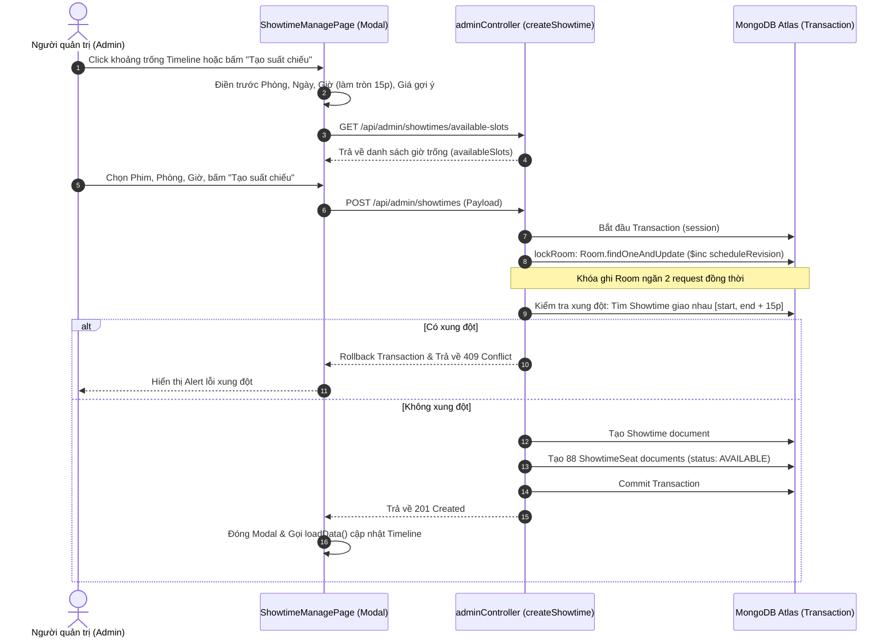

# BÁO CÁO KIỂM TOÁN SOURCE CODE TRƯỚC KHI TRIỂN KHAI TÍNH NĂNG LẶP LỊCH CHIẾU
**Dự án:** D'AVENOR Cinema Management System (`movietix-project`)  
**Phạm vi kiểm toán:** Hệ thống tạo suất chiếu, kiểm tra xung đột, xếp lịch hàng loạt và đồng bộ dữ liệu khách hàng.  
**Nguyên tắc thực thi:** CHỈ ĐỌC, PHÂN TÍCH VÀ TRÍCH XUẤT SOURCE CODE. Tuyệt đối không thay đổi mã nguồn, database hay schema.

---

## MỤC LỤC
1. [Cây thư mục các file liên quan](#1-cây-thư-mục-các-file-liên-quan)
2. [Source code thực tế của các thành phần cần kiểm tra](#2-source-code-thực-tế-của-các-thành-phần-cần-kiểm-tra)
   - [2.1 Frontend Source Code](#21-frontend-source-code)
   - [2.2 Backend Source Code](#22-backend-source-code)
3. [Danh sách API và Request/Response Payload](#3-danh-sách-api-và-requestresponse-payload)
4. [Schema MongoDB/Mongoose và Indexes](#4-schema-mongodbmongoose-và-indexes)
5. [Luồng tạo suất chiếu hiện tại](#5-luồng-tạo-suất-chiếu-hiện-tại)
6. [Luồng xếp lịch hàng loạt hiện tại](#6-luồng-xếp-lịch-hàng-loạt-hiện-tại)
7. [Những chức năng có thể tái sử dụng](#7-những-chức-năng-có-thể-tái-sử-dụng)
8. [Những chức năng còn thiếu](#8-những-chức-năng-còn-thiếu)
9. [Các rủi ro kỹ thuật khi bổ sung tính năng lặp lịch](#9-các-rủi-ro-kỹ-thuật-khi-bổ-sung-tính-năng-lặp-lịch)
10. [Danh sách file dự kiến cần chỉnh sửa và lý do](#10-danh-sách-file-dự-kiến-cần-chỉnh-sửa-và-lý-do)

---

## 1. CÂY THƯ MỤC CÁC FILE LIÊN QUAN

```text
movietix-project/
├── backend/
│   ├── src/
│   │   ├── config/
│   │   │   └── db.js                                  # Kết nối MongoDB Atlas
│   │   ├── controllers/
│   │   │   ├── adminController.js                     # createShowtime, batchScheduleShowtimes, getAvailableShowtimeSlots, getAdminShowtimes, deleteShowtime
│   │   │   ├── cinemaController.js                    # getCinemaShowtimes (khách hàng xem lịch theo rạp)
│   │   │   ├── movieController.js                     # getMovieSchedule (khách hàng xem lịch theo phim)
│   │   │   └── showtimeController.js                  # getShowtimeById, getShowtimeSeats, recommendSeats
│   │   ├── middleware/
│   │   │   └── authMiddleware.js                      # authenticateAdmin, authenticateCustomer
│   │   ├── models/
│   │   │   ├── Cinema.js                              # Schema cụm rạp
│   │   │   ├── Movie.js                               # Schema phim, thời lượng, độ tuổi, định dạng
│   │   │   ├── Room.js                                # Schema 9 phòng vật lý, scheduleRevision
│   │   │   ├── Showtime.js                            # Schema suất chiếu, startTime, endTime, cleaningMinutes
│   │   │   ├── ShowtimeSeat.js                        # Schema 88 ghế độc lập/suất chiếu, unique index
│   │   │   └── TicketPricingConfig.js                 # Bảng giá vé động tập trung (2D, 3D, IMAX, Gold Class)
│   │   ├── routes/
│   │   │   ├── adminRoutes.js                         # Định tuyến API quản trị (/api/admin/showtimes/*)
│   │   │   ├── cinemaRoutes.js                        # Định tuyến API rạp (/api/cinemas/:id/showtimes)
│   │   │   ├── movieRoutes.js                         # Định tuyến API phim (/api/movies/:id/schedule)
│   │   │   └── showtimeRoutes.js                      # Định tuyến API ghế (/api/showtimes/:id/seats)
│   │   └── services/
│   │       ├── bookingPolicy.js                       # Quy tắc nghiệp vụ: opensMoreThanSevenDaysAhead
│   │       └── pricingConfigService.js                # Quản lý nạp cache bảng giá vé
└── frontend/
    └── src/
        ├── components/
        │   ├── home/
        │   │   └── HomeQuickBooking.jsx               # Đặt vé nhanh trang chủ (đồng bộ lịch)
        │   └── movie-detail/
        │       └── MovieShowtimesSection.jsx          # Lịch chiếu tại trang chi tiết phim
        ├── pages/
        │   └── admin/
        │       ├── ShowtimeManagePage.jsx             # Giao diện chính: Timeline, Modal tạo suất, Modal batch
        │       └── statistics/
        │           └── drawers/
        │               └── ShowtimeDetailDrawer.jsx   # Drawer chi tiết suất & sơ đồ ghế
        ├── services/
        │   └── api.js                                 # Axios instance với Authorization header
        └── utils/
            ├── cinemaCalendar.js                      # Tiện ích định dạng ngày giờ rạp chiếu
            └── pricing.js                             # calculateDynamicPrices, resolveSuggestedPrice
```

---

## 2. SOURCE CODE THỰC TẾ CỦA CÁC THÀNH PHẦN CẦN KIỂM TRA

### 2.1 FRONTEND SOURCE CODE

#### 2.1.1 State quản lý dữ liệu trong `ShowtimeManagePage.jsx`
*(File: `frontend/src/pages/admin/ShowtimeManagePage.jsx`, dòng 82-100)*

```javascript
// Form mở 1 suất lẻ
const [formData, setFormData] = useState({
  movieId: '',
  cinemaId: '',
  roomId: '',
  roomName: '',
  startTime: '',
  price: 80000,
});

// Form lên lịch chiếu hàng loạt theo Tuần / Tháng
const [batchData, setBatchData] = useState({
  cinemaId: 'ALL',
  startDate: todayStr,
  endDate: todayStr,
  selectedMovieIds: [],
  timeSlots: ['09:00', '11:30', '14:00', '16:30', '19:00', '21:30'],
  roomIds: [],
});
```

#### 2.1.2 Hàm xử lý khi chọn ngày chiếu trong Modal
*(File: `frontend/src/pages/admin/ShowtimeManagePage.jsx`, dòng 308-316)*

```javascript
const handleFormDateChange = (newDate) => {
  const curTime = formTime || '18:00';
  const newDateTime = `${newDate}T${curTime}`;
  setFormData(prev => ({
    ...prev,
    startTime: newDateTime,
    price: resolveSuggestedPrice(prev.roomName, newDateTime, pricingConfig)
  }));
};
```

#### 2.1.3 Hook lấy danh sách khung giờ khả dụng (Available Slots)
*(File: `frontend/src/pages/admin/ShowtimeManagePage.jsx`, dòng 186-227)*

```javascript
useEffect(() => {
  if (!isModalOpen || !formData.roomId || !formData.movieId || !formData.startTime) {
    setAvailableSlots([]);
    setAlternativeRooms([]);
    return;
  }

  const datePart = formData.startTime.slice(0, 10);
  if (!datePart || datePart.length !== 10) return;

  let isMounted = true;
  setSlotsLoading(true);

  api.get('/admin/showtimes/available-slots', {
    params: {
      roomId: formData.roomId,
      movieId: formData.movieId,
      date: datePart,
    },
  })
    .then((res) => {
      if (!isMounted) return;
      if (res.data?.success) {
        setAvailableSlots(res.data.availableSlots || []);
        setAlternativeRooms(res.data.alternativeRooms || []);
      }
    })
    .catch(() => {
      if (!isMounted) return;
      setAvailableSlots([]);
      setAlternativeRooms([]);
    })
    .finally(() => {
      if (isMounted) setSlotsLoading(false);
    });

  return () => {
    isMounted = false;
  };
}, [isModalOpen, formData.roomId, formData.movieId, formData.startTime]);
```

#### 2.1.4 Hàm xử lý khi chọn giờ chiếu
*(File: `frontend/src/pages/admin/ShowtimeManagePage.jsx`, dòng 318-326)*

```javascript
const handleFormTimeChange = (newTime) => {
  const curDate = formDate || viewDate;
  const newDateTime = `${curDate}T${newTime}`;
  setFormData(prev => ({
    ...prev,
    startTime: newDateTime,
    price: resolveSuggestedPrice(prev.roomName, newDateTime, pricingConfig)
  }));
};
```

#### 2.1.5 Hàm submit tạo suất chiếu đơn lẻ
*(File: `frontend/src/pages/admin/ShowtimeManagePage.jsx`, dòng 463-488)*

```javascript
const handleCreateShowtime = async (e) => {
  e.preventDefault();
  if (!formData.startTime || !formData.roomId || !formData.movieId) {
    alert('Vui lòng điền đầy đủ phim, phòng chiếu và thời gian bắt đầu!');
    return;
  }
  if (conflictStatus.tone === 'danger') {
    alert('Không thể tạo suất chiếu: ' + conflictStatus.text);
    return;
  }

  try {
    setIsSubmittingShowtime(true);
    await api.post('/admin/showtimes', {
      ...formData,
      formatFeature: selectedFormat || getCompatibleFormats(selectedMovie, selectedRoom)[0] || '2D Tiêu chuẩn'
    });
    alert('Đã khởi tạo suất chiếu mới thành công!');
    setIsModalOpen(false);
    loadData();
  } catch (err) {
    alert('Không thể tạo suất chiếu: ' + (err.response?.data?.message || err.message));
  } finally {
    setIsSubmittingShowtime(false);
  }
};
```

#### 2.1.6 Cơ chế click vào khoảng trống trên Timeline để tự điền phòng và giờ
*(File: `frontend/src/pages/admin/ShowtimeManagePage.jsx`, dòng 418-437 & 1184-1191)*

```javascript
// Tính toán giờ theo tọa độ click trên Timeline:
const clickedMinutes = Math.floor(ratio * totalTimelineMinutes) + startHour * 60;
const hour = Math.floor(clickedMinutes / 60);
const minute = Math.floor((clickedMinutes % 60) / 15) * 15;
handleTimelineSlotClick(room, hour, minute);

// Hàm mở modal và điền trước thông tin:
const handleTimelineSlotClick = (room, hour, minute = 0) => {
  const hh = String(hour).padStart(2, '0');
  const mm = String(minute).padStart(2, '0');
  const targetDateTime = `${viewDate}T${hh}:${mm}`;
  const firstMovie = movies[0];

  setFormData((prev) => ({
    ...prev,
    roomId: room._id || room.id,
    roomName: room.name,
    movieId: prev.movieId || (firstMovie?.id || firstMovie?._id || ''),
    startTime: targetDateTime,
    price: resolveSuggestedPrice(room.name, targetDateTime, pricingConfig),
  }));
  const compFormats = getCompatibleFormats(firstMovie, room);
  setSelectedFormat(compFormats[0] || '2D Tiêu chuẩn');
  setIsMoviePickerOpen(false);
  setMovieSearchKeyword('');
  setIsModalOpen(true);
};
```

#### 2.1.7 Hàm xử lý Xem trước và Ghi Database của xếp lịch hàng loạt hiện có
*(File: `frontend/src/pages/admin/ShowtimeManagePage.jsx`, dòng 538-593)*

```javascript
// Xem trước (Preview)
const handlePreviewBatch = async () => {
  if (!batchData.startDate || !batchData.endDate) {
    alert('Vui lòng chọn ngày bắt đầu và kết thúc!');
    return;
  }
  if (batchData.selectedMovieIds.length === 0) {
    alert('Vui lòng chọn ít nhất 1 bộ phim!');
    return;
  }

  try {
    setBatchLoading(true);
    const res = await api.post('/admin/showtimes/schedule-batch', {
      cinemaId: batchData.cinemaId,
      startDate: batchData.startDate,
      endDate: batchData.endDate,
      movieIds: batchData.selectedMovieIds,
      timeSlots: batchData.timeSlots,
      roomIds: batchData.roomIds,
      preview: true,
    });

    if (res.data?.preview) {
      setBatchPreview(res.data);
    }
  } catch (err) {
    alert('Lỗi xem trước lịch chiếu: ' + (err.response?.data?.message || err.message));
  } finally {
    setBatchLoading(false);
  }
};

// Ghi Database hàng loạt
const handleExecuteBatchSchedule = async () => {
  try {
    setBatchLoading(true);
    const res = await api.post('/admin/showtimes/schedule-batch', {
      cinemaId: batchData.cinemaId,
      startDate: batchData.startDate,
      endDate: batchData.endDate,
      movieIds: batchData.selectedMovieIds,
      timeSlots: batchData.timeSlots,
      roomIds: batchData.roomIds,
      preview: false,
    });

    alert(`Đã xếp lịch chiếu hàng loạt thành công! (${res.data?.totalCreatedShowtimes || 0} suất)`);
    setIsBatchModalOpen(false);
    setBatchPreview(null);
    loadData();
  } catch (err) {
    alert('Lỗi xếp lịch chiếu: ' + (err.response?.data?.message || err.message));
  } finally {
    setBatchLoading(false);
  }
};
```

---

### 2.2 BACKEND SOURCE CODE

#### 2.2.1 Logic chống xung đột và khởi tạo ghế: `scheduleInRoom`
*(File: `backend/src/controllers/adminController.js`, dòng 259-323)*

```javascript
class ScheduleConflict extends Error {}

async function scheduleInRoom({ room, movie, start, price, pricing, session }) {
  const duration = Number(movie.duration);
  const cleaningMinutes = 15;
  if (!Number.isFinite(duration) || duration <= 0) throw new ScheduleConflict('Phim chưa có thời lượng hợp lệ.');
  if (movie.releaseDate && businessDate(start) < businessDate(movie.releaseDate)) {
    throw new ScheduleConflict('Suất chiếu sớm hơn ngày khởi chiếu.');
  }
  const endTime = new Date(start.getTime() + duration * 60000);
  const blockedUntil = endTime.getTime() + cleaningMinutes * 60000;

  const existing = await Showtime.find({
    $or: [{ roomId: room._id }, { roomId: null, cinemaId: room.cinemaId, roomName: { $in: [room.name, room.shortName].filter(Boolean) } }],
    cancelledAt: null,
  }).select('movieId startTime endTime cleaningMinutes').populate('movieId', 'duration').session(session).lean();
  const overlaps = existing.some(slot => {
    const legacyDuration = Number(slot.movieId?.duration) || 120;
    const slotStart = slot.startTime.getTime();
    const slotEnd = slot.endTime?.getTime() ?? (slotStart + legacyDuration * 60000);
    const slotClean = (slot.cleaningMinutes ?? cleaningMinutes) * 60000;
    const slotBlockedUntil = slotEnd + slotClean;
    // Chặn mọi va chạm: trùng giờ bắt đầu, bao phủ, chồng lấn một phần, hoặc thiếu 15p dọn phòng
    return start.getTime() < slotBlockedUntil && blockedUntil > slotStart;
  });
  if (overlaps) throw new ScheduleConflict('Khung giờ chồng lịch chiếu hoặc không đủ 15 phút dọn dẹp vệ sinh phòng.');

  let seatTemplates = [];
  const [template] = await ShowtimeSeat.aggregate([
    { $match: { roomId: room._id } },
    { $group: { _id: '$showtimeId', count: { $sum: 1 } } },
    { $match: { count: room.totalSeats } },
    { $sort: { _id: -1 } },
    { $limit: 1 },
  ]).session(session);

  if (template) {
    seatTemplates = await ShowtimeSeat.find({ roomId: room._id, showtimeId: template._id })
      .select('row col seatNumber type').session(session).lean();
  }

  // Nếu phòng chưa có template lịch sử (như các phòng 04, 06, 07, 08), sinh ma trận 88 ghế chuẩn
  if (!seatTemplates.length) {
    const rows = ['A', 'B', 'C', 'D', 'E', 'F', 'G', 'H'];
    for (const r of rows) {
      const type = ['E', 'F', 'G'].includes(r) ? 'VIP' : (r === 'H' ? 'SWEETBOX' : 'STANDARD');
      for (let c = 1; c <= 11; c++) {
        seatTemplates.push({ row: r, col: c, seatNumber: `${r}${c}`, type });
      }
    }
  }

  const calculated = calculatePricesFromConfig({
    roomName: room.name, roomType: room.roomType, formatFeature: room.formatFeature, startTime: start,
  }, pricing);
  const [showtime] = await Showtime.create([{
    movieId: movie._id, cinemaId: room.cinemaId, roomId: room._id, roomName: room.name,
    formatFeature: room.formatFeature, startTime: start, endTime, cleaningMinutes,
    price: price ?? calculated.priceStandard,
  }], { session });
  await ShowtimeSeat.insertMany(seatTemplates.map(({ row, col, seatNumber, type }) => ({
    roomId: room._id, showtimeId: showtime._id, row, col, seatNumber, type, status: 'AVAILABLE',
  })), { session });
  return showtime;
}
```

#### 2.2.2 Khóa phòng chống xung đột đồng thời (Concurrency Lock): `lockRoom`
*(File: `backend/src/controllers/adminController.js`, dòng 325-331)*

```javascript
async function lockRoom(roomId, session) {
  const room = await Room.findOneAndUpdate(
    { _id: roomId, status: 'ACTIVE' }, { $inc: { scheduleRevision: 1 } }, { new: true, session }
  );
  if (!room) throw new ScheduleConflict('Phòng không có hoặc đang bảo trì.');
  return room;
}
```

#### 2.2.3 Controller tạo 1 suất chiếu: `createShowtime`
*(File: `backend/src/controllers/adminController.js`, dòng 333-367)*

```javascript
export const createShowtime = async (req, res) => {
  try {
    const { movieId, cinemaId, roomId, roomName, startTime, price } = req.body;
    const timestamp = typeof startTime === 'string' && /^\d{4}-\d{2}-\d{2}T\d{2}:\d{2}$/.test(startTime)
      ? startTime + ':00+07:00' : startTime;
    const start = new Date(timestamp);
    if (!mongoose.isObjectIdOrHexString(movieId) || !Number.isFinite(start.getTime()) || start <= new Date()
        || (price != null && (!Number.isSafeInteger(Number(price)) || Number(price) <= 0))) {
      return res.status(400).json({ message: 'Phim, giờ bắt đầu hoặc giá vé không hợp lệ.' });
    }
    const [movie, pricing] = await Promise.all([Movie.findById(movieId), ensurePricingConfig()]);
    if (!movie) return res.status(404).json({ message: 'Không tìm thấy phim.' });
    let targetRoomId = roomId;
    if (targetRoomId == null && typeof roomName === 'string') {
      const matches = await Room.find({ name: roomName, ...(mongoose.isObjectIdOrHexString(cinemaId) && { cinemaId }) }).select('_id').limit(2);
      if (matches.length === 1) targetRoomId = matches[0]._id;
    }
    if (!mongoose.isObjectIdOrHexString(targetRoomId)) {
      return res.status(400).json({ message: 'Vui lòng chọn phòng vật lý.' });
    }

    const showtime = await mongoose.connection.transaction(async session => {
      const room = await lockRoom(targetRoomId, session);
      if (cinemaId && cinemaId !== 'ALL' && String(room.cinemaId) !== cinemaId) {
        throw new ScheduleConflict('Phòng không thuộc cụm rạp đã chọn.');
      }
      return scheduleInRoom({ room, movie, start, price: price == null ? undefined : Number(price), pricing, session });
    });
    return res.status(201).json({ message: 'Đã tạo suất chiếu.', showtime });
  } catch (error) {
    if (error instanceof ScheduleConflict) return res.status(409).json({ message: error.message });
    console.error('Schedule creation failed:', error.name);
    return res.status(500).json({ message: 'Không thể tạo suất chiếu.' });
  }
};
```

#### 2.2.4 Controller tìm khung giờ khả dụng: `getAvailableShowtimeSlots`
*(File: `backend/src/controllers/adminController.js`, dòng 692-793)*

```javascript
export const getAvailableShowtimeSlots = async (req, res) => {
  try {
    const { roomId, movieId, date } = req.query;
    if (!roomId || !movieId || !date) {
      return res.status(400).json({ message: 'Vui lòng cung cấp roomId, movieId và date (YYYY-MM-DD).' });
    }

    const [room, movie] = await Promise.all([
      Room.findById(roomId).lean(),
      Movie.findById(movieId).lean(),
    ]);

    if (!room) return res.status(404).json({ message: 'Phòng không tồn tại.' });
    if (!movie) return res.status(404).json({ message: 'Phim không tồn tại.' });

    if (room.status === 'MAINTENANCE') {
      return res.json({
        roomStatus: 'MAINTENANCE',
        message: 'Phòng đang bảo trì, không thể xếp lịch.',
        availableSlots: [],
        alternativeRooms: [],
      });
    }

    const duration = Number(movie.duration) || 120;
    const cleaningMinutes = 15;
    const totalSlotMinutes = duration + cleaningMinutes;

    const dayStart = new Date(`${date}T00:00:00+07:00`);
    const dayEnd = new Date(`${date}T23:59:59.999+07:00`);
    const lookbackStart = new Date(dayStart.getTime() - 4 * 3600000);
    const lookaheadEnd = new Date(dayEnd.getTime() + 4 * 3600000);

    const existing = await Showtime.find({
      roomId: room._id,
      cancelledAt: null,
      startTime: { $gte: lookbackStart, $lte: lookaheadEnd },
    }).populate('movieId', 'duration').lean();

    const occupiedIntervals = existing.map(slot => {
      const dur = Number(slot.movieId?.duration) || 120;
      const sStart = new Date(slot.startTime).getTime();
      const sEnd = slot.endTime ? new Date(slot.endTime).getTime() : (sStart + dur * 60000);
      const clean = (slot.cleaningMinutes ?? 15) * 60000;
      return { start: sStart, end: sEnd + clean };
    });

    const availableSlots = [];
    const baseDate = new Date(`${date}T00:00:00+07:00`);

    // Khung giờ rạp mở cửa từ 08:30 đến 23:30 (bước 15 phút)
    for (let hour = 8; hour <= 23; hour++) {
      for (const minute of [0, 15, 30, 45]) {
        if (hour === 8 && minute < 30) continue;
        if (hour === 23 && minute > 30) continue;

        const candidateStart = new Date(baseDate);
        candidateStart.setHours(hour, minute, 0, 0);
        const candidateStartTime = candidateStart.getTime();
        const candidateEndTime = candidateStartTime + totalSlotMinutes * 60000;

        if (candidateStartTime <= Date.now()) continue;

        const isColliding = occupiedIntervals.some(occ =>
          candidateStartTime < occ.end && candidateEndTime > occ.start
        );

        if (!isColliding) {
          const hh = String(hour).padStart(2, '0');
          const mm = String(minute).padStart(2, '0');
          availableSlots.push(`${hh}:${mm}`);
        }
      }
    }

    let alternativeRooms = [];
    if (availableSlots.length === 0) {
      alternativeRooms = await Room.find({
        _id: { $ne: room._id },
        roomType: room.roomType,
        status: 'ACTIVE',
      }).select('name roomType formatFeature totalSeats').lean();
    }

    res.json({
      success: true,
      roomId: room._id,
      roomName: room.name,
      roomType: room.roomType,
      movieId: movie._id,
      movieTitle: movie.title,
      duration,
      cleaningMinutes,
      totalSlotMinutes,
      availableSlots,
      alternativeRooms,
    });
  } catch (error) {
    res.status(500).json({ message: 'Lỗi tìm khung giờ trống', error: error.message });
  }
};
```

#### 2.2.5 Controller xếp lịch hàng loạt: `batchScheduleShowtimes`
*(File: `backend/src/controllers/adminController.js`, dòng 796-921)*

```javascript
export const batchScheduleShowtimes = async (req, res) => {
  try {
    const { roomIds, startDate, endDate, movieIds, timeSlots, preview } = req.body;
    const day = 86400000;
    const start = new Date(startDate + 'T00:00:00+07:00');
    const end = new Date(endDate + 'T00:00:00+07:00');
    if (!Number.isFinite(+start) || !Number.isFinite(+end) || start > end || +end - +start > 30 * day
      || businessDate(start) !== startDate || businessDate(end) !== endDate
      || !Array.isArray(roomIds) || !roomIds.length || !roomIds.every(mongoose.isObjectIdOrHexString)
      || !Array.isArray(movieIds) || !movieIds.length || !movieIds.every(mongoose.isObjectIdOrHexString)
      || !Array.isArray(timeSlots) || !timeSlots.length || !timeSlots.every(time => typeof time === 'string' && /^(?:[01]\d|2[0-3]):[0-5]\d$/.test(time))) {
      return res.status(400).json({ message: 'Kiểm tra danh sách phòng, phim, ngày hoặc khung giờ.' });
    }

    const uniqueRooms = [...new Set(roomIds)].sort();
    const uniqueTimes = [...new Set(timeSlots)].sort();
    const [movies, pricing] = await Promise.all([Movie.find({ _id: { $in: movieIds } }), ensurePricingConfig()]);
    if (movies.length !== new Set(movieIds).size) return res.status(404).json({ message: 'Một số phim không tồn tại.' });

    // Chế độ Xem trước (Preview Mode): Không ghi Database, trả về danh sách hợp lệ và xung đột
    if (preview) {
      const previewValid = [];
      const previewConflicts = [];
      const occupiedByRoom = new Map();

      const existingShowtimes = await Showtime.find({
        roomId: { $in: uniqueRooms },
        cancelledAt: null,
        startTime: { $gte: new Date(+start - 86400000), $lte: new Date(+end + 86400000) },
      }).populate('movieId', 'duration').lean();

      for (const s of existingShowtimes) {
        const rId = String(s.roomId);
        if (!occupiedByRoom.has(rId)) occupiedByRoom.set(rId, []);
        const dur = Number(s.movieId?.duration) || 120;
        const sStart = new Date(s.startTime).getTime();
        const sEnd = s.endTime ? new Date(s.endTime).getTime() : sStart + dur * 60000;
        const clean = (s.cleaningMinutes ?? 15) * 60000;
        occupiedByRoom.get(rId).push({ start: sStart, end: sEnd + clean });
      }

      const roomsInDb = await Room.find({ _id: { $in: uniqueRooms } }).lean();
      const roomObjMap = new Map(roomsInDb.map(r => [String(r._id), r]));

      for (const [index, roomId] of uniqueRooms.entries()) {
        const room = roomObjMap.get(String(roomId));
        if (!room || room.status === 'MAINTENANCE') {
          previewConflicts.push({ roomId, reason: 'Phòng không tồn tại hoặc đang bảo trì' });
          continue;
        }

        const roomOcc = occupiedByRoom.get(String(roomId)) || [];

        for (let date = +start; date <= +end; date += day) {
          const movie = movies[(index + (date - +start) / day) % movies.length];
          const dur = Number(movie.duration) || 120;
          const cleaning = 15;
          const totalSlotMs = (dur + cleaning) * 60000;

          for (const time of uniqueTimes) {
            const startsAt = new Date(businessDate(new Date(date)) + 'T' + time + ':00+07:00');
            const startMs = startsAt.getTime();
            const endMs = startMs + totalSlotMs;

            if (startsAt <= new Date()) {
              previewConflicts.push({
                roomId, roomName: room.name, movieTitle: movie.title, time, date: businessDate(new Date(date)),
                reason: 'Khung giờ ở quá khứ',
              });
              continue;
            }

            const collision = roomOcc.some(occ => startMs < occ.end && endMs > occ.start);
            if (collision) {
              previewConflicts.push({
                roomId, roomName: room.name, movieTitle: movie.title, time, date: businessDate(new Date(date)),
                reason: 'Chồng lấn với suất chiếu hoặc thời gian dọn phòng (15p)',
              });
            } else {
              const slotInfo = {
                roomId, roomName: room.name, roomType: room.roomType,
                movieId: movie._id, movieTitle: movie.title,
                time, date: businessDate(new Date(date)),
                startTime: startsAt, endTime: new Date(startMs + dur * 60000),
                duration: dur, cleaningMinutes: cleaning,
              };
              previewValid.push(slotInfo);
              roomOcc.push({ start: startMs, end: endMs });
            }
          }
        }
      }

      return res.json({
        success: true,
        preview: true,
        validCount: previewValid.length,
        conflictCount: previewConflicts.length,
        validSlots: previewValid,
        conflictSlots: previewConflicts,
      });
    }

    const totalCreatedShowtimes = await mongoose.connection.transaction(async session => {
      let count = 0;
      for (const [index, roomId] of uniqueRooms.entries()) {
        const room = await lockRoom(roomId, session);
        for (let date = +start; date <= +end; date += day) {
          const movie = movies[(index + (date - +start) / day) % movies.length];
          for (const time of uniqueTimes) {
            const startsAt = new Date(businessDate(new Date(date)) + 'T' + time + ':00+07:00');
            if (startsAt <= new Date()) continue;
            await scheduleInRoom({ room, movie, start: startsAt, pricing, session });
            count++;
          }
        }
      }
      return count;
    });
    return res.json({ success: true, totalCreatedShowtimes, message: 'Đã tạo ' + totalCreatedShowtimes + ' suất chiếu.' });
  } catch (error) {
    if (error instanceof ScheduleConflict) return res.status(409).json({ message: error.message });
    console.error('Batch scheduling failed:', error.name);
    return res.status(500).json({ message: 'Không thể xếp lịch hàng loạt.' });
  }
};
```

#### 2.2.6 Middleware xác thực quyền Admin: `authenticateAdmin`
*(File: `backend/src/middleware/authMiddleware.js`, dòng 6-39)*

```javascript
function authenticate(models, allowedRoles, property) {
  return async (req, res, next) => {
    const token = req.get('authorization')?.match(/^Bearer ([^\s]+)$/i)?.[1];
    if (!token) return res.status(401).json({ message: 'Vui lòng đăng nhập.' });
    const secret = process.env.JWT_SECRET;
    if (!secret) return res.status(503).json({ message: 'Dịch vụ xác thực chưa được cấu hình.' });

    let identity;
    try {
      identity = jwt.verify(token, secret, { algorithms: ['HS256'] });
    } catch {
      return res.status(401).json({ message: 'Phiên đăng nhập không hợp lệ hoặc đã hết hạn.' });
    }
    if (!mongoose.isObjectIdOrHexString(identity?.id)) {
      return res.status(401).json({ message: 'Phiên đăng nhập không hợp lệ.' });
    }

    try {
      for (const model of models) {
        const account = await model.findById(identity.id).select('name email phone role').lean();
        if (account && allowedRoles.includes(account.role)) {
          req[property] = { ...account, id: String(account._id) };
          return next();
        }
      }
      return res.status(403).json({ message: 'Bạn không có quyền thực hiện thao tác này.' });
    } catch (error) {
      return next(error);
    }
  };
}

export const authenticateAdmin = authenticate([AdminUser, User], ['ADMIN'], 'admin');
```

---

## 3. DANH SÁCH API VÀ REQUEST/RESPONSE PAYLOAD

### 3.1 API Quản trị (Admin APIs)

| Endpoint | Method | Middleware | Mục đích |
| :--- | :---: | :---: | :--- |
| `/api/admin/showtimes` | `POST` | `authenticateAdmin` | Tạo 1 suất chiếu đơn lẻ |
| `/api/admin/showtimes/available-slots` | `GET` | `authenticateAdmin` | Gợi ý các khung giờ trống không chồng lấn |
| `/api/admin/showtimes/schedule-batch` | `POST` | `authenticateAdmin` | Xếp lịch hàng loạt (Hỗ trợ Preview hoặc Commit) |
| `/api/admin/showtimes` | `GET` | `authenticateAdmin` | Lấy danh sách suất chiếu hiển thị trên Timeline/Movie/List |
| `/api/admin/showtimes/:id` | `DELETE` | `authenticateAdmin` | Xóa hoàn toàn (0 vé) hoặc hủy mềm & hoàn tiền (>0 vé) |

#### Chi tiết Request / Response Payload:

1. **`POST /api/admin/showtimes`**
   - **Request Payload:**
     ```json
     {
       "movieId": "6ae624fdb0ee30fb919c72d3",
       "roomId": "6b01b798fe378d805c7c1799",
       "roomName": "Phòng 01 - IMAX Laser (Grand Hall 1)",
       "startTime": "2026-11-25T14:30",
       "price": 130000,
       "formatFeature": "2D IMAX Laser"
     }
     ```
   - **Response Success (201 Created):**
     ```json
     {
       "message": "Đã tạo suất chiếu.",
       "showtime": {
         "_id": "6b0584...",
         "movieId": "6ae624...",
         "roomId": "6b01b7...",
         "roomName": "Phòng 01 - IMAX Laser (Grand Hall 1)",
         "formatFeature": "2D IMAX Laser",
         "startTime": "2026-11-25T07:30:00.000Z",
         "endTime": "2026-11-25T09:40:00.000Z",
         "cleaningMinutes": 15,
         "price": 130000
       }
     }
     ```
   - **Response Error (409 Conflict):**
     ```json
     {
       "message": "Khung giờ chồng lịch chiếu hoặc không đủ 15 phút dọn dẹp vệ sinh phòng."
     }
     ```

2. **`GET /api/admin/showtimes/available-slots`**
   - **Query Parameters:** `?roomId=...&movieId=...&date=YYYY-MM-DD`
   - **Response Success (200 OK):**
     ```json
     {
       "success": true,
       "roomId": "6b01b798fe378d805c7c1799",
       "roomName": "Phòng 01 - IMAX Laser (Grand Hall 1)",
       "duration": 130,
       "cleaningMinutes": 15,
       "totalSlotMinutes": 145,
       "availableSlots": ["08:30", "08:45", "11:15", "13:45", "16:15", "18:45", "21:15"],
       "alternativeRooms": []
     }
     ```

3. **`POST /api/admin/showtimes/schedule-batch`**
   - **Request Payload:**
     ```json
     {
       "cinemaId": "ALL",
       "startDate": "2026-11-25",
       "endDate": "2026-11-28",
       "movieIds": ["6ae624fdb0ee30fb919c72d3"],
       "roomIds": ["6b01b798fe378d805c7c1799"],
       "timeSlots": ["09:00", "13:30", "18:00"],
       "preview": true
     }
     ```
   - **Response Preview (200 OK):**
     ```json
     {
       "success": true,
       "preview": true,
       "validCount": 11,
       "conflictCount": 1,
       "validSlots": [
         {
           "roomId": "6b01b7...",
           "roomName": "Phòng 01 - IMAX Laser (Grand Hall 1)",
           "movieTitle": "Deadpool & Wolverine",
           "time": "09:00",
           "date": "2026-11-25",
           "duration": 128,
           "cleaningMinutes": 15
         }
       ],
       "conflictSlots": [
         {
           "roomId": "6b01b7...",
           "roomName": "Phòng 01 - IMAX Laser (Grand Hall 1)",
           "movieTitle": "Deadpool & Wolverine",
           "time": "18:00",
           "date": "2026-11-25",
           "reason": "Chồng lấn với suất chiếu hoặc thời gian dọn phòng (15p)"
         }
       ]
     }
     ```

---

## 4. SCHEMA MONGODB/MONGOOSE VÀ INDEXES

### 4.1 Model `Showtime` (`backend/src/models/Showtime.js`)
- **Collection:** `showtimes`
- **Fields:**
  - `movieId` (`ObjectId`, ref: `'Movie'`, `required: true`, `index: true`)
  - `cinemaId` (`ObjectId`, ref: `'Cinema'`, `index: true`)
  - `roomId` (`ObjectId`, ref: `'Room'`, `index: true`)
  - `roomName` (`String`, `required: true`, default: `'Phòng 01 - 2D'`)
  - `formatFeature` (`String`, default: `''`)
  - `startTime` (`Date`, `required: true`, `index: true`)
  - `endTime` (`Date`)
  - `cleaningMinutes` (`Number`, min: 0)
  - `price` (`Number`, `required: true`, default: 95000)
  - `isLocked` (`Boolean`, default: `false`)
  - `cancelledAt` (`Date`, default: `null`)
  - `bookingRevision` (`Number`, default: 0, `select: false`)
- **Indexes:**
  - `{ movieId: 1, startTime: 1 }`
  - `{ roomId: 1, startTime: 1, cancelledAt: 1 }`
- **Ghi chú đặc biệt:** Không có unique index trên `{ roomId: 1, startTime: 1 }`. Việc chống trùng lặp hoàn toàn dựa vào transaction và logic `scheduleInRoom`.

### 4.2 Model `ShowtimeSeat` (`backend/src/models/ShowtimeSeat.js`)
- **Collection:** `showtimeseats`
- **Fields:**
  - `showtimeId` (`ObjectId`, ref: `'Showtime'`, `required: true`, `index: true`)
  - `roomId` (`ObjectId`, ref: `'Room'`, `index: true`)
  - `seatNumber` (`String`, `required: true` - ví dụ `"A1"`, `"E05"`)
  - `row` (`String`, `required: true`)
  - `col` (`Number`, `required: true`)
  - `type` (`String`, enum: `['STANDARD', 'VIP', 'SWEETBOX']`, default: `'STANDARD'`)
  - `status` (`String`, enum: `['AVAILABLE', 'HOLDING', 'BOOKED']`, default: `'AVAILABLE'`, `index: true`)
  - `holdExpiresAt` (`Date`, default: `null`)
  - `bookingId` (`ObjectId`, ref: `'Booking'`, default: `null`)
- **Indexes:**
  - `{ showtimeId: 1, seatNumber: 1 }` (**UNIQUE INDEX** bắt buộc: Một suất chiếu không thể có 2 ghế trùng mã)
  - `{ showtimeId: 1, status: 1, holdExpiresAt: 1 }`

### 4.3 Model `Room` (`backend/src/models/Room.js`)
- **Collection:** `rooms`
- **Fields:**
  - `cinemaId` (`ObjectId`, ref: `'Cinema'`, `required: true`)
  - `roomNumber` (`Number`, `required: true`)
  - `name` (`String`, `required: true`)
  - `shortName` (`String`, default: `'Phòng 1'`)
  - `roomType` (`String`, enum: `['IMAX Laser', 'Dolby Atmos', 'Gold Class', 'RealD 3D', '2D Tiêu chuẩn', '4DX Sound']`)
  - `formatFeature` (`String`)
  - `totalSeats` (`Number`, default: 88)
  - `status` (`String`, enum: `['ACTIVE', 'MAINTENANCE']`, default: `'ACTIVE'`)
  - `scheduleRevision` (`Number`, default: 0, `select: false` - Dùng cho Concurrency Optimistic Lock)
- **Danh sách 9 phòng vật lý thực tế tại D'AVENOR Cinema:**
  1. Phòng 01: `Phòng 01 - IMAX Laser (Grand Hall 1)` (IMAX Laser, 88 ghế)
  2. Phòng 02: `Phòng 02 - IMAX Laser (Grand Hall 2)` (IMAX Laser, 88 ghế)
  3. Phòng 03: `Phòng 03 - IMAX Laser (Grand Hall 3)` (IMAX Laser, 88 ghế)
  4. Phòng 04: `Phòng 04 - Dolby Atmos (Auditorium 1)` (Dolby Atmos, 88 ghế)
  5. Phòng 05: `Phòng 05 - Dolby Atmos (Auditorium 2)` (Dolby Atmos, 88 ghế)
  6. Phòng 06: `Phòng 06 - Dolby Atmos (Auditorium 3)` (Dolby Atmos, 88 ghế)
  7. Phòng 07: `Phòng 07 - Gold Class (Lounge 1)` (Gold Class, 88 ghế)
  8. Phòng 08: `Phòng 08 - Gold Class (Lounge 2)` (Gold Class, 88 ghế)
  9. Phòng 09: `Phòng 09 - Gold Class (Lounge 3)` (Gold Class, 88 ghế)

### 4.4 Model `Movie` (`backend/src/models/Movie.js`)
- **Collection:** `movies`
- **Fields quan trọng:**
  - `title` (`String`, `required: true`)
  - `duration` (`Number`, `required: true` - Phút)
  - `ageRating` (`String`, enum: `['P', 'T11', 'T13', 'T16', 'T18']`)
  - `releaseDate` (`Date`)
  - `status` (`String`, enum: `['NOW_SHOWING', 'COMING_SOON', 'ENDED']`)
  - `formats` (`[String]`)

### 4.5 Múi giờ và Lưu trữ thời gian
- MongoDB lưu trữ toàn bộ trường Date dưới dạng **UTC Timestamp**.
- Trong ứng dụng, chuỗi nhập liệu từ Client có dạng `YYYY-MM-DDTHH:mm`.
- Backend chuẩn hóa bằng cách nối thêm múi giờ địa phương: `+ ':00+07:00'`.
- Hàm `businessDate` chuẩn hóa ngày theo `Asia/Ho_Chi_Minh` bằng format `sv-SE` (`YYYY-MM-DD`).

---

## 5. LUỒNG TẠO SUẤT CHIẾU HIỆN TẠI



---

## 6. LUỒNG XẾP LỊCH HÀNG LOẠT HIỆN TẠI

1. **Khởi tạo dữ liệu:**
   - Admin mở Modal "Lên lịch chiếu hàng loạt".
   - Chọn `startDate` và `endDate` (tối đa 30 ngày).
   - Chọn mảng `selectedMovieIds` (nhiều phim).
   - Chọn mảng `roomIds` (nhiều phòng).
   - Danh sách giờ cố định: `['09:00', '11:30', '14:00', '16:30', '19:00', '21:30']`.
2. **Giai đoạn Preview (`preview: true`):**
   - Backend duyệt qua từng phòng, từng ngày và từng giờ.
   - **Xoay tua phim tự động:** `movie = movies[(index + (date - +start) / day) % movies.length]`.
   - Kiểm tra va chạm với các suất đã có trong DB và các suất hợp lệ phát sinh trước đó trong cùng đợt preview.
   - Trả về 2 danh sách riêng biệt: `validSlots` (suất hợp lệ) và `conflictSlots` (suất bị va chạm).
   - Frontend hiển thị tóm tắt: `X suất hợp lệ`, `Y suất bị trùng` và danh sách chi tiết các ca trùng.
3. **Giai đoạn Commit (`preview: false`):**
   - Mở 1 `session` transaction duy nhất.
   - Duyệt vòng lặp tạo suất bằng `scheduleInRoom`.
   - **Điểm yếu cốt lõi:** Nếu có bất kỳ 1 suất nào bị trùng (xung đột), hàm `scheduleInRoom` lập tức ném `ScheduleConflict`, làm toàn bộ transaction **Rollback 100% (All-or-Nothing)**, không tạo được suất nào cả.

---

## 7. NHỮNG CHỨC NĂNG CÓ THỂ TÁI SỬ DỤNG

1. **Hàm lõi `scheduleInRoom` (Backend):**
   - Đã xử lý đầy đủ: Kiểm tra thời lượng phim, kiểm tra ngày phát hành, kiểm tra va chạm thời gian chính xác (bao gồm 15 phút dọn phòng), tính giá vé tự động và khởi tạo đầy đủ 88 ghế cho phòng chiếu.
2. **Cơ chế khóa phòng `lockRoom` (Backend):**
   - Đảm bảo an toàn tuyệt đối khi có nhiều request xếp lịch diễn ra đồng thời tại cùng một phòng chiếu.
3. **Thuật toán quét va chạm (Overlap Formula):**
   - Biểu thức `start.getTime() < slotBlockedUntil && blockedUntil > slotStart` chuẩn xác cho mọi trường hợp giao thoa đoạn thời gian mở.
4. **Cơ chế tính giá vé động `resolveSuggestedPrice` (Frontend) & `calculatePricesFromConfig` (Backend):**
   - Tự động áp dụng giá vé phù hợp theo loại phòng (IMAX, Atmos, Gold Class) và khung giờ chiếu (trước 17h, giờ vàng, đêm muộn).
5. **Giao diện Holographic Dark Navy:**
   - Cấu trúc modal bo góc 22px, màu nền `#101728`, ô nhập liệu `#080E1D`, thẻ hiển thị phim và phòng đã đạt chuẩn UI/UX cao cấp, có thể mở rộng trực tiếp mà không cần làm lại từ đầu.

---

## 8. NHỮNG CHỨC NĂNG CÒN THIẾU

1. **Về phía Modal tạo suất chiếu (`ShowtimeManagePage.jsx`):**
   - **Chưa có chế độ chuyển đổi (Tab / Toggle):** Modal hiện tại chỉ có 1 trường `Ngày chiếu` (chọn 1 ngày) và 1 trường `Giờ bắt đầu` (chọn 1 giờ).
   - **Chưa có bộ chọn khoảng ngày:** Thiếu `Từ ngày` (`startDate`) và `Đến ngày` (`endDate`).
   - **Chưa có bộ chọn các thứ trong tuần (Days of Week):** Thiếu các nút chọn Thứ 2, Thứ 3, ..., Chủ Nhật (hoặc "Cả tuần", "Ngày trong tuần - Thứ 2 đến Thứ 6", "Cuối tuần - Thứ 7, CN").
   - **Chưa có bộ chọn nhiều khung giờ (Multi-slot Selector):** Khung giờ khả dụng hiện tại chỉ cho phép click chọn 1 giờ duy nhất (thay thế giá trị `formTime`). Cần cơ chế chọn/bỏ chọn nhiều khung giờ (chips/checkboxes).
   - **Chưa có bước Xem trước danh sách suất dự kiến sinh ra (Preview Summary):** Khi lặp theo tuần x nhiều khung giờ, số lượng suất có thể từ vài chục đến hàng trăm. Cần có bảng xem trước số suất hợp lệ và số suất trùng trước khi Admin xác nhận tạo.
2. **Về phía Backend (`adminController.js`):**
   - **Xoay tua phim ép buộc trong `batchScheduleShowtimes`:** Hiện tại backend tự động chia phim theo công thức modulo `(index + dayIndex) % movies.length`. Khi Admin muốn xếp lịch lặp cho **duy nhất 1 bộ phim đang chọn trong modal**, backend hiện tại sẽ chạy sai nếu truyền nhiều phim hoặc không hỗ trợ linh hoạt.
   - **Thiếu bộ lọc ngày theo thứ (`daysOfWeek`):** Vòng lặp `for (let date = +start; date <= +end; date += day)` hiện tại chạy qua tất cả các ngày liên tiếp, chưa kiểm tra ngày đó có thuộc thứ Admin chọn hay không.
   - **Thiếu tùy chọn "Bỏ qua suất trùng, chỉ tạo suất hợp lệ" (`skipConflicts: true`):** Hiện tại nếu 1 suất bị trùng, transaction dừng lại và báo lỗi toàn bộ. Cần cơ chế cho phép bỏ qua các khung giờ bị trùng và tiếp tục tạo các khung giờ hợp lệ còn lại.

---

## 9. CÁC RỦI RO KỸ THUẬT KHI BỔ SUNG TÍNH NĂNG LẶP LỊCH

### 9.1 Rủi ro quá tải Transaction MongoDB (Transaction Overhead)
- Khi lặp lịch cho 1 phòng trong 30 ngày, mỗi ngày 6 suất = 180 suất chiếu.
- Mỗi suất chiếu cần tạo 88 document trong `ShowtimeSeat`. Tổng cộng: `180 x 88 = 15.840 documents`.
- Nếu đưa toàn bộ 15.840 documents vào trong 1 Transaction duy nhất, MongoDB Atlas có thể gặp lỗi:
  - Vượt quá thời gian timeout của transaction (mặc định 60 giây).
  - Vượt quá giới hạn bộ nhớ đệm transaction (`transactionLifetimeLimitSeconds`).
- **Giải pháp:** Cần giới hạn khoảng ngày lặp tối đa (ví dụ 14 - 30 ngày) hoặc chia batch chèn ghế theo chunk tối ưu (`bulkWrite` / `insertMany` có kiểm soát).

### 9.2 Rủi ro Concurrency khi 2 Admin cùng thao tác
- Nếu 2 Admin cùng mở modal và cùng xếp lịch lặp vào một phòng chiếu:
  - Hiện tại hàm `lockRoom` dùng `$inc: { scheduleRevision: 1 }` sẽ serialize 2 transaction.
  - Transaction thứ 2 sẽ bị throw `ScheduleConflict` và rollback toàn bộ, không gây hỏng dữ liệu nhưng sẽ gây ức chế cho Admin thứ 2 vì mất trắng toàn bộ lịch vừa tạo.
- **Giải pháp:** Khi có va chạm, hệ thống nên thông báo rõ ràng suất nào bị va chạm và cho phép tạo các suất còn lại.

### 9.3 Rủi ro logic lọc tháng ở API Khách hàng (`movieController.js`)
- Tại dòng 220 của `backend/src/controllers/movieController.js`:
  ```javascript
  const localRelease = movie.releaseDate?.toLocaleDateString('sv-SE', { timeZone: 'Asia/Ho_Chi_Minh' });
  const showtimes = localRelease && (date < localRelease || date.slice(0, 7) !== localRelease.slice(0, 7))
    ? [] : await Showtime.find(...);
  ```
- Biểu thức `date.slice(0, 7) !== localRelease.slice(0, 7)` kiểm tra nếu tháng của ngày đang xem khác tháng khởi chiếu của phim thì trả về mảng rỗng `[]`!
- **Hệ quả cực kỳ nghiêm trọng:** Nếu Admin xếp lịch lặp xuyên từ cuối tháng này sang đầu tháng sau (ví dụ từ 28/11 đến 05/12), thì các suất chiếu vào tháng 12 sẽ bị API khách hàng chặn không trả về!
- Cần ghi nhận đây là điểm bất cập cần khắc phục đồng bộ.

### 9.4 Rủi ro chính sách mở bán 7 ngày (`opensMoreThanSevenDaysAhead`)
- Admin được phép lên lịch chiếu trước cả tháng (30 ngày), nhưng khách hàng chỉ được phép đặt vé trong vòng 7 ngày tới.
- Cần bảo đảm giao diện và hệ thống phân định rõ: Suất chiếu ngoài 7 ngày vẫn được lưu trữ bình thường trong DB nhưng ở trạng thái `COMING_SOON` đối với khách hàng, không được chặn việc Admin tạo lịch.

---

## 10. DANH SÁCH FILE DỰ KIẾN CẦN CHỈNH SỬA VÀ LÝ DO

| File | Thành phần | Lý do cần chỉnh sửa | Mức độ tác động |
| :--- | :--- | :--- | :---: |
| `frontend/src/pages/admin/ShowtimeManagePage.jsx` | Modal Tạo suất chiếu | Bổ sung Tab chuyển đổi "Tạo 1 suất" / "Lặp lịch chiếu", bộ chọn khoảng ngày, chọn thứ trong tuần, chọn nhiều khung giờ và bảng Preview trước khi lưu. | **Chính (Cao)** |
| `backend/src/controllers/adminController.js` | `batchScheduleShowtimes` | Bổ sung hỗ trợ 1 phim cố định, tham số `daysOfWeek` (mảng các thứ), tùy chọn `skipConflicts: true` để tạo các suất hợp lệ thay vì hủy toàn bộ. | **Chính (Cao)** |
| `backend/src/controllers/movieController.js` | `getMovieSchedule` | Loại bỏ hoặc nới lỏng điều kiện ràng buộc cùng tháng `date.slice(0, 7) !== localRelease.slice(0, 7)` để khách hàng xem được lịch của các tháng tiếp theo khi Admin lên lịch dài hạn. | **Phụ (Trung bình)** |

---
**Báo cáo đã hoàn tất. Toàn bộ mã nguồn, cơ sở dữ liệu và cấu trúc dự án vẫn được giữ nguyên 100%. Sẵn sàng chờ phê duyệt phương án triển khai từ Quản trị viên.**
